<div align="center">

[简体中文](README.md) | English

[](https://starsl.cn)
[](https://cassinfra.github.io/KubeDoor/)
[](https://github.com/CassInfra/KubeDoor/commits/main)
[](https://github.com/CassInfra/KubeDoor/issues)
[](https://www.python.org)
[](https://vuejs.org)
[](https://www.postgresql.org)
[](https://kubernetes.io)
[](LICENSE.txt)


# 花折 - KubeDoor

花开堪折直须折🌻莫待无花空折枝

*Pluck the flower while it blooms 🌻 don't wait until only a bare branch is left*

**AI-driven intelligent management platform for multi-cluster Kubernetes**

[Website](https://cassinfra.github.io/KubeDoor/) · [Quick Start](#quick-start) · [Docs](#documentation) · [Community](#kubedoor-community-and-donations)

</div>

---
**If images fail to load for you in mainland China, try the Gitee mirror: <a target="_blank" href="https://gitee.com/starsl/KubeDoor">https://gitee.com/starsl/KubeDoor</a>**

## 🏷Contents
* [🌈Overview](#overview)
* [🎉What's New in 2.x](#whats-new-in-2x)
* [💠Architecture](#architecture)
* [💎Features](#features)
  * [🤖AI Assistant, WeCom Bot and MCP](#1-ai-assistant-wecom-bot-and-mcp)
  * [🧩Code and Runtime Config Lookup](#2-code-and-runtime-config-lookup)
  * [🌐Istio VirtualService Management](#3-istio-virtualservice-management)
  * [🧭CoreDNS Management](#4-coredns-management)
  * [🎛K8S Resource Management](#5-k8s-resource-management)
  * [📡Multi-Cluster Monitoring](#6-multi-cluster-monitoring)
  * [🧬Alerts, Events and Notifications](#7-alerts-events-and-notifications)
  * [🚧Peak-Hour Resources and Admission Control](#8-peak-hour-resources-and-admission-control)
  * [☕JVM Control and Diagnostics](#9-jvm-control-and-diagnostics)
  * [⚖Node Balancing and Elastic Scheduling](#10-node-balancing-and-elastic-scheduling)
  * [🔐Platform, Permissions and Console Settings](#11-platform-permissions-and-console-settings)
* [🚀Quick Start](#quick-start)
* [♻Upgrade Notes](#upgrade-notes)
* [📚Documentation](#documentation)
* [🔔Community and Donations](#kubedoor-community-and-donations)
* [🙇Contributors](#contributors)
* [🥰Acknowledgements](#acknowledgements)

---

## 🌈Overview

🌼**花折 - KubeDoor** is an **AI-driven intelligent management platform for multi-cluster Kubernetes**, built with Python + Vue. **One command starts a Web wizard** that installs the control plane, and each workload cluster joins by uploading its kubeconfig in the Web UI; a single Web UI then covers multi-cluster monitoring, resource management, alerts and events, Istio routing, CoreDNS records, peak-hour resource governance and JVM control. It has a built-in **AI ops assistant with approvals and an audit trail** that you can talk to both in the Web UI and in **WeCom** (WeChat Work), that can read service source code and look up runtime configuration, and that is exposed to external clients via **standard MCP**.

KubeDoor focuses on microservice resources as seen during the daily peak hours: it collects the real resource usage of every microservice during the peak, and uses K8S admission control to keep resource requests in line with that real usage. Building on this, 2.x makes the AI assistant a core capability, consolidates storage on PostgreSQL and reduces deployment to one command plus a Web wizard.

- 🚀**One command, installed from the browser**: `sh install.sh` starts the Web wizard; fill in the database, the time-series database and the admin password, and the control-plane services are deployed together automatically and checked one by one until they are ready, with the option to install the Agent in the same cluster along the way; other clusters are installed by uploading a kubeconfig in the Web UI. The machine running it only needs `sh` and `kubectl`: no Helm, and no config files to edit.
- 🤖**AI ops assistant**: troubleshoot, query and make changes in natural language. It automatically calls 73 KubeDoor business operations as well as tools such as the K8S API, kubectl and istioctl; it can download a service's source code to pinpoint problems, fetch the runtime configuration and run read-only queries against MySQL, Redis and Elasticsearch, and connect to your own MCP servers; queries run automatically, while changes first show their parameters and diff and, as configured, run only after a human approves them.
- 🧩**Code and runtime config lookup**: hook up your own APIs, then from the Deployment and Pod menus open the code page, source download and latest commits for the current image in one click, or view the configuration the service actually runs with (the effective values after merging the config center, environment variables and config files); the AI assistant uses them too, to read code and check configuration.
- 💬**WeCom smart bot**: chat one-on-one with the bot in WeCom to have the AI assistant troubleshoot and operate, and approve changes from an approval card or simply by replying 「批准」 (approve); members are bound to KubeDoor accounts (unbound members can share a default permission), and permissions are checked live against the account.
- 🌐**Istio VirtualService management**: gather a project's VirtualServices across clusters into one group standard, with hosts and domains kept per cluster; compare clusters, adopt in one click, and preview the diff before pushing; VirtualServices are backed up automatically before a cluster is changed and can be rolled back in one click, and domain conflicts within a cluster are checked automatically.
- 🧭**CoreDNS management**: maintain the cluster's custom DNS records as if editing a table, rewriting only the lines you changed; review the diff before saving, and confirm from inside the cluster that the records resolve.
- 🎯**Peak-hour resource governance**: collect resource data for the business peak hours, then use admission control to enforce replica counts, requests, limits and JVM startup flags in one place.
- 🛰**Unified multi-cluster management**: agents connect out to the control plane, so workload clusters need no inbound ports; the resources, metrics, events and alerts of all clusters live in one platform.
- 🔔**Alerts and notifications**: metric alerts, K8S event alerts and alert silences, with notifications sent to WeCom, DingTalk, Feishu and Slack; configure them on the 「消息通知」 (Notifications) page, with a different group chat per cluster if needed.
- 🔐**Accounts, permissions and approvals**: local and LDAP sign-in, per-cluster grants (Admin / Read-write / Read-only / None), a 「权限与审批」 (Permissions & approvals) table that sets, for 27 operation types, what each level may do and which AI operations need human approval, and an audit trail of logins, changes and denied attempts.
- 🖥**Settings in the console**: notifications, permissions & approvals, LDAP, the WeCom bot, image registries and the code and runtime-config APIs are all configured under 「系统管理」 (System); changes take effect on save and sensitive values are stored encrypted, with no config files to edit and no services to restart.

<div align="center">

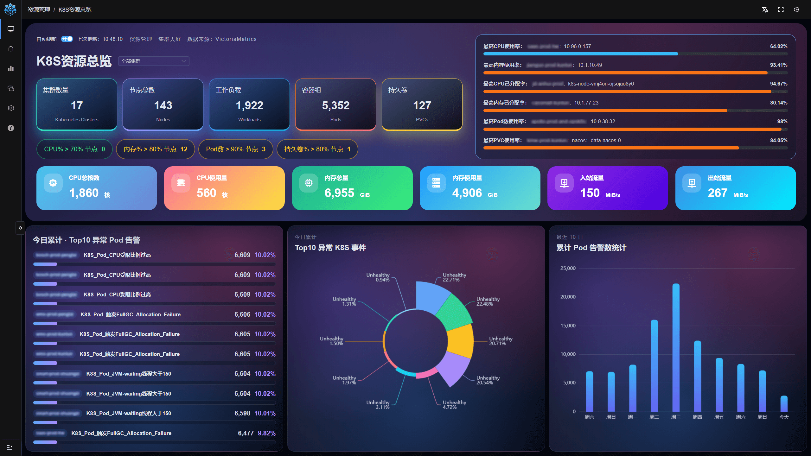

K8S Resource Overview: multi-cluster resources, at-risk nodes, and today's abnormal alerts and events, all on one screen

</div>

---

## 🎉What's New in 2.x

**Compared with 1.7, 2.x is an architecture-level upgrade: the AI assistant becomes a core capability, PostgreSQL becomes the only database, and deployment becomes one command plus a Web wizard.** The main changes are listed below, newest version first; see [Features](#features) for details.

**🚀2.6: One-command install with a Web wizard, code and runtime config lookup, an AI that reads code and checks configuration, permissions and approvals**
- 🚀**One command + a Web installation wizard**: download `deploy/install.sh` on its own, run `sh install.sh` on a machine where `kubectl` works, and open the printed address to enter the six-step wizard (environment check → PostgreSQL → time-series database → basic settings → automatic installation → Agent for this cluster). The database is created if it does not exist, the time-series read/write URLs are generated and the access URL is detected automatically; the control-plane services are deployed together, each with its own status, duration and failure reason, success is reported only after every check passes, and afterwards the setup service is stopped and its temporary permissions are revoked automatically. Helm, Python and editing `kubedoor.conf` are no longer needed.
- 🛰**Agent installation from the Web UI**: in 「Agent管理」 (Agent Management; English UI: "Workbench"), upload a kubeconfig and confirm the cluster identifier to install the Agent and the metrics collection components, with progress shown step by step and both the Agent coming online and its metrics verified; each cluster gets its own Agent account, vmagent writes directly to the time-series database, and once the Agent is online the cluster's 「AI Kubeconfig」 is configured automatically.
- 🧩**Code and runtime config lookup**: system admins enter the URL and request headers of their own APIs on the 「获取代码接口」 (Get code API) and 「获取运行配置接口」 (Get runtime config API) pages; the Deployment and Pod menus then open the code page, source download and latest commits for the current image in one click, or show the configuration the service actually runs with.
- 🤖**AI assistant enhancements**: download the source code of the running version, search it with ripgrep and find definitions with ctags, tracing an error stack down to the line of code; fetch the runtime configuration (passwords are replaced with placeholders, so the model never sees them in plain text) and run read-only queries against MySQL, Redis and Elasticsearch; connect your own MCP servers in 「MCP 管理」 (MCP management); generic operations now run through the Agent first; in WeCom, simply replying 「批准」 or 「拒绝」 (approve / reject) also works for approvals.
- 🔐**Permissions and approvals**: for each of 27 operation types, system admins tick whether Read-only / Read-write / Admin may perform it and whether the AI needs human approval first; commands the AI runs inside Pods are classified as view / other / dangerous, and dangerous commands such as rm and kill always need approval; the Web UI, the AI assistant, the WeCom bot and external MCP share one table.
- 🔔**Notifications page**: notifications are no longer set in environment variables; configure the global default group chat under 「系统管理 → 消息通知」 (System → Notifications), optionally send each cluster's notifications to a different group, and send a test message; operation notifications are now all sent by the master, and the agent buffers them while disconnected and resends them after reconnecting.
- 🌐**Istio VirtualService**: automatic backups before a cluster is changed, with one-click rollback; domain conflicts within the same cluster are checked, and the push preview blocks the conflicts a push would newly introduce; comparisons show both sides line by line, and rules from a cluster's live state can be synced into the group standard; the matrix supports full-text search on rule content.
- Also: compatibility with older clusters whose CA certificate lacks a key identifier (such as early Huawei Cloud CCE clusters, which newer Python versions refuse to connect to by default).

**✨2.3: AI assistant enhancements, WeCom bot, Istio VirtualService management, CoreDNS management**
- 🤖**AI assistant enhancements**: long conversations keep hitting the model's prefix cache, the context is compressed automatically according to the model's window and the dialog shows how much of it is in use, the new 「AI 用量看板📊」 (AI usage dashboard) tracks usage, cache hit rate and estimated cost, and the DeepSeek thinking effort is adjustable; the assistant is aware of KubeDoor resource control, so scaling, resource and JVM changes to managed services go through the control table and are read back afterwards; sessions are searchable, the last turn can be regenerated or edited and resent, and the alert, event, Deployment and Pod menus offer one-click 「问 AI」 (Ask AI).
- 💬**WeCom smart bot**: a WeCom bot in API mode connects to the AI assistant over a long-lived connection, so no public callback URL is needed; one-on-one chats get streaming replies, changes are approved via 「批准 / 拒绝」 (Approve / Reject) cards, and members are bound to KubeDoor accounts (unbound members can share a default permission), with cluster permissions checked live against the account.
- 🌐**Istio VirtualService management (rebuilt)**: manage a project's VirtualServices per "Istio group": the group standard is shared by the whole group, while hosts and the domain conditions inside rules are kept per cluster; refresh the live state, compare, adopt in one click and push after previewing the diff, with cross-group conflict detection and unmodeled fields preserved as-is.
- 🧭**CoreDNS management**: maintain custom hosts records in a table, rewriting only the changed lines; review the diff before saving, with concurrent edits detected as conflicts; check from inside the cluster whether a record has taken effect, plus DNS lookup and port tests and a Monaco 「高级编辑」 (Advanced edit).
- Also: admission control now rewrites replica changes made directly with kubectl and similar tools to the controlled value as well (they used to be allowed through until the next rollout or restart); Pod live logs and the agent connection are more robust (log streams use a separate, capped connection pool, and large cluster listings no longer stall the agent); the console's 「关于」 (About) page now embeds the official website.

**🔐2.2: Accounts and permissions**
- **LDAP sign-in + per-cluster permissions**: a global role (Admin / Read-write / Read-only / None) plus per-user, per-cluster grants; clusters set to "None" are hidden from every page, alert and the AI assistant. Sign-in and sessions are handled by the master, and agents and Grafana also authenticate through KubeDoor.
- **Audit log**: logins, account and permission changes, and every write operation (including denied attempts) can be searched, kept for 180 days by default.
- **Pod and node terminals**: a Web terminal into a container, or onto the host through a temporary privileged Pod.
- Also: bulk agent updates and restarts, control of rolling-update parameters (maxSurge / maxUnavailable), syncing control settings to other environments, and the ink-wash moon-gate sign-in page.

**🤖2.1: AI assistant**
- **Built-in AI assistant** (kubedoor-ai, always installed with the control plane): bring your own model, select a cluster, then troubleshoot and operate it in natural language; changes run only after approval; global memory and direct kubeconfig connections are supported.
- **New MCP**: merged into kubedoor-ai and served through the Web entry point as `/mcp` (Streamable HTTP) and `/sse`; it reuses the Web accounts and permissions, write operations must be approved in the Web UI, and the 16 tool names from 1.x remain compatible.
- Also: live Deployment status, JVM startup flag control and peak-hour P95 heap usage.

**🧱2.0: Architecture and deployment**
- **PostgreSQL as the only database**: ClickHouse and MySQL are removed; tables are created automatically at startup, no extensions are needed, and expired data is purged automatically.
- **Web installation wizard**: download the standalone `deploy/install.sh` and run it with `sh` or `bash`. Configure external databases in the browser, deploy the services and check each service status, with support for private image registries.
- Also: alert silences, node balancing, Huawei Cloud CCI elastic scaling and Deployment-level aggregated logs.

---

## 💠Architecture

**The Web wizard installs the control plane in one go, and each workload cluster gets one agent; agents connect outbound, and all data is stored in PostgreSQL (metrics live in the time-series database).**

<div align="center">
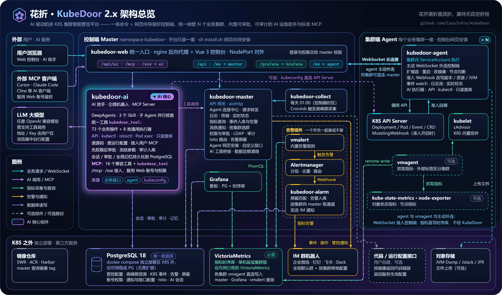
</div>

- **Control plane** (deployed by the Web wizard): kubedoor-web (nginx single entry point + Vue 3 console), kubedoor-master (API gateway, agent connection hub, notifications), kubedoor-ai (AI assistant, WeCom bot and MCP Server), kubedoor-collect (daily peak-hour collection CronJob) and the Grafana dashboards, plus the alerting components (vmalert, Alertmanager, kubedoor-alarm), which one switch installs or skips together. kubedoor-setup, used for installation, is a temporary service that is stopped automatically once installation is complete.
- **Cluster side** (installed from Agent Management in the Web UI; the control plane's own cluster can also get it in the last step of the installation wizard): kubedoor-agent, plus optional vmagent, kube-state-metrics and node-exporter. The agent **initiates** the WebSocket connection to the control plane, so workload clusters need no inbound ports; in the same cluster it connects directly to the master Service, while across clusters it goes through the Web entry point, and the Web installation creates a separate Agent account for each cluster; vmagent remote-writes directly to the time-series database.
- **PostgreSQL 18 is the only database**: deployed standalone outside K8S with docker compose, or use an existing PostgreSQL (no extensions or superuser needed; the installation wizard creates the database if it does not exist).
- **Independent time-series database**: single-node VictoriaMetrics (Docker Compose in `deploy/victoria-metrics/`) or the VictoriaMetrics cluster version, or connect an existing one; each cluster's metrics are distinguished by the label `<PROM_K8S_TAG_KEY>=<cluster name>`.
- **Single entry point**: the Web UI, Grafana, the AI assistant and MCP share one kubedoor-web NodePort, and login and permissions are managed by the master.

---

## 💎Features

**Covers the full chain of day-to-day K8S operations; most of the queries and operations below can also be handed straight to the AI assistant.** [2.x] marks the version in which a capability first became available.

> UI labels are quoted in Chinese exactly as they appear in the Web UI (「…」), with an English gloss on first mention. The UI is Chinese-first and its English locale is only partial; where a menu entry is named differently in the English locale, that name is given as *English UI: "…"*.

### 1. 🤖AI Assistant, WeCom Bot and MCP

**Click 「AI 助手」 (AI Assistant) in the middle of the top bar, select a cluster and describe the problem in one sentence: queries run automatically, changes are approved before they run by default, and every step is traceable.** The same tools, permissions and approvals are also available to the WeCom bot and to external MCP clients such as Cursor and Claude Code.

- 🧠**Bring your own model**: enter the Base URL, API Key and model name in 「模型设置」 (Model Settings); 「测试连接」 (Test Connection) runs a real tool-calling test. Any OpenAI-compatible Chat Completions API works (including self-hosted models without authentication), with dedicated support for DeepSeek thinking mode (adjustable thinking effort); the context window and compression threshold are prefilled from the model name and can be changed. The model configuration is stored only in your own browser.
- 🎯**Resource context**: first choose a 「K8S 集群」 (K8S cluster) — each turn only operates on the selected cluster — then optionally narrow it down to a namespace, Deployment or Pod.
- 🧰**One governed tool**: every cluster operation goes through a single tool, `kubedoor_tool`, which covers **73 KubeDoor business operations** (44 read-only, 29 write) and **8 kinds of generic executors** (K8S API/CRD, kubectl, istioctl, diagnostic commands, Pod exec, plus read-only queries against MySQL, Redis and Elasticsearch); existing KubeDoor APIs take precedence.
- 🛰**Agent first, with a direct connection as fallback**: generic operations run through the online Agent inside the workload cluster first (re-checked by the master and validated again by the Agent, no kubeconfig needed); when the Agent is offline or too old, a direct connection with the cluster's kubeconfig is used instead. That kubeconfig is configured automatically from the Agent's service account when the Agent is installed from the Web UI, or a system admin can upload one in 「Agent管理」 (Agent Management; English UI: "Workbench"), stored encrypted; historical and monitoring data can still be queried while the agent is offline.
- 🔍**Reading source code to pinpoint problems [2.6]**: look up the code page, source download and latest commits for the current image by Deployment or Pod; once an admin allows it, the AI downloads the source code of the running version, searches it with ripgrep for the exceptions in the logs, finds definitions with ctags and reads it line by line, then points out the faulty code and suggests a fix. The source is only extracted and cached inside kubedoor-ai; the model never gets the download URL and cannot pass one in.
- 🗄**Runtime configuration and read-only database queries [2.6]**: once an admin allows it, the AI fetches the configuration a service actually runs with, with passwords and keys replaced by placeholders so the model never sees them in plain text; while troubleshooting, it uses the connection details in that configuration to run read-only queries against MySQL, Redis and Elasticsearch: the server fills in the real password at execution time and only connects to the addresses written in the configuration, and by default every query needs approval from the person who asked.
- 🔌**Bring your own MCP [2.6]**: connect your own SSE / Streamable HTTP MCP servers (maps, ticketing, knowledge bases and so on) under 「MCP 管理」 (MCP management) in the dialog, isolated per account and stored encrypted; the AI calls them as needed, read-only tools run automatically, and the rest are approved according to your settings.
- ⏰**Immediate / scheduled / periodic operations**: Deployment restarts and scaling can run immediately, at a set time, or periodically on a Cron schedule; when the time-series database is VictoriaMetrics, the AI can also write MetricsQL to query metrics (restricted to the current cluster).
- 📝**Global memory**: 「总结为记忆」 (Summarize as memory) turns a conversation into a memory; once it is saved as a global memory, every logged-in user can bring it into their questions as needed.
- 🛡**Aware of KubeDoor resource control**: before scaling or changing requests/limits or JVM options, the assistant checks whether the Deployment is under admission-control management: managed ones go through the control table (a permanent scale also writes the managed replica count; temporary scaling is available too), unmanaged ones are changed directly. The approval card shows current → target values and side effects, the result is read back after execution, and direct kubectl-style edits of managed Deployments are blocked instead of "succeeding" and being reverted.
- 💬**Conversation experience**: search sessions by title and content; regenerate or edit-and-resend the last turn; one-click 「问 AI」 (Ask AI) in the alert, K8S event, Deployment and Pod menus fills in the cluster, resource and alert details.
- 🧩**Powered by DeepAgents**: three built-in Skills (K8S ops, service source code analysis, and runtime configuration and data queries), sub-agents that investigate in parallel and automatic context compression (the dialog header shows how much of the context is in use); the system prompt and history stay stable, so long conversations keep hitting the model's prefix cache; sessions are stored on the server (visible only to you), with streaming replies and resume after disconnects, and tasks keep running after you close the dialog.

#### 💬WeCom Smart Bot

**[2.3] Once a system admin connects a WeCom smart bot under 「系统管理 → 企微 AI 机器人」 (System → WeCom AI bot), members can chat one-on-one with the bot in WeCom to query, troubleshoot and request changes, just as they would in the Web UI.**

- 🔗**Long-lived connection**: enter the Bot ID and Secret of a WeCom bot in API mode, and kubedoor-ai opens the long-lived connection itself, so no public callback URL is needed, only outbound access to WeCom; the page shows the connection status live, and the bot reconnects automatically after a disconnect.
- 🧠**Dedicated model**: the bot has its own model settings (Base URL, API Key, model name), and 「测试模型」 (Test model) checks tool calling, without touching the Web AI's model configuration; credentials are stored encrypted (AES-256-GCM) and never shown again.
- 👥**Member binding and default permission**: bind a WeCom UserID to a KubeDoor account and set a default cluster; members who are not bound yet appear in the 「待绑定」 (to be bound) list after their first message. You can also set 「未绑定成员默认权限」 (default permission for unbound members) so that all unbound members use the permissions of one KubeDoor account (ideally a dedicated one, e.g. a read-only account; system admin and cluster admin accounts are not allowed) and start in a default cluster you choose; if it is not set, members must be bound first. Binding grants nothing by itself: every message is checked live against the KubeDoor account, so disabling the account or revoking its cluster access takes effect immediately.
- 🎯**Switching clusters**: each turn operates on one cluster, which is named at the end of every answer; members who have not switched use their default cluster, and if the default cluster is 「无」 (none) they must pick a cluster before asking. Send 「集群」 (clusters) to list the accessible clusters with numbers, switch with 「切换集群 2」 or 「切换集群 <name>」 (switch cluster), or simply write a cluster's full name in your question to switch to it.
- 🧹**Conversation boundaries**: WeCom has a single chat window, so a message sent more than 2 hours after the last one (configurable on the settings page, 0 turns it off) automatically starts a new conversation, with a note at the top of the reply. Send 「新对话」 (new conversation) to start over, which also stops any unfinished task, or 「继续上次」 (continue last) to go back to the previous conversation. The first time a member opens the chat each day, a welcome card offers both choices as buttons. When the context grows large, the end of the answer shows how much of it is in use, and a task left with only expired approvals is stopped automatically instead of blocking later questions.
- ✅**Approval cards**: replies are streamed; permissions and approvals follow exactly the same rules as in the Web UI: a change that needs approval first has its parameters frozen, then a 「批准 / 拒绝」 (Approve / Reject) card is sent, with the cluster shown prominently at the top. Only the member who started the request can approve it, and they can also simply reply 「批准」 or 「拒绝」; the card stops working once it expires, and after approval the run continues and the result is sent back.
- 🗂WeCom sessions are stored separately and do not appear in the Web AI's session list; the first version supports one-on-one text messages only.

📖Details: [WeCom smart bot](src/kubedoor-ai/README.md#企业微信智能机器人) (Chinese)

#### 🛡Safety Guardrails

| Guardrail | Details |
| --- | --- |
| Approval | Permission first, then approval: an operation the account may not perform is refused outright and never reaches approval. When it is allowed, the approval column of 「系统管理 → 权限与审批」 (System → Permissions & approvals) decides whether a human must approve it (by default business changes and kubectl / K8S API changes need approval, the AI's view and other commands inside Pods and its diagnostic tools do not, and dangerous commands such as rm and kill always do). Operations that need approval first show the exact parameters, the command, a change preview or a config diff; a pending approval expires after 30 minutes. Ticking 「自动批准执行」 (auto-approve) approves every operation that needs approval, dangerous commands included, and applies to the current page only |
| Frozen parameters | The complete parameters are written to the database at the preparation stage and executed exactly as-is after approval, so the model cannot swap them; replacing the kubeconfig invalidates earlier approvals |
| Dry-run | Generic K8S API writes first run with `dryRun=All` to produce a config diff, and carry resourceVersion/UID preconditions; `kubectl apply` first runs `--dry-run=server` |
| No blind replays | A write that times out or loses its connection is marked 「执行结果不确定」 (result uncertain), and no further writes are made in that turn; a service restart never re-sends an operation that was already dispatched |
| Redaction | The Web AI's API Key is only held in memory for a single run and is never written to the database or logs (the WeCom bot's model key is stored encrypted); streamed output, checkpoints, logs and memories are all redacted, and Secret contents are hidden automatically; passwords and keys in the runtime configuration are replaced with placeholders before it reaches the model, the server swaps the real values back in when querying a database, and any password that shows up in a result is masked |
| Read-only database queries | MySQL accepts only a single query statement, run inside a read-only transaction; Redis is limited to a whitelist of read-only commands and Elasticsearch to a whitelist of query APIs; requests that do not qualify are refused outright and never reach approval; the connection address must be one written in that service's runtime configuration, so passwords cannot be sent to other hosts |
| Per-cluster, per-operation permissions | Every operation is checked against the operation table in 「权限与审批」 using the account's permission on the selected cluster, with the same rules for the Web AI, the WeCom bot and external MCP (by default, read-only accounts can only chat and query); clusters set to "None" are invisible in the AI assistant, the WeCom bot and MCP; uploading kubeconfigs is limited to system admins |
| Audit | Sessions, runs and every tool call (with full parameters, preview and result) are written to PostgreSQL; external MCP calls also create sessions that can be reviewed in the Web UI |

> Note: through the AI, accounts with read-only access to a cluster can run a wider range of read-only queries (e.g. K8S API GET, viewing logs and ConfigMaps) than the classic pages allow, and Secret redaction is best-effort, so hand out accounts accordingly; in production, put HTTPS in front of the Web UI.

#### 🔗Connecting External MCP Clients

- **URL**: `http(s)://<KubeDoor address>/mcp` (Streamable HTTP, recommended), and clients that only support SSE use `/sse`; `<KubeDoor address>` is the Web entry point, e.g. `<node IP>:<Web NodePort>`.
- **Authentication**: reuses the Web accounts (local or LDAP) via the request header `Authorization: Basic <base64(username:password)>`, and runs with that account's per-cluster permissions and the 「权限与审批」 rules, the same as the Web AI.
- **Tools**: the 16 tool names from 1.x are kept (e.g. `get_k8s_list`, `get_pods_logs`, `scale_deployment`, `get_pod_jvm_dump`) + the unified tool `kubedoor_tool` + the Skill resource `skills://kubedoor-k8s`.
- **Operations that need approval never run directly**: operations that need approval under 「权限与审批」 (by default write operations and JVM diagnostics that run inside a Pod) return `pending` and a `browserlink` (relative path); log in to the Web UI with the **same account** and open it to approve. Results of approved operations are not pushed back to the MCP client, so query again to verify; operations that need no approval run directly and return their result.
- **Turning off the external endpoints**: legacy configuration-based deployments can set `ENABLE_MCP="false"` in `kubedoor.conf`; the AI assistant in the Web UI is not affected.

Example (Cursor's `mcp.json` format, derived from the interface; for other clients, check their documentation for the field names):

```json
{
  "mcpServers": {
    "kubedoor": {
      "url": "http://<KubeDoor address>/mcp",
      "headers": {
        "Authorization": "Basic <base64(username:password)>"
      }
    }
  }
}
```

Generate `<base64(username:password)>` with `printf '%s' 'username:password' | base64`; a dedicated account for MCP is recommended.

<details close>
<summary>💬Click to expand a sample conversation (illustrative: the cluster, service names and data are all fictional)</summary>

```text
Context: K8S cluster prod-a · namespace demo · Deployment deploy-demo-order

You: This service has been restarting a lot lately. Use the logs, events and metrics to find out why.

AI assistant:
  Tool calls 5 (read-only queries, run automatically)
    ✓ pods                 Pod list and restart counts
    ✓ previous_logs        logs of the last exited container
    ✓ events               related K8S events
    ✓ resource_inventory   limits and JVM flags in the control table
    ✓ metrics              memory curve for the last 6 hours
  Conclusion: container memory stays close to its limit; the last exit reason was OOMKilled.
  Suggestion: raise the memory limit to 1024MB and do a rolling restart off-peak. Shall I submit the change?

You: Go ahead: set the memory limit to 1024MB and restart once tonight at 23:30.

AI assistant:
  1 pending approval  resource_config_update
    Exact parameters: limit_mem_mb=1024 (other fields keep current values)   [Reject] [Approve this operation]
  … after approval …
  1 pending approval  schedule_deployment_restart
    Exact parameters: run_at=<today>T23:30                                   [Reject] [Approve this operation]
  … after approval …
  Control settings saved (effective on the next rollout or restart); the one-off restart task is registered and will run on time.
```

The free-form `metrics` query requires VictoriaMetrics as the time-series database.

</details>

📖Details: [AI assistant guide](docs/ai-assistant.md) (Chinese)

---

### 2. 🧩Code and Runtime Config Lookup

**[2.6] Hook up your own APIs, and the Deployment and Pod action menus show the code behind the current image in one click, or fetch the configuration the service actually runs with; the AI assistant also uses them to read code and check configuration while troubleshooting.** KubeDoor only defines the request and response formats; where the code is hosted and where the configuration comes from is up to your API (for example, mapping the image tag to its Git commit, or merging the config center, environment variables and config files into the effective configuration).

- 🔗**Get code**: a system admin enters the API URL and request headers (such as an auth token; stored encrypted, with only the header names shown back) under 「系统管理 → 获取代码接口」 (System → Get code API), and saves once the test passes. Click 「获取代码」 (Get code) in the action menu of the Deployment page, and KubeDoor POSTs `{k8s, namespace, deployment, image}` to the API, which returns three links (the code page, the source download and the latest commits) that you open from a dialog; available to accounts with read-only access to the cluster or above.
- ⚙**Get runtime config**: configured the same way under 「系统管理 → 获取运行配置接口」 (System → Get runtime config API). 「获取运行配置」 (Get runtime config) on the Deployment page, on the Pods in a Deployment's details and on the Pod page sends `{k8s, namespace, deployment|pod}` to the API, and the returned JSON is shown in a read-only editor with collapsible levels and one-click copy; an API that needs time to prepare the result can return 202 first, and KubeDoor retries automatically according to `Retry-After` until the configured timeout. Requires the 「查看运行配置」 (View runtime config) permission (read-write and above by default).
- 🤖**Hand it to the AI**: once 「允许 AI 下载并分析源码」 (Allow AI to download and analyze source code) and 「允许 AI 获取运行配置」 (Allow AI to get runtime config) are turned on on the same pages (both off by default), the AI assistant can download the source code of the running version and search and read it for the exceptions in the logs to pinpoint the problem; it can also fetch the runtime configuration (with passwords replaced by placeholders) and then run read-only queries against the MySQL, Redis and Elasticsearch it references.
- 🛡**Safety**: only http(s) links are accepted; calls have a timeout, do not follow redirects and limit the response size; every lookup is recorded in the audit log (for runtime configuration, only who fetched which service and when, never the configuration itself). The complete API contract is described on the two settings pages.

📖Details: [Service source code lookup and analysis](docs/ai-assistant.md#服务源码查询与分析) · [Runtime configuration and data queries](docs/ai-assistant.md#运行配置与数据查询) (both in Chinese)

---

### 3. 🌐Istio VirtualService Management

**[2.3] Maintain one project's VirtualServices across clusters per "Istio group": KubeDoor keeps one group standard (rules, default route and gateways are shared by the whole group), while hosts and the domain conditions inside rules stay per cluster; compare, adopt, preview and then push.**

Built for the case where the same services run in test clusters and in several production clusters (multiple sites): the VirtualService rules are nearly identical everywhere and only the domains differ. Applied cluster by cluster with `kubectl apply`, they drift apart over time; now you change them in one place and push per cluster, and any cluster that has drifted stands out at a glance.

- 🗺**Groups and matrix**: a group = the shared test clusters + the project's own production clusters, and a cluster can join several groups; the matrix view shows each VirtualService's hosts and status in every cluster on one screen (in sync / pending push / drifted / missing / domains missing), and each VirtualService chooses which clusters it is deployed to; the search box does full-text search on names, hosts and rule content.
- 📥**Refresh the live state and adopt**: collect the VirtualServices of all clusters in parallel (read-only snapshots); compare clusters with rules aligned by match conditions and line-by-line YAML diffs, adopt the identical ones in one click (ones that differ only in hosts and domains count as identical), and for the different ones pick a base cluster to adopt from, then push to bring the others in line.
- ✏**Visual editing**: create VirtualServices and add or edit HTTP rules (match conditions, URI rewrites, route destinations with weights or a delegate VirtualService, timeouts, priority), and tidy up priorities with 「整理优先级」 (Reorder priorities); domain-based conditions (authority, headers.host) are stored per cluster, and you can pick the domains for every cluster at once by keyword, or copy them from another cluster while replacing the site token (e.g. penglai → kunlun).
- 🚀**Preview, then push**: before pushing, the latest live state is fetched from each cluster and the diff 「集群现状 → 将要下发」 (live state → to be pushed) is shown item by item, with an extra warning when production clusters are selected; each cell of the matrix shows who pushed last and when.
- 🧯**Backup and rollback [2.6]**: before a VirtualService in a cluster is changed (push, rollback, delete), its latest content is fetched from the cluster and backed up, keeping the 5 most recent backups of each; on the details page, each cluster can 「回退」 (roll back) to one of them (a backup is taken before the rollback too, so it can be undone); this changes only the cluster, not the group standard, and is recorded in the audit log.
- 🚦**Domain conflict checks [2.6]**: VirtualServices bound to the same gateway in the same cluster must not share hosts, and rules inside a VirtualService that are shadowed by earlier rules and can never take effect are flagged too. The matrix and the details page show these live; the push preview blocks the conflicts a push would newly introduce, while pre-existing ones are only reported.
- 🔁**Sync to the group standard [2.6]**: comparisons show both sides line by line (differing lines in red, with in-line differences highlighted more strongly), and you can pick rules from a cluster's live state to add, replace, delete or reorder, then save them to the group standard; the versions of both sides are checked on save, so changes someone else has just made are not overwritten.
- 🧩**Scope and conflicts**: a VirtualService can belong to only one group; each group defines its scope with include / ignore rules (wildcards or regular expressions), and single VirtualServices can also be ignored or included by hand; rows that conflict with another group sharing a cluster are highlighted in red and cannot be adopted or pushed.
- 🔎**View and delete**: view the complete live object of a VirtualService in a cluster (like `kubectl get -o yaml`), or delete it from the cluster directly (with confirmation; it is backed up automatically and recorded in the audit log before deletion).
- 🛡**Lossless, permission-checked changes**: fields the editor does not model (retries, corsPolicy, redirect, fault, ...) are kept as-is, so pushing never drops configuration; viewing is filtered by per-cluster read access, and changes need the 「Istio 修改」 (Istio changes) permission on the cluster (admins only by default), with group-level changes (groups, group standards, rules, hosts) needing it on every cluster in the group.
- 🚸The management page for delegate VirtualServices is still under development.

📖Details: [Istio VirtualService management](src/kubedoor-master/istio_route/README.md) (Chinese; model, status rules and typical workflows)

---

### 4. 🧭CoreDNS Management

**[2.3] Under 「资源管理 → CoreDNS管理」 (English UI: "Resource Management" → 「CoreDNS管理」), maintain the cluster's custom CoreDNS records (the hosts plugin entries in `kube-system/coredns`): add, edit and delete them like rows in a table, review the diff before saving, and afterwards confirm from inside the cluster that they resolve — no more hand-editing the Corefile with `kubectl edit`.**

- 📋**Table editing**: hosts records are split into an 「IP / 域名 / 备注」 (IP / domains / remark) table that you can search and filter by enabled / disabled / comment / unsaved; the 「启用」 (Enabled) switch comments a record out with a leading `#` (it is not deleted and can be re-enabled at any time), and full-line comments can serve as group headings; insert, copy and delete anywhere, with changed rows highlighted in yellow and new ones in green.
- 🧷**Only the changed lines are touched**: only modified lines are rewritten, aligned to the existing columns, and everything else (comments, blank lines, other plugins) is kept as-is; IPs, domain formats and record positions (records must come before fallthrough) are validated as you type, and you can switch between server blocks when there are several.
- 🔍**Confirm before saving, never overwrite others' edits**: save row by row with 「保存」 (Save) or everything with 「全部保存」 (Save all), and every save or delete shows the changes first; saves carry the resourceVersion as an optimistic lock, so if someone else (kubectl or another page) changed the ConfigMap after you opened it, you get a conflict, and 「加载最新」 (Load latest) tries to keep your unsaved edits.
- ✅**Check that it took effect**: 「检查」 (Check) on a record resolves it once per second from the kubedoor-agent Pod until it returns the expected IP (or, for a disabled record, until it no longer does), and shows how long that took; if the Corefile does not enable the reload plugin, you are reminded to restart CoreDNS.
- 🛠**Network tests**: 「解析测试」 (DNS lookup test) uses the `/etc/resolv.conf` of the agent's Pod (just like running ping inside a workload Pod, search domains included); 「端口测试」 (Port test) is like running `nc -zv` from inside the cluster and requires the 「端口测试」 permission (read-write and above by default).
- 📝**Advanced edit**: edit every file in the ConfigMap directly in the Monaco editor (Corefile, `*.server`, hosts and so on, with syntax highlighting by type), with Ctrl+S to save and Ctrl+/ to toggle comments; the Corefile is validated and the diff is shown before saving.
- 🔐Read-only accounts can view, check and run DNS lookup tests; changes require the 「CoreDNS 修改」 (CoreDNS changes) permission on the cluster (admins only by default; editing `kube-system/coredns` as YAML on the ConfigMap page or through the AI needs it too), and every save is recorded in the audit log. A new agent is required (older agents show a prompt to upgrade first).

---

### 5. 🎛K8S Resource Management

**Manage the Deployments, Pods, Services, Ingresses, ConfigMaps, StatefulSets, DaemonSets and nodes of all clusters in one console, with common operations a single click away.**

- 🗂**Unified resource pages**: view, edit YAML in Monaco (Create / Apply / Replace) and delete; a Deployment's ready replicas, rollout status and Pod details refresh live over WebSocket [2.1]; the Deployment and Pod action menus also offer 「获取代码」 (Get code), 「获取运行配置」 (Get runtime config) [2.6] and 「问 AI」 (Ask AI).
- 💻**Pod and node terminals [2.2]**: open a Web terminal in a new tab; the Pod terminal picks bash / ash / sh automatically, while for the node terminal the agent starts a temporary privileged Pod that uses `nsenter` to get onto the host and is cleaned up automatically on exit; the 「网页 Pod 终端」 / 「网页节点终端」 (Web Pod / node terminal) permission is required (read-write and above by default), and sessions are recorded in the audit log.
- 📜**Log viewer**: live follow, keyword search and jumping between matches, colors by log level, and 「重启前日志」 (logs before restart); a Deployment's logs can be viewed across all of its Pods, and full logs can be downloaded gzipped.
- 🔁**Scaling and restarts**: run immediately, at a set time or periodically, with optional 「临时扩容」 (temporary scale-out) and 「调度到指定节点」 (schedule to specified nodes).
- 🏷**Image updates**: automatically lists the 20 most recent tags in the image registry (Alibaba Cloud ACR, Huawei Cloud SWR, Harbor); read-only accounts can be authorized by cluster, time window and account whitelist, and progress is pushed to IM. Manage rules and registry credentials under 「系统管理 → 镜像管理」 (System → Image management); database changes take effect immediately.
- 🧪**Pod isolation**: changes the Pod's `app` label to `<original value>-ALERT`, taking it out of Service traffic while keeping it for investigation, optionally adding 1 Pod temporarily.

<details close>
<summary>🔍Click to expand screenshots ...</summary>

|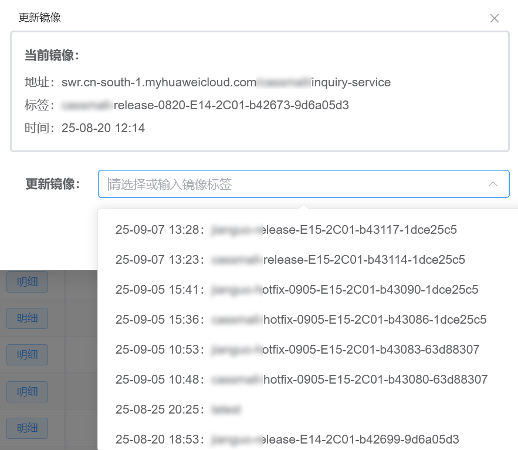|
|-|

</details>

📖Details: [K8S microservice image update configuration](help/K8S微服务镜像更新配置说明.md) (Chinese)

---

### 6. 📡Multi-Cluster Monitoring

**Each cluster's vmagent remote-writes its metrics to the same time-series database, and a single label tells the clusters apart, so you see every cluster in one Web UI.**

- 🖥**Resource overview**: 「K8S资源总览」 (English UI: "K8s Overview") switches between all clusters and a single cluster, showing resource counts, at-risk nodes and the highest usage/allocation rates, plus today's Top 10 abnormal Pod alerts, the Top 10 abnormal K8S events and the alert trend of the last 10 days.
- 🌊**Unified time-series database**: single-node or cluster VictoriaMetrics, deployed separately with the Docker Compose in `deploy/victoria-metrics`, or an existing one (legacy configuration-based deployments also support Prometheus); each cluster's vmagent remote-writes to it directly, and kube-state-metrics and node-exporter already running in the cluster can be reused.
- 📊**Grafana dashboards**: 「K8S监控看板📊」 (K8S Monitoring Dashboard; English UI: "Resource K8S"), 「节点监控看板📊」 (Node Monitoring Dashboard; English UI: "Resource Node") and 「高峰资源看板📊」 (Peak Resource Dashboard; English UI: "Resource Statistics") are embedded in the Web UI and imported automatically at installation; system admins also get 「系统管理 → AI 用量看板📊」 (System → AI usage dashboard) with the AI assistant's token usage, cache hit rate, context size and estimated cost.

<details close>
<summary>🔍Click to expand screenshots ...</summary>

|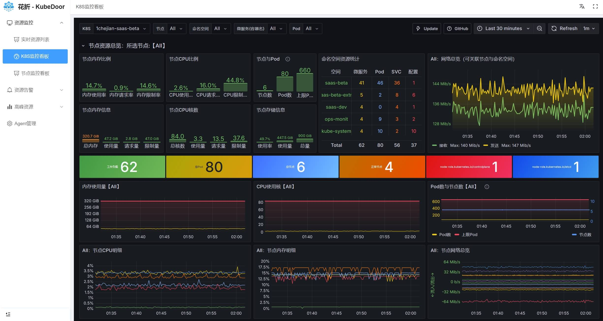|
|-|

</details>

---

### 7. 🧬Alerts, Events and Notifications

**Metric alerts, K8S event alerts and operation notifications are all pushed to WeCom, DingTalk, Feishu or Slack, configured on the 「消息通知」 (Notifications) page with a different group chat per cluster if needed; silences only block notifications and never drop data.**

- 🚨**Metric alerts**: 44 built-in vmalert alerting rules (Pods, Deployments, nodes, JVM, etc.), pushed to IM by kubedoor-alarm via Alertmanager; Pod alerts are also stored, and firing/resolved notifications show how long the alert lasted; the alerting components (vmalert, Alertmanager, kubedoor-alarm) are installed or skipped together with a single switch at installation time.
- 📋**Alert analysis**: 「告警面板」 (Alarm Statistics) aggregates alerts by name per day; 「K8S告警详情」 (Alarm Detail) offers multi-criteria filtering and lets you isolate or delete a Pod or run Dump, Jstack or JFR on it directly, or 「屏蔽」 (silence) the alert in one click.
- 🔕**Alert silences [2.0]**: Alertmanager-style matchers (`=`, `!=`, `=~`, `!~`), match preview and automatic expiry; the 【屏蔽】 (Silence) link in IM notifications opens the silence page with the matchers pre-filled. Silenced alerts are still stored; only their notifications are blocked.
- 📺**K8S event center**: all K8S events of every cluster are written to PostgreSQL and can be searched by cluster, namespace, Kind, reason, message and more; event alerts are configured with JSON rules (built-in rules cover restarts, failed health checks, scheduling failures, resource pressure, etc.), and the same event is not notified twice within the dedup window.
- 🔔**Notifications [2.6]**: under 「系统管理 → 消息通知」 (System → Notifications), set the IM type, the bot URL and the default people to @-mention (the token is stored encrypted and the page shows only its last 4 characters); changes take effect as soon as they are saved, and you can send a test message. A single cluster can have its own group chat, while clusters without their own settings use the global ones; a table on the page spells out who sends each of the four kinds of notifications (K8S event alerts, control table notifications, operation notifications, metric alerts) and when. This can also be filled in beforehand in step 4 of the installation wizard.
- 📮**Operation notifications**: isolation, scaling, restarts, image updates, admission results and more are produced by the agent and handed to the master, which picks the group chat by cluster and sends them, so workload clusters no longer store bot tokens; while the agent is disconnected from the master they are buffered, then resent after it reconnects and marked as delayed. External systems can write alerts via `POST /api/custom_alert` (requires the alerting components).

<details close>
<summary>🔍Click to expand screenshots ...</summary>

|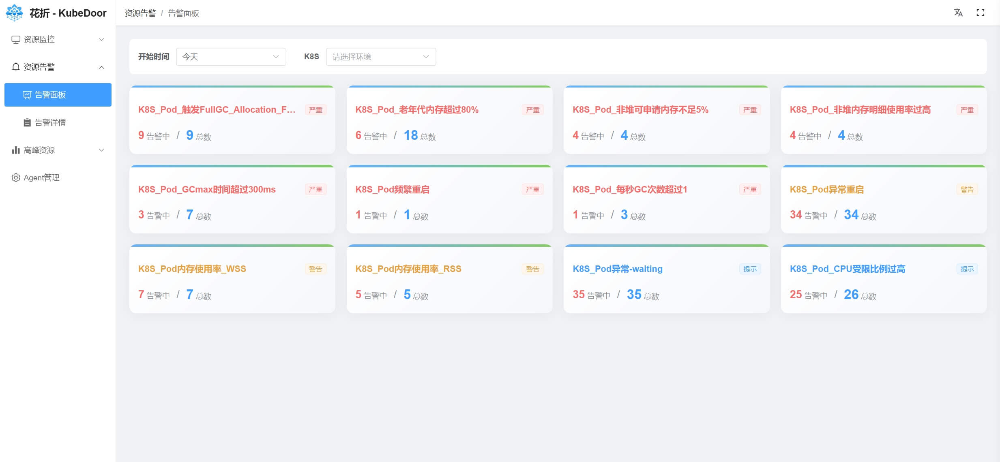|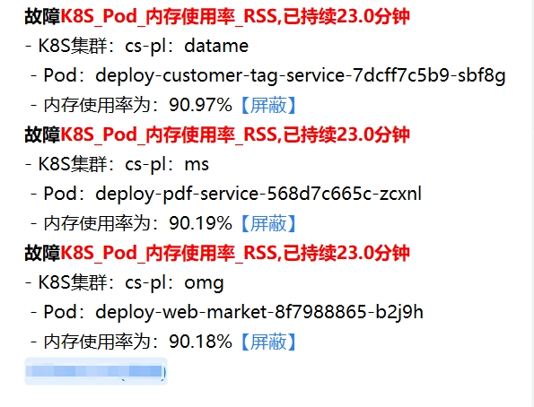|
| ------------------------------------| ----------------------------------- |

</details>

📖Details: [Alert silences](docs/alert-silence.md) · [K8S event alert rule configuration](help/K8S事件告警规则配置说明.md) (both in Chinese)

---

### 8. 🚧Peak-Hour Resources and Admission Control

**Collect each microservice's real resource usage during the daily business peak, then use K8S admission control to keep its requests in line with that real peak usage: more accurate scheduling, less resource fragmentation.**

- 📊**Peak-hour collection**: in 「Agent管理」, turn on 「自动采集」 (auto collection) and set 「高峰时段」 (peak hours); every day at 01:00 Beijing time (UTC+8) the previous day's peak data is collected, and 1–90 days can be backfilled. CPU and memory use the peak-hour P80, heap and G1 Eden usage use P95, and the control table takes the data of the day in the last 10 days on which the cluster's total CPU consumption was highest.
- 🗂**Peak resource control**: 「高峰资源管控」 (Peak Resource Control; English UI: "Resource Management") is one place to view and configure replica counts, requests, limits, JVM flags and rolling-update parameters (maxSurge / maxUnavailable) [2.2], with bulk scaling and bulk restarts, and settings can be 「同步到」 (synced to) other K8S environments [2.2]; 「高峰资源看板📊」 shows long-term trends and TOP 10 lists.
- 🚧**Admission control**: once it is enabled, the agent creates a MutatingWebhook automatically, and Deployment creation, rollouts and scaling have the replica count, the first container's requests/limits and the JVM flags rewritten to the controlled values; new services that are not in the control table are either rejected with a notification or allowed through, as configured; replica changes made directly with kubectl and similar tools are rewritten to the controlled value too, and only a 「临时扩容」 is allowed through.

> ⚠️ Admission control is off by default and **fail-closed** once enabled: while the agent or master is unavailable, Deployment creation, rollouts and scaling are rejected in every namespace not labeled `kubedoor-ignore`; in an emergency, run `kubectl delete mutatingwebhookconfiguration kubedoor-admis-configuration`.

<details close>
<summary>🔍Click to expand screenshots ...</summary>

Peak resource dashboard (Grafana): global peak-hour resource statistics with a TOP 10 for each resource, plus peak resource analysis and resource curves at namespace / microservice / Pod level.

|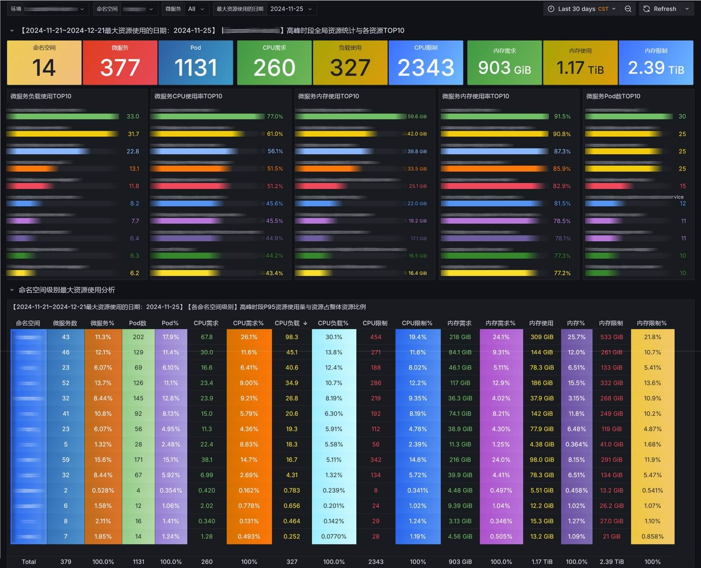|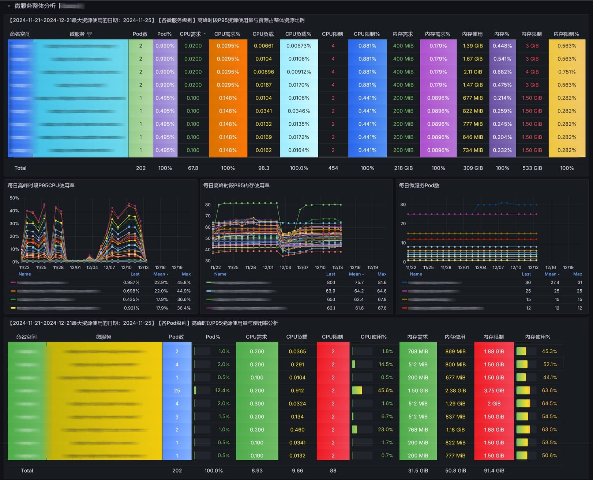|
|-|-|
|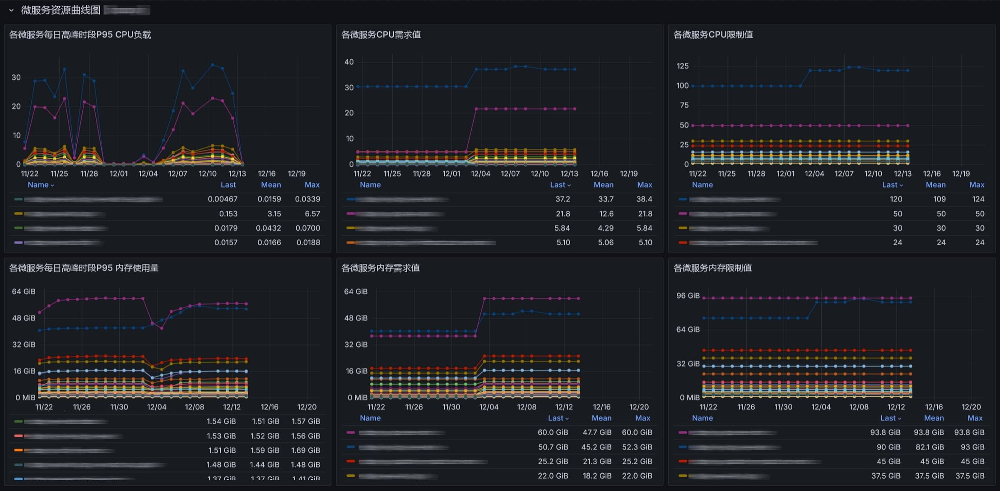|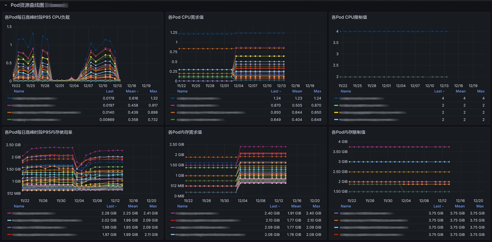|

</details>

📖Details: [K8S resource control guide](help/K8S资源管控功能说明.md) (Chinese)

---

### 9. ☕JVM Control and Diagnostics

**Startup flags, peak-hour heap usage and one-click diagnostics for Java microservices, all handled inside KubeDoor.**

- 🩺**One-click diagnostics**: run 「Dump」, 「Jstack」, 「JFR」 or 「JVM」 on a Pod from the Deployment, Pod and 「K8S告警详情」 pages; results are shown in a dialog and pushed to IM, and the files are uploaded to object storage (`OSS_URL`).
- 🧩**Startup flag control [2.1]**: collects and controls `-Xms`, `-Xmx`, `-Xss` and `-XX:MaxMetaspaceSize`, which admission control replaces with the controlled values on rollout or restart; the daily peak-hour P95 heap and G1 Eden usage help with tuning.
- 🚨**JVM alerts**: 14 built-in JVM alerting rules; vmagent automatically scrapes Pods annotated with `prometheus.io/jvm: "true"`.

<details close>
<summary>🔍Click to expand screenshots ...</summary>

|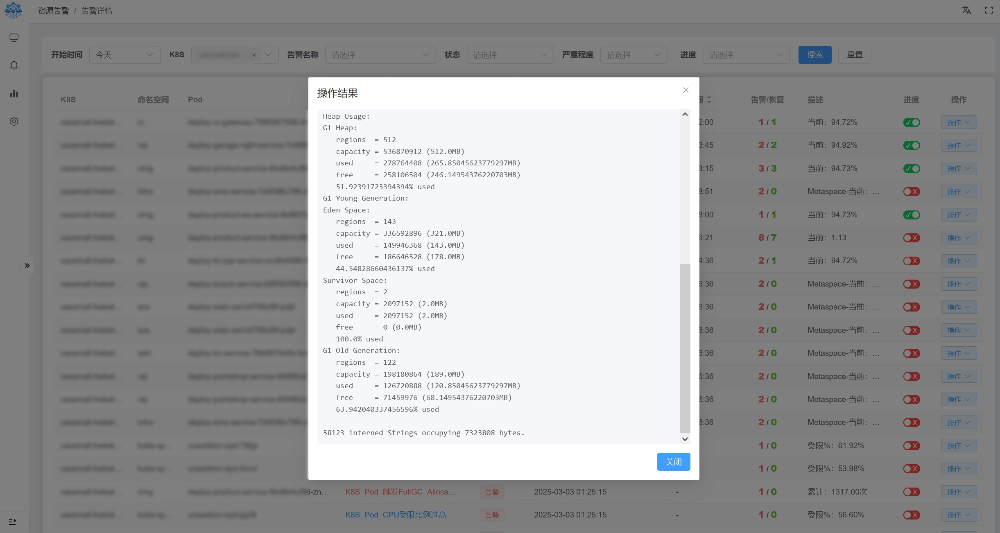|
|-|

</details>

📖Details: [JVM flag control](docs/jvm-resource-control.md) (Chinese)

---

### 10. ⚖Node Balancing and Elastic Scheduling

**Generate a migration plan from live node CPU load and migrate in batches after manual confirmation; when scaling out, Pods can also be scheduled to specified nodes or to Huawei Cloud CCI.**

- ⚖**Node balancing [2.0]**: 「分析负载」 (analyze load) builds a 「迁移计划」 (migration plan) from node CPU usage and, after confirmation, migrates in isolated batches (the next batch starts only when the new Pods are ready, and the old Pods are cleaned up once you have verified); thresholds, the blacklist, excluded namespaces/nodes and more are configurable. Manual execution only: other nodes are temporarily cordoned while it runs and it requires metrics-server, so run it off-peak.
- 🎯**Specified nodes and CCI**: when scaling, restarting or isolating, rank nodes by CPU, memory or Pod count to pick the target nodes; on Huawei Cloud CCE clusters, a 「临时扩容」 can burst the extra Pods to CCI [2.0].
- 💻**Node management**: view node usage against allocatable capacity, cordon/uncordon in bulk, and open a node terminal.

📖Details: [Node balancing algorithm and parameters](src/kubedoor-agent/load_balance/README.md) (Chinese; developer doc — its timed-check and auto-execute options are not implemented yet, execution is manual only)

---

### 11. 🔐Platform, Permissions and Console Settings

**One entry point, permissions per cluster and per operation, and settings managed in the UI: the Web UI, Grafana, the AI assistant and MCP share one NodePort, and KubeDoor manages its own logins, permissions and settings.**

- 🚪**Single entry point**: nginx in kubedoor-web only reverse-proxies; login, sessions and permission checks live in the master, and the AI assistant, MCP and Grafana (`/grafana/`) are authorized by the master through nginx `auth_request`.
- 👥**Accounts and permissions [2.2]**: local accounts plus LDAP (configured and tested in the Web UI, auto-provisioned on first login); a global role (System admin / Cluster admin / Read-write / Read-only (default) / None) plus per-user, per-cluster grants (Admin / Read-write / Read-only / None), with grants taking precedence; clusters with "None" are hidden everywhere, including alerts and the AI. System admins additionally manage users, LDAP, the WeCom bot, agents, permissions & approvals and the other system settings, while cluster admins only manage clusters. The built-in super admin `kubedoor` cannot be deleted or have its role changed.
- 🧩**Permissions and approvals [2.6]**: under 「系统管理 → 权限与审批」 (System → Permissions & approvals), tick for each of 27 operation types (restart, scale, delete Pods, edit YAML, view Secrets, view runtime config, CoreDNS changes, Istio changes, Web terminals, AI commands inside Pods, AI database queries and so on) whether Read-only / Read-write / Admin may do it, and whether the AI needs human approval before doing it; the view-command and dangerous-command lists used for AI commands inside Pods are maintained there too (dangerous commands always need approval). The Web UI, the AI assistant, the WeCom bot and external MCP all use this one table; the defaults match earlier behavior, except that CoreDNS and Istio changes are now admin-only.
- 🖥**Console settings [2.6]**: 「系统管理」 (System) brings together users & permissions, permissions & approvals, LDAP settings, image management, the WeCom AI bot, the Get code API, the Get runtime config API, notifications, the AI usage dashboard and the audit log; these settings are stored in the database and take effect on save without a restart, and sensitive values such as tokens and request headers are stored encrypted, with the page only showing whether they are set.
- 🧾**Audit log [2.2]**: logins, account and permission changes, and every write operation (including denied attempts) can be searched under 「系统管理 → 操作审计」 (System → Audit log).
- 🛰**Agent management**: 「安装 Agent」 (Install Agent) installs an agent from the Web UI by uploading a kubeconfig [2.6]; an agent registers itself on its first connection; view online status, heartbeat and version, update the image or restart agents one at a time or in bulk [2.2], and configure collection, admission control and 「AI Kubeconfig」 (set up automatically for Web installations) in one place.
- 🧹**Automatic data cleanup**: K8S events are kept for 90 days, alert records and peak snapshots for 365 days, adjustable in `kubedoor-config` (`0` means never purge).
- 🌗**UI**: the ink-wash moon-gate sign-in page [2.2]; Simplified Chinese / English (partially translated), light/dark/auto themes, mobile-friendly.

📖Details: [Deployment guide](deploy/README.md), [Accounts and permissions](tools/legacy-install/README.md#账号与权限) (Chinese)

<details close>
<summary>🔍Click to expand screenshots ...</summary>

|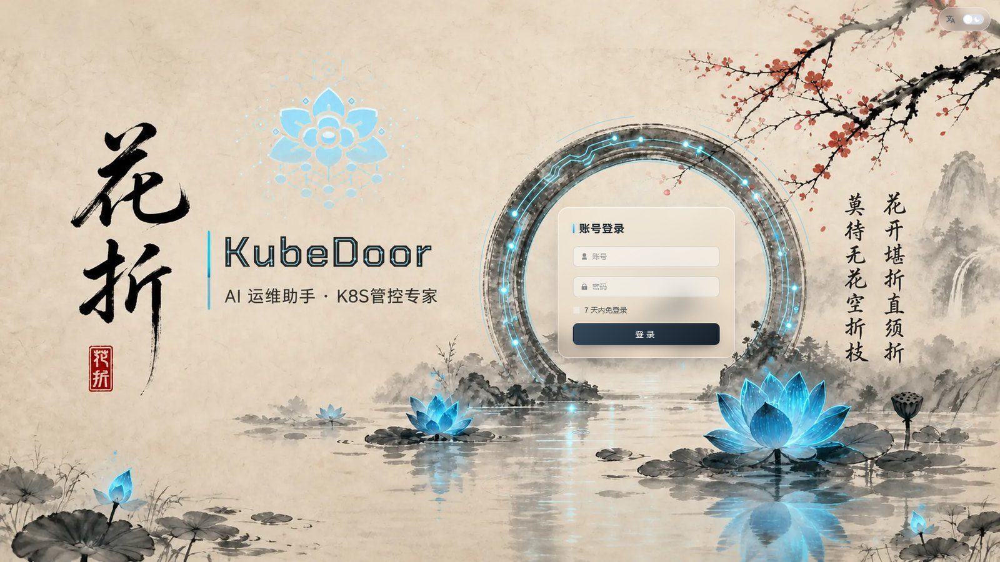|
|-|

</details>

---

## 🚀Quick Start

**One command starts the Web wizard; click through six steps in the browser and the control plane is installed. Each cluster's Agent is also installed from the Web UI by uploading a kubeconfig.** No Helm and no config files to edit; the machine running it only needs `sh` and `kubectl`, and without `kubectl` the script can still generate YAML for you to deploy. See the [deployment guide](deploy/README.md) (Chinese) for full details.

#### Prerequisites

| Item | Requirement |
| --- | --- |
| Installer machine | Only `sh` (or `bash`) and a `kubectl` that can reach the target cluster; no Python, jq or full source checkout needed. Without `kubectl`, generate YAML with the script and deploy that instead (see step ②) |
| Kubernetes | ≥ 1.21; running daily collection and scheduled/periodic tasks in Beijing time (`timeZone: Asia/Shanghai`) requires ≥ 1.25 (older clusters run them in the time zone of kube-controller-manager) |
| metrics-server | Required: Pod/node CPU and memory usage and node balancing all depend on it |
| PostgreSQL | An existing PostgreSQL (14+ recommended; no extensions or superuser required; if the database does not exist, the wizard creates it with that account), or a standalone PostgreSQL 18 started with the Docker Compose in `deploy/postgres` |
| Time-series database | Single-node or cluster VictoriaMetrics: deploy it separately with the Docker Compose in `deploy/victoria-metrics`, or use an existing one. The Deployment list, the K8S resource overview and peak-hour collection all depend on it; without monitoring data these pages are empty and nothing can be collected |
| CPU architecture | Official images are amd64 only |
| Network | The database and the time-series database must be reachable from K8S Pods; each workload cluster's vmagent writes directly to the time-series database, and cross-cluster Agents connect to the control plane through KubeDoor's Web entry point; to install Agents in other clusters from the Web UI, the control plane must be able to reach the target cluster's API Server |

#### Installation Steps

**① Prepare the database and the time-series database** (skip if you already have them)

If you already have PostgreSQL and VictoriaMetrics, just use them. If not, start one of each with Docker Compose on a machine the K8S nodes can reach:

```bash
git clone https://github.com/CassInfra/KubeDoor.git
cd KubeDoor/deploy/postgres
cp .env.example .env && vi .env      # change at least PG_PASSWORD
docker compose up -d

cd ../victoria-metrics
cp .env.example .env && vi .env      # change at least VM_PASSWORD
docker compose up -d
```

There is no need to create tables by hand: master and kubedoor-ai create them automatically at startup. The default images are amd64 only; outside mainland China or on ARM machines, switch to the official images in `.env` (e.g. `PG_IMAGE=postgres:18-alpine`); see the [VictoriaMetrics deployment guide](deploy/victoria-metrics/README.md) (Chinese).

**② Start the installation wizard with one command**

Copy [install.sh](deploy/install.sh) on its own to a machine that can reach the cluster with `kubectl`, and run it:

```sh
sh install.sh        # bash install.sh also works
```

The script starts the Web UI and a temporary setup service in the `kubedoor` namespace, and finally prints the 「Web 入口」 (Web entry point) address and a one-time setup key. Image repositories and versions are set at the top of the script; in private networks, override them with `--image-repo`, `--tag` and `--image-pull-secret`. See the [Web installation guide](deploy/README.md#网页向导安装推荐) (Chinese).

**No `kubectl`? Generate YAML with the script and deploy it.** Exporting does not connect to any cluster, so it runs on any machine with `sh` (the image options above apply as well):

```sh
sh install.sh --export kubedoor-install.yaml --nodeport 30080    # pins the Web port; pick any free one
```

Import the generated `kubedoor-install.yaml` into the target cluster: the "create from YAML" feature of your K8S management platform or cloud console, or `kubectl apply -f` on another machine that has `kubectl`. Once `kubedoor-setup` and `kubedoor-web` are ready, open `http://<K8S node IP>:30080`; the setup key is `SETUP_KEY` in the Secret `kubedoor-setup-auth`, which you can view in the management platform. The exported file is for new installations only; see [Install from exported YAML](deploy/README.md#导出-yaml-后安装) (Chinese).

**③ Click through the six steps in the browser**

| Step | What you do | What the wizard does automatically |
| --- | --- | --- |
| 1. Environment check | Enter with the setup key and confirm where to install | Checks cluster access, deployment permissions, node architecture and any existing installation |
| 2. PostgreSQL | Fill in the address, database name, user and password, click 「测试连接」 (Test Connection), then 「继续」 (Continue) | Actually checks the connection, authentication and table-creation permission; creates the database if it does not exist |
| 3. Time-series database | Choose single-node or cluster VictoriaMetrics; enter only the host name or IP as the address | Generates the remote read / write URLs and looks for data carrying the cluster label |
| 4. Basic settings | Set the password of the admin account `kubedoor`; choose whether to install the alerting components; optionally fill in alert notifications | Detects the access URL and generates internal keys and service credentials |
| 5. Automatic installation | Review the summary and click 「开始安装」 (Start installation) | Deploys the services together, showing each one's status, duration and failure reason; verifies the entry point, login and metric writes |
| 6. Install Agent (optional) | Tick the option and enter the cluster name | Installs the Agent and collection components in the control plane's cluster and verifies that it comes online; finally stops the setup service and revokes the temporary permissions |

Success is reported only after all services and checks pass, and the completion page shows the access URL, the admin account and its password. Refreshing or closing the page does not interrupt the installation; if something fails, the page shows why, and once you have fixed it you just click retry, without the database being re-initialized.

- The PostgreSQL and time-series database addresses must be reachable from K8S Pods; the wizard checks them for real from inside the cluster.
- The cluster label name defaults to `origin_prometheus`; when connecting existing monitoring, enter the actual label name (e.g. if the metrics carry `cluster="prod-k8s"`, enter `cluster`).

**④ Connect other clusters**

After signing in, an admin opens 「Agent管理」 → 「安装 Agent」 (Install Agent), uploads the target cluster's kubeconfig, selects its context, confirms the cluster identifier, and installs once the checks pass; progress is shown step by step, both the Agent coming online and the metric writes are verified, and the cluster's 「AI Kubeconfig」 is configured automatically. If the control plane cannot reach the target Kubernetes API, use the [legacy installer](tools/legacy-install/README.md) from a machine in that network.

#### Accessing the Web UI

- Open the address printed during installation (also shown on the installation's completion page) in a browser, and sign in as `kubedoor` with the password set in the wizard.
- Add accounts and grant per-cluster permissions under 「系统管理 → 用户与权限」, and connect LDAP under 「LDAP 设置」; adjust what each permission level may do, and which AI operations need approval, under 「权限与审批」 if needed.
- Agents installed from the Web UI each use their own credentials. Legacy deployments still using the built-in Agent factory password should reset it under 「用户与权限」 and update all Agents sharing that account.

#### First Steps

1. Open 「Agent管理」 (Agent Management; English UI: "Workbench") and check that the cluster's status is 「在线」 (online); if step 6 of the wizard installed the Agent in this cluster, it is already online, and other clusters are connected with 「安装 Agent」 (Install Agent).
2. Turn on 「自动采集」 (auto collection) and set 「高峰时段」 (peak hours) in the dialog (default `10:00:00-11:30:00`).
3. Click 「采集」 (Collect) in the 「采集历史数据」 (collect historical data) column and choose 「采集天数」 (days to collect; default 10, range 1–90) to write historical peak data into the control table; from then on, collection runs automatically every day at 01:00 Beijing time (UTC+8). Newly installed monitoring only has data to collect after one full peak window has passed; after that, you can also run `kubectl -n kubedoor create job --from=cronjob/kubedoor-collect collect-now` to collect immediately.
4. After checking that the data in 「高峰资源管控」 (Peak Resource Control) is correct, turn on 「准入控制」 (admission control) as needed (off by default).
5. Click 「AI 助手」 (AI Assistant) → 「模型设置」 (Model Settings) in the top bar, fill in the Base URL, API Key and model name, click 「测试连接」 (Test Connection), and start chatting.
6. (Optional) Configure or adjust alert notifications under 「系统管理 → 消息通知」 (System → Notifications) (anything filled in at step 4 of the wizard is already saved), and connect your own APIs under 「获取代码接口」 (Get code API) and 「获取运行配置接口」 (Get runtime config API).
7. (Optional) Connect the WeCom bot under 「系统管理 → 企微 AI 机器人」 (System → WeCom AI bot), then bind members or set a default permission for unbound members; see [WeCom Smart Bot](#wecom-smart-bot).

#### Production Tips

- 🔒The Web UI and MCP use plain HTTP by default; in production, put HTTPS in front of the Web UI (the Ingress/LB must support WebSocket), and if you have a domain name, change the access URL in step 4 of the wizard; set `AUTH_COOKIE_SECURE` to `"true"` in `kubedoor-config` when TLS terminates in front of nginx.
- 🚧Admission control is fail-closed: Deployment changes are rejected while the agent or master is unavailable; in an emergency, run `kubectl delete mutatingwebhookconfiguration kubedoor-admis-configuration`. Before uninstalling or reinstalling an agent, turn off 「准入控制」 in 「Agent管理」 first.
- 💾Back up the PostgreSQL data and the in-cluster Secrets for connections, authentication, `kubedoor-ai-security` and so on; legacy script deployments should also back up the original configuration and its `.ai-secrets` file. Changing the AI encryption key makes saved kubeconfigs, the WeCom bot credentials, the notification tokens and the API request headers impossible to decrypt.
- 📌Keep the namespace at its default, `kubedoor`; admission control, scheduled tasks and other features depend on this namespace.

---

## ♻Upgrade Notes

Use the Web wizard for a new installation. The Web wizard only performs fresh installations (it does not initialize a database that already holds KubeDoor data), and editing the image versions in the script after installation does not update the running services; a Web upgrade flow is not yet available. The upgrade notes below apply to legacy configuration-based deployments: run the commands from `tools/legacy-install` and pass the original configuration with `-c`.

Release image versions are stored in the image configuration block at the top of `deploy/install.sh`. Legacy `TAG_*` overrides still take precedence; see the [legacy maintenance guide](tools/legacy-install/README.md).

VictoriaMetrics now deploys independently. Updating the master does not migrate or delete an existing Kubernetes instance or its PVC. Back up and migrate its data, update the query and write URLs, verify both paths, then remove the old resources manually; see the [migration guide](deploy/victoria-metrics/README.md#数据与维护) (Chinese).

#### Upgrading from 1.x (Helm)

- ClickHouse/MySQL data from 1.x is not migrated; 2.x is designed as a fresh installation. The old Helm chart injects `CK_*` variables, so do not mix it with the new manifests.
- Recommended order:
  1. If admission control was ever enabled, first turn off 「准入控制」 in 「Agent管理」 of the old Web UI;
  2. Uninstall the old control plane and agents with `helm uninstall` (e.g. `helm uninstall kubedoor -n kubedoor` and `helm uninstall kubedoor-agent -n kubedoor`; use the release names of your actual installation);
  3. Do a fresh installation following [Quick Start](#quick-start); an existing Prometheus/VictoriaMetrics can still be used by setting `PROM_URL`, `PROM_TYPE` and `METRICS_WRITE_URL`.
- The 1.x MCP address (`/sse` on the NodePort of the standalone `kubedoor-mcp`) is deprecated; use `/mcp` on the Web entry point instead.

#### Upgrading from 2.0.x to 2.1

1. Update to the latest repository code; in `kubedoor.conf`, append or update `TAG_MASTER`, `TAG_AGENT` and `TAG_WEB` to `2.1.0` and set `TAG_AI="2.1.0"`; the old `TAG_MCP` is no longer used and can be deleted.
2. The meaning of `ENABLE_MCP` has changed: it now only controls whether the Web entry point exposes kubedoor-ai's `/mcp`, `/sse` and `/messages`, and it defaults to `true`.
3. Run `./install.sh master`, then run `./install.sh agent` in each cluster (only the new agent supports the AI's generic tools).
4. The install script only runs `apply` and does not delete the standalone MCP service left over from 2.0.x; delete it manually:
   ```bash
   kubectl -n kubedoor delete deploy/kubedoor-mcp svc/kubedoor-mcp
   ```
5. Point external MCP clients to `/mcp` (`/sse` remains compatible); starting with 2.1, write operations from external MCP clients run only after they are approved in the Web UI.
6. The first 2.1 installation generates `kubedoor.conf.ai-secrets`; back it up together with the PostgreSQL data.

#### Upgrading from 2.1.x to 2.2

2.2 moves sign-in and permissions from nginx basic auth to the master (local accounts + LDAP, per-cluster grants).

1. Update to the latest repository code and append or update `TAG_MASTER`, `TAG_AGENT`, `TAG_WEB` and `TAG_AI` in `kubedoor.conf` to `2.2.0` (the alarm service is unchanged in this release, so `TAG_ALARM` stays at `2.1.0`).
2. `WEB_AUTH_USERS`/`WEB_RW_USERS` no longer take effect (the install script warns about them). Run `./install.sh master`, sign in with the built-in admin `kubedoor`, then recreate accounts under 「系统管理 → 用户与权限」 (System → Users & permissions), or connect LDAP under 「LDAP 设置」 and grant clusters as needed.
3. Every agent must now use the built-in agent account `Up4biLko1dNh`: change same-cluster agents' `MASTER_WS` to `ws://Up4biLko1dNh:<password>@kubedoor-master.kubedoor`, then run `./install.sh agent` in each cluster. Cross-cluster agents that still use the factory password need no change; if you had changed that account's password, set `KUBEDOOR_INIT_AGENT_PASSWORD` in `kubedoor.conf` to it before upgrading (it only applies when the account is first created). If you cannot update all agents at once, set `AGENT_AUTH_REQUIRED="false"` temporarily, then set it back to `true` and re-run `./install.sh master`.
4. Grafana now uses auth proxy: KubeDoor system admins are Grafana Admins, everyone else is a Viewer, and only accounts that can see every cluster can open it.

See [Deployment guide · Accounts and permissions](tools/legacy-install/README.md#账号与权限) (Chinese).

#### Upgrading from 2.2.x to 2.3

2.3 adds CoreDNS management and the WeCom smart bot, rebuilds Istio VirtualService management and enhances the AI assistant; no new settings are needed in `kubedoor.conf`.

1. Update to the latest repository code, append or update `TAG_MASTER`, `TAG_AGENT`, `TAG_WEB` and `TAG_AI` in `kubedoor.conf` to `2.3.0` (the alarm service is unchanged, so `TAG_ALARM` stays at `2.1.0`), and run `./install.sh master`. The master, Web and AI must be upgraded together in this release (the new AI service relies on new master APIs), and this step does exactly that; it also adds `RETENTION_AI_CHECKPOINT_DAYS` to `kubedoor-config` (how many days to keep the checkpoints of old WeCom conversations, 7 by default) and imports the "KubeDoor-AI" usage dashboard into Grafana.
2. Agents only need a new image: select the clusters in 「Agent管理」 and use 「批量更新」 (bulk update) to `2.3.0`, or re-run `./install.sh agent` in each cluster. CoreDNS management and its network tests, as well as deleting VirtualServices from a cluster and viewing their complete live state, require the new agent (older agents show a prompt to upgrade first); scheduled or recurring 「临时扩容」 (temporary scale-out) and the admission rewrite of direct replica changes also need the new agent (older agents show no prompt: scheduled tasks run as a normal scale, and direct replica changes are still allowed through).
3. Istio VirtualService management is now organized by "Istio group": at startup the master drops the old tables of the 2.2 trial version (`vs_global`, `vs_http_routes`, `k8s_cluster`), while the VirtualServices in your clusters are not affected; after upgrading, create groups on the global VirtualService page under 「ISTIO管理」 (English UI: "ISTIO Management" → "Level1 VirtualService"), then click 「刷新现状」 (Refresh live state) and adopt them again.
4. The WeCom smart bot connects out to WeCom from kubedoor-ai, which therefore needs outbound access to WeCom; if you do not configure the bot, nothing else is affected.
5. **Admission control behaviour change**: in controlled namespaces, changing a managed service's `spec.replicas` directly with `kubectl edit/patch/apply` used to be allowed with the requested value until the next rollout or restart; with the new agent it is rewritten to the controlled value immediately, just like `kubectl scale`. To change the replica count for good, edit the 「指定Pod」 (pinned Pod count) value; for a short scale-out, use 「临时扩容」.
6. The AI assistant's system prompt and tools have changed, so after the upgrade the next request in each existing conversation misses the model's prefix cache (once only).

#### Upgrading from 2.3.x to 2.6

2.6 switches new installations to the Web wizard and moves notification settings into the console; legacy deployments are upgraded with the legacy script, and no new settings are needed in `kubedoor.conf`.

1. Update to the latest repository code; if the original configuration contains `TAG_*` entries, change them to `2.6.0` (or delete these overrides to follow the default versions at the top of `deploy/install.sh`), then run `./install.sh master -c <original config>`. The master, Web, AI and alarm must be upgraded together in this release.
2. **Notifications are now configured in the console**: `MSG_TYPE`, `MSG_TOKEN` and `DEFAULT_AT` no longer take effect (the script warns you if `MSG_TOKEN` is set). After upgrading, sign in as a system admin and enter the bot URLs again under 「系统管理 → 消息通知」 (System → Notifications), with separate settings per cluster if needed; they take effect on save. Metric alerts are still sent by kubedoor-alarm, which asks the master for the channel of the cluster each alert belongs to.
3. Agents only need a new image: select the clusters in 「Agent管理」 and use 「批量更新」 (bulk update) to `2.6.0`. The new agent hands operation notifications to the master, which sends them per cluster; the AI's read-only MySQL / Redis / ES queries from inside the workload cluster also need the new agent (with an older agent they are started from kubedoor-ai instead, which may not be able to reach the business databases).
4. To install Agents from the Web UI and collect their metrics, add `METRICS_WRITE_URL` to `kubedoor.conf`, set to the full write URL of the time-series database that every workload cluster can reach, then run the command from step 1 again.
5. 「权限与审批」 gains two operation types, 「查看运行配置」 (View runtime config) and 「AI 查询数据库 / Redis / ES」 (AI database / Redis / ES queries); Read-write and above may perform them by default, and the latter needs approval by default. 「获取代码接口」 and 「获取运行配置接口」 are not configured by default: a system admin sets them up under 「系统管理」 when needed, and letting the AI use the source code and runtime configuration must be turned on separately on the same pages.

> Upgrades within 2.x: master and kubedoor-ai use the Recreate strategy, so the AI assistant and MCP are briefly unavailable during an upgrade, and in clusters with admission control enabled, Deployment changes are rejected while the master restarts; upgrade during off-peak hours. The nginx config is mounted via subPath, so if the Web image tag has not changed, run `kubectl -n kubedoor rollout restart deploy/kubedoor-web` for the new config to take effect.

---

## 📚Documentation

**Start with the deployment guide, then read the feature guides as needed.** All documents are in Chinese.

| Document | Contents |
| --- | --- |
| [Deployment guide](deploy/README.md) | Installing the control plane with one command and the Web wizard, exporting YAML, private image registries and failure recovery, standalone PostgreSQL and VictoriaMetrics deployments |
| [Accounts and permissions](tools/legacy-install/README.md#账号与权限) | Local and LDAP accounts, global roles and per-cluster grants, permissions and approvals, built-in accounts, the audit log and password resets |
| [AI assistant](docs/ai-assistant.md) | Model configuration, resource scope, multi-turn conversations, permissions and approvals, global memory, direct kubeconfig connections, bringing your own MCP servers and external MCP |
| [Service source code and runtime configuration](docs/ai-assistant.md#服务源码查询与分析) | Reading source code with the AI to pinpoint problems, fetching runtime configuration (with password placeholders) and read-only MySQL / Redis / ES queries |
| [WeCom smart bot](src/kubedoor-ai/README.md#企业微信智能机器人) | Bot and dedicated model configuration, member binding and the default permission for unbound members, switching clusters and approval cards |
| [Istio VirtualService management](src/kubedoor-master/istio_route/README.md) | Istio groups and the group standard, per-cluster hosts and domain conditions, status rules, typical workflows and APIs |
| [Alert silences](docs/alert-silence.md) | Silence rule syntax, states, match preview and the IM 【屏蔽】 link |
| [JVM flag control](docs/jvm-resource-control.md) | Collecting and controlling Xms/Xmx/Xss/MaxMetaspaceSize; peak-hour heap and G1 Eden usage |
| [K8S resource control guide](help/K8S资源管控功能说明.md) | Controlling replica counts, requests and limits through admission control |
| [K8S event alert rule configuration](help/K8S事件告警规则配置说明.md) | Syntax of the event alert rule file, the default rules and how changes take effect |
| [K8S microservice image update configuration](help/K8S微服务镜像更新配置说明.md) | Authorizing image updates by cluster, time window and account, and configuring image registry credentials |
| [FAQ](help/FAQ.md) | Frequently asked questions and troubleshooting |

**Developer reference**
- [src/kubedoor-master/auth/README.md](src/kubedoor-master/auth/README.md): how authentication, authorization and auditing are implemented (permission model, permissions and approvals, per-endpoint permission table, nginx `auth_request`)
- [src/kubedoor-ai/README.md](src/kubedoor-ai/README.md): APIs, environment variables, build and testing of the AI service
- [src/kubedoor-tools/README.md](src/kubedoor-tools/README.md): the K8S execution library shared by the AI service and the agent, and its security boundaries
- [src/kubedoor-web/README.md](src/kubedoor-web/README.md): frontend development and build, the sign-in page and the system management pages
- [src/kubedoor-agent/load_balance/README.md](src/kubedoor-agent/load_balance/README.md): node balancing algorithm and parameters

---

## 🔔KubeDoor Community and 🧧Donations

<div align="center">

#### If you like the project, please give it a ⭐️Star⭐️. If you have other ideas or needs, feel free to discuss them in the issues


**Add the author on WeChat or follow the WeChat Official Account to join the community group**

</div>

## 🙇Contributors
<div align="center">
<table>
<tr>
    <td align="center">
        <a href="https://github.com/starsliao">
            
            <br />
            <sub><b>StarsL.cn</b></sub>
        </a>
    </td>
    <td align="center">
        <a href="https://github.com/xiaofennie">
            
            <br />
            <sub><b>xiaofennie</b></sub>
        </a>
    </td>
    <td align="center">
        <a href="https://github.com/shidousanxia">
            
            <br />
            <sub><b>shidousanxia</b></sub>
        </a>
    </td>
    <td align="center">
        <a href="https://github.com/comqx">
            
            <br />
            <sub><b>comqx</b></sub>
        </a>
    </td>
    <td align="center">
        <a href="https://github.com/seaworld008">
            
            <br />
            <sub><b>seaworld008</b></sub>
        </a>
    </td>
  </tr>
</table>
</div>

## 🥰Acknowledgements

Thanks to the following excellent projects; without them, **KubeDoor** would not exist:
- [Python](https://www.python.org/) [AIOHTTP](https://github.com/aio-libs/aiohttp) [FastAPI](https://fastapi.tiangolo.com/) [Flask](https://flask.palletsprojects.com/) [VUE](https://cn.vuejs.org/) [Pure Admin](https://pure-admin.cn/) [Element Plus](https://element-plus.org) [ECharts](https://echarts.apache.org/) [Monaco Editor](https://microsoft.github.io/monaco-editor/) [Kubernetes](https://kubernetes.io/) [VictoriaMetrics](https://victoriametrics.com/) [Prometheus](https://prometheus.io/) [PostgreSQL](https://www.postgresql.org/) [Grafana](https://grafana.com/) [Nginx](https://nginx.org/) [LangChain](https://github.com/langchain-ai/langchain) [LangGraph](https://github.com/langchain-ai/langgraph) [DeepAgents](https://github.com/langchain-ai/deepagents) [FastMCP](https://gofastmcp.com/) ...

**Special thanks**
- [**CassTime**](https://www.casstime.com): **KubeDoor** would not have been possible without the support of 🦄**CassTime**.
