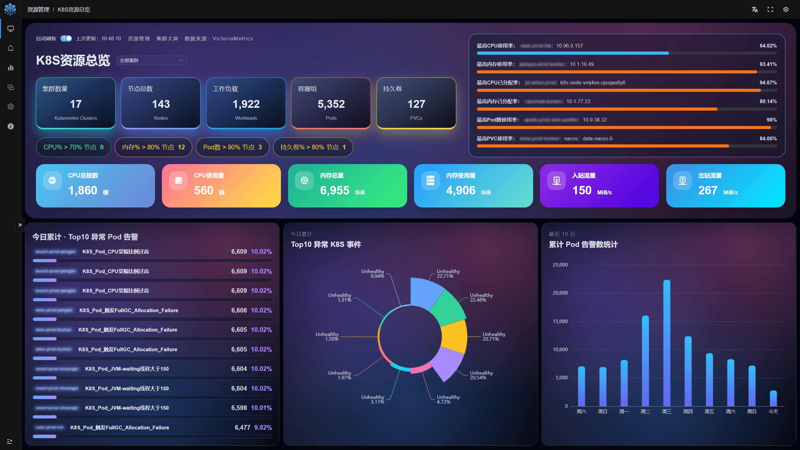
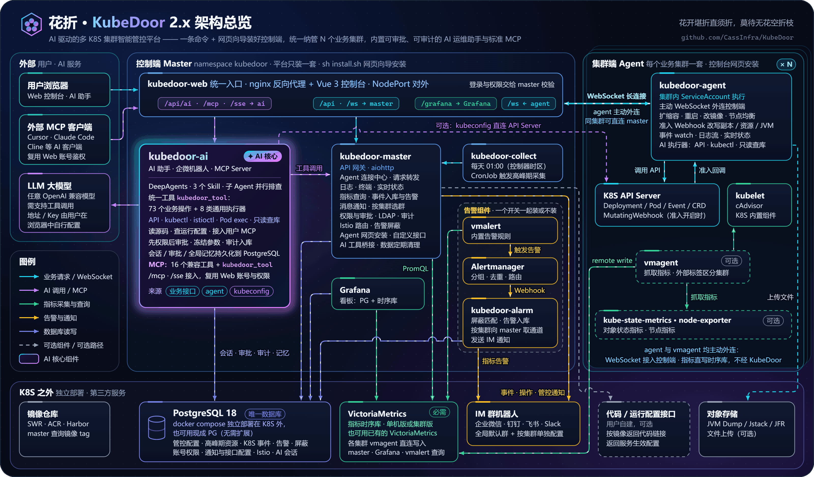
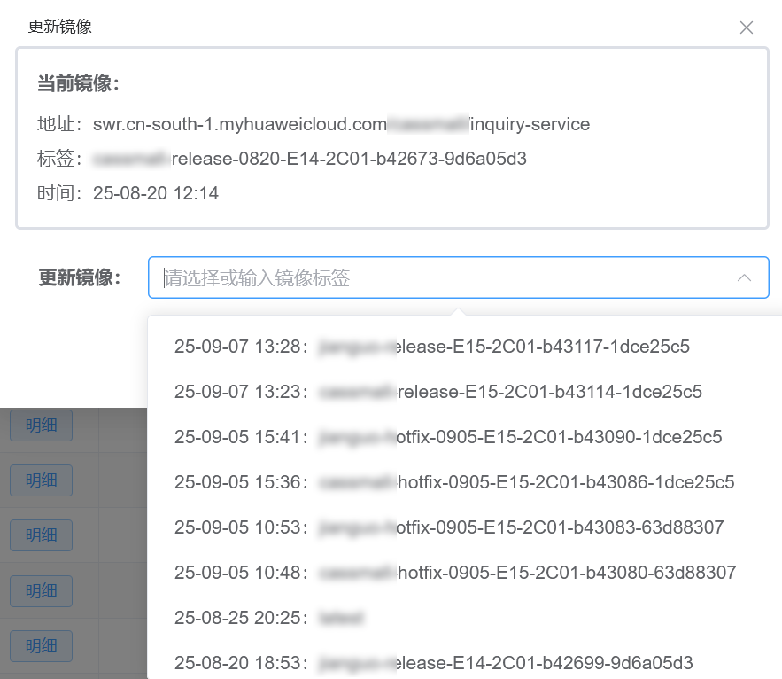
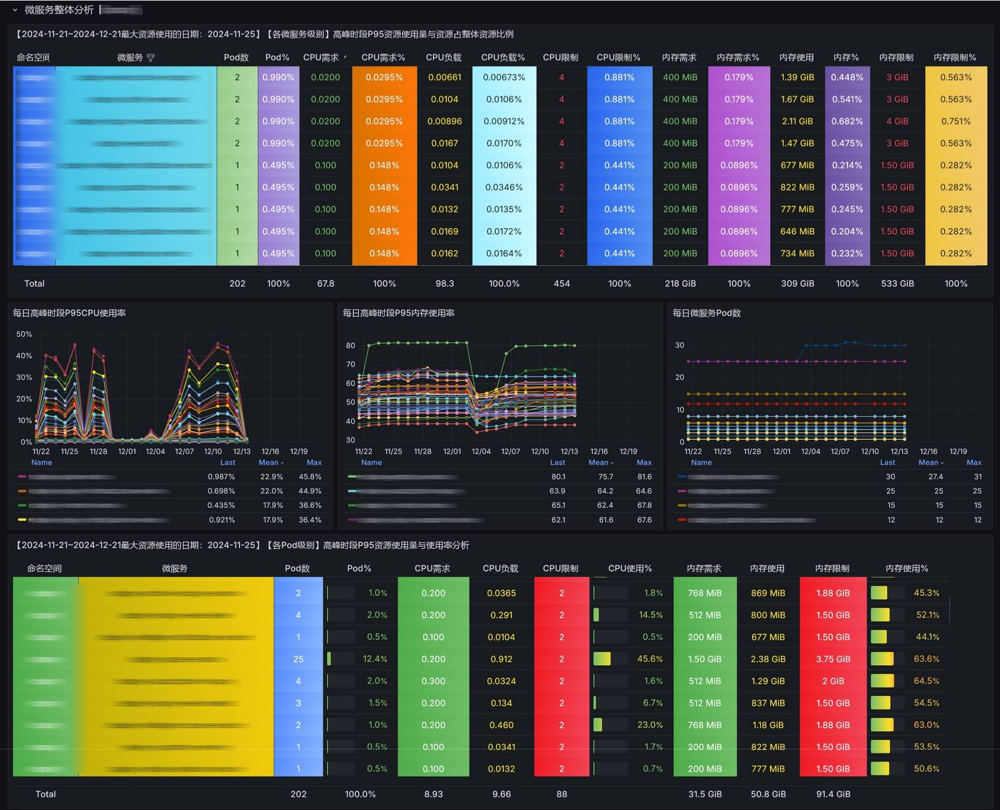
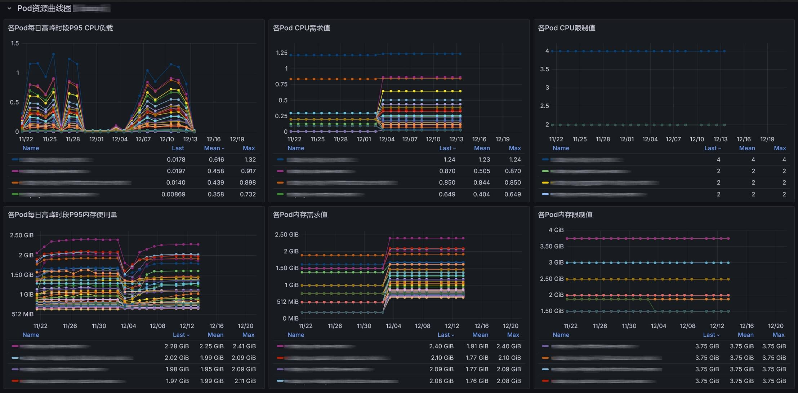
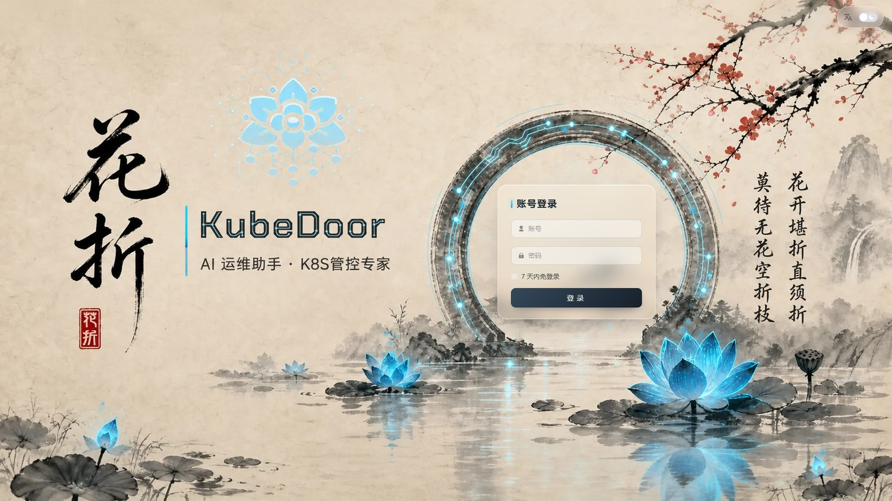

<div align="center">

[简体中文](README.md) | English

[](https://starsl.cn)
[](https://cassinfra.github.io/KubeDoor/)
[](https://github.com/CassInfra/KubeDoor/commits/main)
[](https://github.com/CassInfra/KubeDoor/issues)
[](https://www.python.org)
[](https://vuejs.org)
[](https://www.postgresql.org)
[](https://kubernetes.io)
[](LICENSE.txt)


# 花折 - KubeDoor

花开堪折直须折🌻莫待无花空折枝

*Pluck the flower while it blooms 🌻 don't wait until only a bare branch is left*

**AI-driven intelligent management platform for multi-cluster Kubernetes**

[Website](https://cassinfra.github.io/KubeDoor/) · [Quick Start](#quick-start) · [Docs](#documentation) · [Community](#kubedoor-community-and-donations)

</div>

---
**If images fail to load for you in mainland China, try the Gitee mirror: <a target="_blank" href="https://gitee.com/starsl/KubeDoor">https://gitee.com/starsl/KubeDoor</a>**

## 🏷Contents
* [🌈Overview](#overview)
* [🎉What's New in 2.x](#whats-new-in-2x)
* [💠Architecture](#architecture)
* [💎Features](#features)
  * [🤖AI Assistant, WeCom Bot and MCP](#1-ai-assistant-wecom-bot-and-mcp)
  * [🧩Code and Runtime Config Lookup](#2-code-and-runtime-config-lookup)
  * [🌐Istio VirtualService Management](#3-istio-virtualservice-management)
  * [🧭CoreDNS Management](#4-coredns-management)
  * [🎛K8S Resource Management](#5-k8s-resource-management)
  * [📡Multi-Cluster Monitoring](#6-multi-cluster-monitoring)
  * [🧬Alerts, Events and Notifications](#7-alerts-events-and-notifications)
  * [🚧Peak-Hour Resources and Admission Control](#8-peak-hour-resources-and-admission-control)
  * [☕JVM Control and Diagnostics](#9-jvm-control-and-diagnostics)
  * [⚖Node Balancing and Elastic Scheduling](#10-node-balancing-and-elastic-scheduling)
  * [🔐Platform, Permissions and Console Settings](#11-platform-permissions-and-console-settings)
* [🚀Quick Start](#quick-start)
* [♻Upgrade](#upgrade)
* [📚Documentation](#documentation)
* [🔔Community and Donations](#kubedoor-community-and-donations)
* [🙇Contributors](#contributors)
* [🥰Acknowledgements](#acknowledgements)

---

## 🌈Overview

🌼**花折 - KubeDoor** is an **AI-driven intelligent management platform for multi-cluster Kubernetes**, built with Python + Vue. The control plane is installed through a Web wizard, and each workload cluster joins by uploading its kubeconfig in the Web UI; a single Web UI covers multi-cluster monitoring, resource management, alerts and events, Istio routing, CoreDNS records, peak-hour resource governance and JVM control. A built-in **AI ops assistant with approvals and an audit trail** is available in the Web UI, in WeCom (WeChat Work), Feishu and MCP clients.

KubeDoor focuses on microservice resources as seen during the daily peak hours: it collects the real resource usage of every microservice during the peak, and uses K8S admission control to keep resource requests in line with that real usage.

- 🚀**Installed from the browser**: download and run the script, then install the control plane in the browser; each cluster's Agent is installed from the Web UI too. No Helm, no config files to edit.
- 🤖**AI ops assistant**: troubleshoot, query and make changes in natural language; queries run automatically, while changes run only after a human approves them, as configured.
- 🛰**Unified multi-cluster management**: agents connect out to the control plane, so workload clusters need no inbound ports; the resources, metrics, events and alerts of all clusters live in one platform.
- 🎯**Peak-hour resource governance**: collect real usage during the business peak, then use admission control to enforce replica counts, requests, limits and JVM flags in one place.
- 🔐**Permissions and audit**: local and LDAP accounts, permissions per cluster and per operation, and every login and change on record.

<div align="center">



K8S Resource Overview: multi-cluster resources, at-risk nodes, and today's abnormal alerts and events, all on one screen

</div>

---

## 🎉What's New in 2.x

**Compared with 1.x, 2.x is an architecture-level upgrade: the AI assistant becomes a core capability, PostgreSQL becomes the only database, and deployment moves to a Web wizard.** See [Releases](https://github.com/CassInfra/KubeDoor/releases) for the full notes of each version.

- **2.7**: unified notifications and an AI bot gateway across WeCom, DingTalk, Feishu and Slack, with a shared default model and Feishu long connection; public sharing of AI conversations; a Deployment environment-variable viewer; hardened pod-mgr, webhook certificates and node-exporter; `upgrade` handles backups, settings migration and Grafana dashboard sync.
- **2.6**: Web-wizard installation of the control plane and Web installation of Agents; code and runtime config lookup, with an AI that reads source code, checks configuration and runs read-only MySQL / Redis / ES queries; permissions & approvals; notifications, general settings and event alert rules configured in the UI; backup / rollback and domain conflict checks for Istio VirtualServices.
- **2.3**: WeCom smart bot; Istio VirtualService management rebuilt around Istio groups; CoreDNS management; prefix caching for long AI conversations, context compression and a usage dashboard.
- **2.2**: LDAP sign-in and per-cluster permissions, the audit log, Web Pod and node terminals.
- **2.1**: the built-in AI assistant (kubedoor-ai) and the new MCP, live Deployment status, JVM flag control.
- **2.0**: PostgreSQL as the only database; alert silences, node balancing, Huawei Cloud CCI elastic scaling.

---

## 💠Architecture

<div align="center">

</div>

- **Control plane** (deployed by the Web wizard): kubedoor-web (single entry point and console), kubedoor-master (API gateway and agent connection hub), kubedoor-ai (AI assistant, WeCom/Feishu bots and MCP), the Grafana dashboards and the daily peak-hour collection job, plus the optional alerting components (vmalert, Alertmanager, kubedoor-alarm).
- **Cluster side** (installed from the Web UI): kubedoor-agent initiates a WebSocket connection to the control plane, so workload clusters need no inbound ports; vmagent, kube-state-metrics and node-exporter are optional, and metrics are written straight to the time-series database.
- **External dependencies**: PostgreSQL 18 (the only database) and VictoriaMetrics (each cluster's metrics are told apart by one label); use existing ones, or deploy them separately with the Docker Compose files under `deploy/`.

---

## 💎Features

[2.x] marks the version in which a capability first became available. UI labels are quoted in Chinese exactly as they appear in the Web UI (「…」), with an English gloss.

### 1. 🤖AI Assistant, WeCom Bot and MCP

**Click 「AI 助手」 (AI Assistant) in the top bar, select a cluster and describe the problem in one sentence: queries run automatically, changes are approved before they run as configured, and every step is traceable.**

- 🧠**Bring your own model**: any OpenAI-compatible API, with dedicated support for DeepSeek thinking mode; long conversations keep hitting the model's prefix cache, and the context is compressed automatically.
- 🧰**Governed tools**: 73 KubeDoor business operations plus the K8S API, kubectl, istioctl, diagnostic commands and Pod exec; generic operations run through the online Agent first, and fall back to a direct connection with the cluster's kubeconfig while the Agent is offline.
- 🔍**Reads code, checks configuration [2.6]**: downloads the source code behind the current image to pinpoint errors; fetches the runtime configuration (passwords are replaced with placeholders, so the model never sees them) and runs read-only queries against MySQL, Redis and Elasticsearch.
- 💬**WeCom bot [2.3]**: connects over a long-lived connection, so no public callback URL is needed; members chat with it one-on-one, approve changes from a card or by replying 「批准」 (approve), and permissions are checked live against the bound KubeDoor account.
- 💬**Feishu bot [2.7]**: long-lived connection with CardKit streaming cards; shares the tools, permissions, approvals and audit trail of the Web AI assistant. Manage bots and models in one page, and let members bind their own IM accounts.
- 🔌**MCP**: the Web entry point serves `/mcp` (Streamable HTTP) and `/sse`, reusing the Web accounts and permissions (Basic auth); you can also connect your own MCP servers under 「MCP 管理」 (MCP management) [2.6].
- 🛡**Guardrails**: permission first, then approval; approved operations run with frozen parameters, K8S writes are dry-run first, and timed-out writes are never replayed; secrets are redacted, and every tool call is stored for auditing.

📖Details: [AI assistant guide](docs/ai-assistant.md) · [WeCom smart bot](src/kubedoor-ai/README.md#企业微信智能机器人) (both in Chinese)

---

### 2. 🧩Code and Runtime Config Lookup

**[2.6] Hook up your own APIs, and the Deployment and Pod action menus open the code page, source download and latest commits for the current image in one click, or show the configuration the service actually runs with.**

- A system admin enters the API URL and request headers under 「系统管理 → 获取代码接口」 / 「获取运行配置接口」 (System → Get code API / Get runtime config API); the API contract is described on those pages.
- Once 「允许 AI 下载并分析源码」 and 「允许 AI 获取运行配置」 (allow the AI to analyze source code / to get runtime config) are turned on on the same pages, the AI assistant can use them too (both off by default).

📖Details: [Service source code lookup and analysis](docs/ai-assistant.md#服务源码查询与分析) · [Runtime configuration and data queries](docs/ai-assistant.md#运行配置与数据查询) (both in Chinese)

---

### 3. 🌐Istio VirtualService Management

**[2.3] Maintain one project's VirtualServices across clusters per "Istio group": one set of rules for the whole group, hosts and domains per cluster; compare, adopt, preview the diff, then push.**

- A matrix view shows every VirtualService's status in each cluster on one screen; adopt identical ones in one click and edit rules visually.
- VirtualServices are backed up automatically before a cluster is changed and can be rolled back in one click; domain conflicts within a cluster are checked; rules from a cluster's live state can be synced back into the group standard [2.6].
- Unmodeled fields are kept as-is; changes need the 「Istio 修改」 (Istio changes) permission (admins only by default).

📖Details: [Istio VirtualService management](src/kubedoor-master/istio_route/README.md) (Chinese)

---

### 4. 🧭CoreDNS Management

**[2.3] Maintain CoreDNS's custom hosts records like a table: only the changed lines are rewritten, the diff is shown before saving, and afterwards you confirm from inside the cluster that the records resolve.**

- Enabling / disabling a record just adds or removes a leading `#`; saves use an optimistic lock, so changes someone else has just made are never overwritten.
- Includes DNS lookup and port tests and a Monaco 「高级编辑」 (Advanced edit); changes need the 「CoreDNS 修改」 (CoreDNS changes) permission (admins only by default).

---

### 5. 🎛K8S Resource Management

**Manage the Deployments, Pods, Services, Ingresses, ConfigMaps, StatefulSets, DaemonSets and nodes of all clusters in one console.**

- View, edit and delete YAML; Deployment replicas and Pod status refresh live.
- Web Pod and node terminals [2.2]; live logs, with all of a Deployment's Pods viewable together.
- Scaling and restarts (immediate / scheduled / periodic), image updates (lists the registry's recent tags; read-only users can be authorized by rules) and Pod isolation that keeps the Pod around for investigation.

<details close>
<summary>🔍Click to expand screenshots ...</summary>

||
|-|

</details>

📖Details: [K8S microservice image update configuration](help/K8S微服务镜像更新配置说明.md) (Chinese)

---

### 6. 📡Multi-Cluster Monitoring

**Each cluster's vmagent writes its metrics to the same time-series database, and one label tells the clusters apart, so you see every cluster in one Web UI.**

- K8S resource overview: resource counts, at-risk nodes, usage, and today's Top 10 abnormal alerts and events.
- Embedded Grafana dashboards (K8S, nodes, peak resources, AI usage), imported automatically at installation.

<details close>
<summary>🔍Click to expand screenshots ...</summary>

||
|-|

</details>

---

### 7. 🧬Alerts, Events and Notifications

**Metric alerts, K8S event alerts and operation notifications are pushed to WeCom, DingTalk, Feishu or Slack, with a different group chat per cluster if needed.**

- 44 built-in vmalert alerting rules; from the alert details you can isolate a Pod or run Dump, Jstack or JFR on it directly.
- Alert silences [2.0]: Alertmanager-style matchers that only block notifications; silenced alerts are still stored.
- K8S event center: all events are stored and searchable; event alert rules are configured on a page and can be dry-run against recent real events.
- Notifications are configured under 「系统管理 → 消息通知」 (System → Notifications) [2.6], optionally with a separate group chat per cluster.

<details close>
<summary>🔍Click to expand screenshots ...</summary>

|||
| ------------------------------------| ----------------------------------- |

</details>

📖Details: [Alert silences](docs/alert-silence.md) · [K8S event alert rule configuration](help/K8S事件告警规则配置说明.md) (both in Chinese)

---

### 8. 🚧Peak-Hour Resources and Admission Control

**Collect each microservice's real resource usage during the daily business peak, then use admission control to keep its requests in line with that usage: more accurate scheduling, less resource fragmentation.**

- Every day, the previous day's peak-hour CPU and memory (P80) and heap usage (P95) are collected into the control table.
- The control table is one place to configure replica counts, requests, limits, JVM flags and rolling-update parameters, with bulk scaling and restarts, and settings can be synced to other clusters.
- With admission control enabled, Deployment creation, rollouts and scaling are rewritten to the controlled values; direct replica changes are rewritten too, and only a 「临时扩容」 (temporary scale-out) is allowed through.

> ⚠️ Admission control is off by default and **fail-closed** once enabled: while the agent or master is unavailable, Deployment changes are rejected; in an emergency, run `kubectl delete mutatingwebhookconfiguration kubedoor-admis-configuration`.

<details close>
<summary>🔍Click to expand screenshots ...</summary>

Peak resource dashboard (Grafana): global peak-hour resource statistics with a TOP 10 for each resource, plus peak resource analysis and resource curves at namespace / microservice / Pod level.

|||
|-|-|
|||

</details>

📖Details: [K8S resource control guide](help/K8S资源管控功能说明.md) (Chinese)

---

### 9. ☕JVM Control and Diagnostics

- 🩺**One-click diagnostics**: run Dump, Jstack, JFR or JVM on a Pod; results are pushed to IM and the files are uploaded to object storage.
- 🧩**Startup flag control [2.1]**: controls `-Xms`, `-Xmx`, `-Xss` and `-XX:MaxMetaspaceSize`, which admission control replaces with the controlled values on rollout.
- 🚨**JVM alerts**: 14 built-in JVM alerting rules.

<details close>
<summary>🔍Click to expand screenshots ...</summary>

||
|-|

</details>

📖Details: [JVM flag control](docs/jvm-resource-control.md) (Chinese)

---

### 10. ⚖Node Balancing and Elastic Scheduling

- ⚖**Node balancing [2.0]**: builds a migration plan from node CPU load and migrates in batches after confirmation (manual only; requires metrics-server).
- 🎯**Specified nodes and CCI**: pick target nodes when scaling or restarting; on Huawei Cloud CCE, a 「临时扩容」 can burst the extra Pods to CCI.

📖Details: [Node balancing algorithm and parameters](src/kubedoor-agent/load_balance/README.md) (Chinese)

---

### 11. 🔐Platform, Permissions and Console Settings

- 🚪**Single entry point**: the Web UI, Grafana, the AI assistant and MCP share one NodePort, and logins and permissions are managed by the master.
- 👥**Accounts and permissions [2.2]**: local accounts plus LDAP, with per-cluster grants (Admin / Read-write / Read-only / None); 「权限与审批」 (Permissions & approvals) [2.6] sets, for 27 operation types, what each level may do and which AI operations need human approval; every write operation is audited.
- 🖥**Console settings [2.6]**: general settings, notifications, event alert rules, image registries, LDAP, the IM bots and more live under 「系统管理」 (System), take effect on save, and store sensitive values encrypted.
- 🛰**Agent management**: install Agents from the Web UI, update and restart them in bulk, and configure collection and admission control.

<details close>
<summary>🔍Click to expand screenshots ...</summary>

||
|-|

</details>

📖Details: [Accounts and permissions](tools/legacy-install/README.md#账号与权限) (Chinese)

---

## 🚀Quick Start

**Download the install script and run it, then install the control plane in the Web wizard; Agents for other clusters are installed from the Web UI too.**

#### Prerequisites

| Item | Requirement |
| --- | --- |
| Installer machine | `sh` (or `bash`) and a `kubectl` that can reach the target cluster |
| Kubernetes | ≥ 1.21 (≥ 1.25 to run scheduled tasks in Beijing time), with metrics-server; official images are amd64 only |
| PostgreSQL | An existing one (14+ recommended; no superuser or extensions needed), or one started with the Docker Compose in [deploy/postgres](deploy/postgres) |
| Time-series database | Single-node or cluster VictoriaMetrics: an existing one, or one started with [deploy/victoria-metrics](deploy/victoria-metrics/README.md) |

The database and the time-series database must be reachable from K8S Pods, and each workload cluster's vmagent must be able to write to the time-series database.

#### ① Download and run the install script

```sh
curl -fsSLO https://raw.githubusercontent.com/CassInfra/KubeDoor/main/deploy/install.sh
sh install.sh
```

If GitHub is unreachable, download it from the Gitee mirror instead (which may lag a few days behind): `https://gitee.com/starsl/KubeDoor/raw/main/deploy/install.sh`

The script starts the Web UI and a temporary setup service in the `kubedoor` namespace, and finally prints the access URL and a one-time setup key. To pick a context, use a private image registry, pin the NodePort, or export YAML when there is no `kubectl`, see the [deployment guide](deploy/README.md) (Chinese).

#### ② Install the control plane in the Web wizard

Open the printed address, enter the setup key and go through the six steps: environment check → PostgreSQL → time-series database → basic settings → automatic installation → install Agent (optional). You only fill in the database, the time-series database and the admin password; the control-plane services are deployed and checked one by one, success is reported only when everything passes, and step 6 can install the Agent in this cluster along the way. Refreshing or closing the page does not interrupt the installation; if something fails, fix it as the page describes and click retry.

> When connecting existing monitoring, set the cluster label name to the label your metrics use to tell clusters apart (e.g. if they carry `cluster="prod-k8s"`, enter `cluster`); the default is `origin_prometheus`.

#### ③ Install kubedoor-agent from the Web UI

Sign in as `kubedoor` with the password set in the wizard, open 「Agent管理」 (Agent Management; English UI: "Workbench") → 「安装 Agent」 (Install Agent), upload the target cluster's kubeconfig and confirm the cluster identifier to install the Agent and the metrics collection components; progress is shown step by step, and both the Agent coming online and its metric writes are verified. The control plane must be able to reach the target cluster's API Server.

#### First Steps

1. In 「Agent管理」, check that the cluster is online, turn on 「自动采集」 (auto collection), set the peak hours and click 「采集」 (Collect) to backfill historical data; once the data in 「高峰资源管控」 (Peak Resource Control) looks right, turn on 「准入控制」 (admission control) as needed (off by default).
2. Click 「AI 助手」 → 「模型设置」 (Model Settings) in the top bar, enter the model's Base URL, API Key and name, and start chatting.
3. Under 「系统管理」 (System), add users, grant cluster permissions or connect LDAP, and set up notifications, the IM bots and so on as needed.

#### Production Tips

- 🔒The Web UI uses plain HTTP by default; in production, put HTTPS in front of it (with WebSocket support), and when TLS terminates in front of nginx, set Cookie Secure to `true` under 「系统管理 → 通用配置」 (System → General settings).
- 🚧Admission control is fail-closed; turn off 「准入控制」 in 「Agent管理」 before uninstalling or reinstalling an agent.
- 💾Back up PostgreSQL and the Secrets in the `kubedoor` namespace; if the encryption key in `kubedoor-ai-security` changes, saved kubeconfigs, notification tokens and other encrypted data can no longer be decrypted.
- 👀Through the AI, accounts with read-only access to a cluster can run a wider range of read-only queries (e.g. K8S API GET) than the pages allow, and Secret redaction is best-effort, so hand out accounts accordingly.

---

## ♻Upgrade

**Upgrading the control plane is two steps as well: download the new script, then run `upgrade`.**

```sh
curl -fsSLO https://raw.githubusercontent.com/CassInfra/KubeDoor/main/deploy/install.sh
sh install.sh upgrade
```

- Back up PostgreSQL first; `sh install.sh upgrade --dry-run` shows the upgrade plan without changing the cluster.
- The script upgrades master, web, AI and alarm, keeps the existing settings and data, and migrates settings from older versions into the database automatically. The master restarts, and in clusters with admission control enabled, Deployment changes are rejected in the meantime, so upgrade off-peak.
- Agents are updated in 「Agent管理」: select the clusters and use 「批量更新」 (bulk update).
- For backup files, settings migration, Grafana dashboard sync and retrying after failures, see [Deployment guide · Updating an existing control plane](deploy/README.md#更新已有控制端包括-230) (Chinese).
- From 1.x (Helm): data is not migrated; turn off admission control in the old version, run `helm uninstall`, then do a fresh installation as in [Quick Start](#quick-start). For legacy script deployments older than 2.3, see the per-version upgrade notes in the [legacy installer](tools/legacy-install/README.md) (Chinese).

---

## 📚Documentation

**Start with the deployment guide, then read the feature guides as needed.** All documents are in Chinese.

| Document | Contents |
| --- | --- |
| [Deployment guide](deploy/README.md) | Downloading the script and installing with the Web wizard, startup options and YAML export, upgrading the control plane, failure recovery, standalone PostgreSQL and VictoriaMetrics deployments |
| [Accounts and permissions](tools/legacy-install/README.md#账号与权限) | Local and LDAP accounts, global roles and per-cluster grants, permissions and approvals, built-in accounts, the audit log and password resets |
| [AI assistant](docs/ai-assistant.md) | Model configuration, resource scope, multi-turn conversations, permissions and approvals, global memory, direct kubeconfig connections, bringing your own MCP servers and external MCP |
| [Service source code and runtime configuration](docs/ai-assistant.md#服务源码查询与分析) | Reading source code with the AI to pinpoint problems, fetching runtime configuration (with password placeholders) and read-only MySQL / Redis / ES queries |
| [WeCom smart bot](src/kubedoor-ai/README.md#企业微信智能机器人) | Bot and dedicated model configuration, member binding and the default permission for unbound members, switching clusters and approval cards |
| [Istio VirtualService management](src/kubedoor-master/istio_route/README.md) | Istio groups and the group standard, per-cluster hosts and domain conditions, status rules, typical workflows and APIs |
| [Alert silences](docs/alert-silence.md) | Silence rule syntax, states, match preview and the IM 【屏蔽】 link |
| [JVM flag control](docs/jvm-resource-control.md) | Collecting and controlling Xms/Xmx/Xss/MaxMetaspaceSize; peak-hour heap and G1 Eden usage |
| [K8S resource control guide](help/K8S资源管控功能说明.md) | Controlling replica counts, requests and limits through admission control |
| [K8S event alert rule configuration](help/K8S事件告警规则配置说明.md) | Syntax of the event alert rules, the default rules and how to configure them on the page |
| [K8S microservice image update configuration](help/K8S微服务镜像更新配置说明.md) | Authorizing image updates by cluster, time window and account, and configuring image registry credentials |
| [FAQ](help/FAQ.md) | Frequently asked questions and troubleshooting |

**Developer reference**
- [src/kubedoor-master/auth/README.md](src/kubedoor-master/auth/README.md): how authentication, authorization and auditing are implemented (permission model, permissions and approvals, per-endpoint permission table, nginx `auth_request`)
- [src/kubedoor-ai/README.md](src/kubedoor-ai/README.md): APIs, environment variables, build and testing of the AI service
- [src/kubedoor-tools/README.md](src/kubedoor-tools/README.md): the K8S execution library shared by the AI service and the agent, and its security boundaries
- [src/kubedoor-web/README.md](src/kubedoor-web/README.md): frontend development and build, the sign-in page and the system management pages
- [src/kubedoor-agent/load_balance/README.md](src/kubedoor-agent/load_balance/README.md): node balancing algorithm and parameters

---

## 🔔KubeDoor Community and 🧧Donations

<div align="center">

#### If you like the project, please give it a ⭐️Star⭐️. If you have other ideas or needs, feel free to discuss them in the issues


**Add the author on WeChat or follow the WeChat Official Account to join the community group**

</div>

## 🙇Contributors
<div align="center">
<table>
<tr>
    <td align="center">
        <a href="https://github.com/starsliao">
            
            <br />
            <sub><b>StarsL.cn</b></sub>
        </a>
    </td>
    <td align="center">
        <a href="https://github.com/xiaofennie">
            
            <br />
            <sub><b>xiaofennie</b></sub>
        </a>
    </td>
    <td align="center">
        <a href="https://github.com/shidousanxia">
            
            <br />
            <sub><b>shidousanxia</b></sub>
        </a>
    </td>
    <td align="center">
        <a href="https://github.com/comqx">
            
            <br />
            <sub><b>comqx</b></sub>
        </a>
    </td>
    <td align="center">
        <a href="https://github.com/seaworld008">
            
            <br />
            <sub><b>seaworld008</b></sub>
        </a>
    </td>
  </tr>
</table>
</div>

## 🥰Acknowledgements

Thanks to the following excellent projects; without them, **KubeDoor** would not exist:
- [Python](https://www.python.org/) [AIOHTTP](https://github.com/aio-libs/aiohttp) [FastAPI](https://fastapi.tiangolo.com/) [Flask](https://flask.palletsprojects.com/) [VUE](https://cn.vuejs.org/) [Pure Admin](https://pure-admin.cn/) [Element Plus](https://element-plus.org) [ECharts](https://echarts.apache.org/) [Monaco Editor](https://microsoft.github.io/monaco-editor/) [Kubernetes](https://kubernetes.io/) [VictoriaMetrics](https://victoriametrics.com/) [Prometheus](https://prometheus.io/) [PostgreSQL](https://www.postgresql.org/) [Grafana](https://grafana.com/) [Nginx](https://nginx.org/) [LangChain](https://github.com/langchain-ai/langchain) [LangGraph](https://github.com/langchain-ai/langgraph) [DeepAgents](https://github.com/langchain-ai/deepagents) [FastMCP](https://gofastmcp.com/) ...

**Special thanks**
- [**CassTime**](https://www.casstime.com): **KubeDoor** would not have been possible without the support of 🦄**CassTime**.
