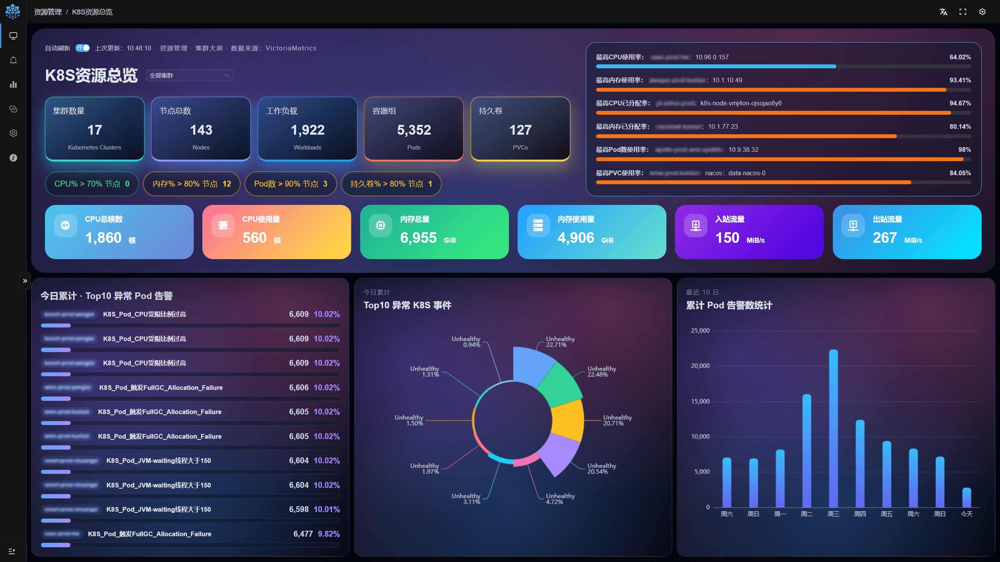
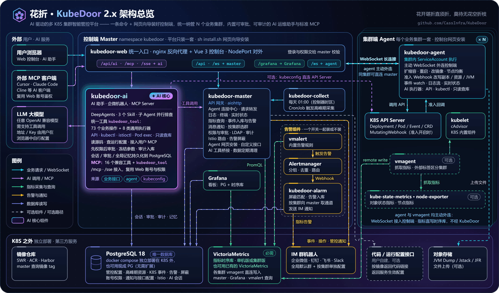
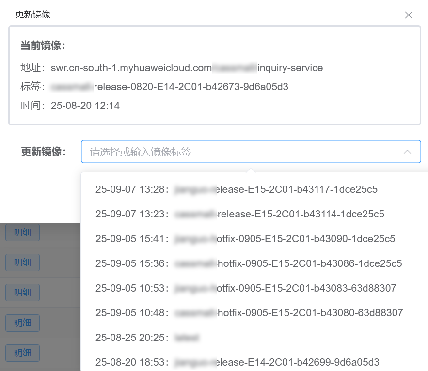
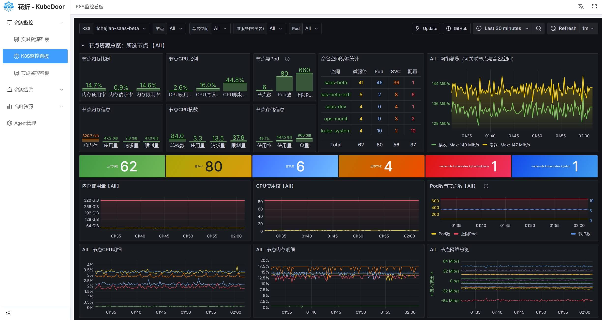
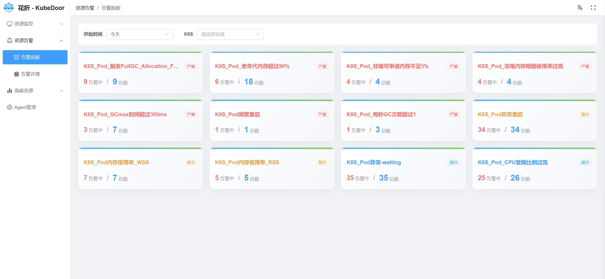
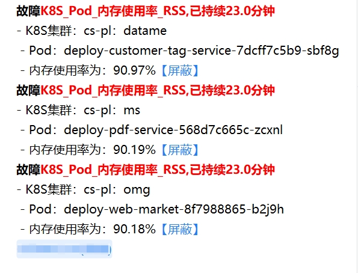
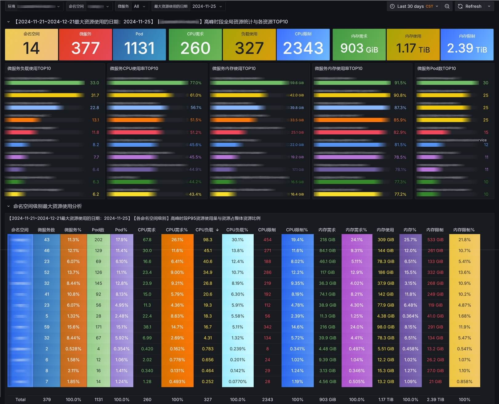
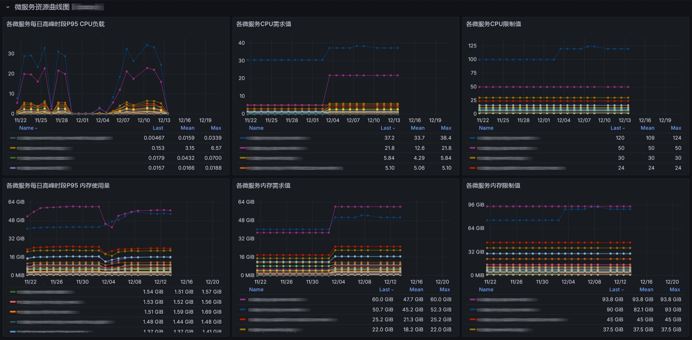
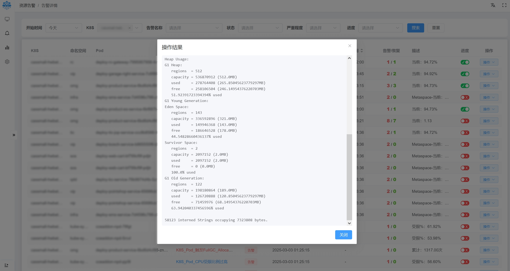

<div align="center">

简体中文 | [English](README.EN.md)

[](https://starsl.cn)
[](https://cassinfra.github.io/KubeDoor/)
[](https://github.com/CassInfra/KubeDoor/commits/main)
[](https://www.python.org)
[](https://vuejs.org)
[](https://kubernetes.io)
[](LICENSE.txt)


# 花折 - KubeDoor

花开堪折直须折🌻莫待无花空折枝

**AI 驱动的多 K8S 集群智能管控平台**

[官网](https://cassinfra.github.io/KubeDoor/) · [快速部署](#快速部署) · [文档](#文档) · [交流群](#kubedoor交流群与赞赏)

</div>

---
**国内用户如果访问图片异常，可以访问Gitee同步站：<a target="_blank" href="https://gitee.com/starsl/KubeDoor">https://gitee.com/starsl/KubeDoor</a>**

## 🏷目录
* [🌈概述](#概述)
* [🎉2.x新特性](#2x新特性)
* [💠架构](#架构)
* [💎功能](#功能)
  * [🤖AI助手、企微机器人与MCP](#1-ai助手企微机器人与mcp)
  * [🧩获取代码与运行配置](#2-获取代码与运行配置)
  * [🌐Istio VirtualService管理](#3-istio-virtualservice管理)
  * [🧭CoreDNS管理](#4-coredns管理)
  * [🎛K8S资源管理](#5-k8s资源管理)
  * [📡多集群监控](#6-多集群监控)
  * [🧬告警、事件与通知](#7-告警事件与通知)
  * [🚧高峰期资源与准入管控](#8-高峰期资源与准入管控)
  * [☕JVM管控与诊断](#9-jvm管控与诊断)
  * [⚖节点均衡与弹性调度](#10-节点均衡与弹性调度)
  * [🔐平台、权限与界面配置](#11-平台权限与界面配置)
* [🚀快速部署](#快速部署)
* [♻升级](#升级)
* [📚文档](#文档)
* [🔔交流群与赞赏](#kubedoor交流群与赞赏)
* [🙇贡献者](#贡献者)
* [🥰鸣谢](#鸣谢)

---

## 🌈概述

🌼**花折 - KubeDoor** 是一个使用Python + Vue开发的**AI驱动的多K8S集群智能管控平台**：控制端用网页向导安装，业务集群在网页上传kubeconfig即可接入；在一个Web里完成多集群的监控、资源管理、告警与事件、Istio路由、CoreDNS解析、高峰期资源治理和JVM管控；内置**可审批、可审计的AI运维助手**，网页、企业微信和MCP客户端里都能用。

KubeDoor专注微服务每日高峰时段的资源视角：采集各微服务高峰期的真实资源用量，基于K8S准入控制让资源需求值与真实用量保持一致。

- 🚀**网页安装**：下载脚本执行后，在浏览器里装好控制端；各集群的Agent也在网页安装，不用Helm，不改配置文件。
- 🤖**AI运维助手**：用自然语言排障、查询和变更，查询自动执行，变更按配置人工批准后才执行。
- 🛰**多集群统一纳管**：agent主动外连控制端，业务集群不用开放入站端口；资源、指标、事件和告警集中在一个平台。
- 🎯**高峰期资源治理**：按业务高峰时段采集真实用量，通过准入控制统一管控副本数、需求值、限制值和JVM参数。
- 🔐**权限与审计**：本地账号 + LDAP，按集群和操作授权，登录和变更全部留痕。

<div align="center">



K8S资源总览：多集群资源、风险节点、今日异常告警与事件，一屏尽览

</div>

---

## 🎉2.x新特性

**相对1.x，2.x是一次架构级升级：AI助手成为核心能力，PostgreSQL成为唯一数据库，部署改为网页向导。** 各版本的完整说明见[Releases](https://github.com/CassInfra/KubeDoor/releases)。

- **2.6**：网页向导安装控制端、网页安装Agent；获取代码与运行配置，AI读源码、查配置、只读查询MySQL / Redis / ES；权限与审批；消息通知、通用配置和事件告警规则改为在页面配置；Istio VirtualService备份回退与域名冲突检查。
- **2.3**：企业微信智能机器人；Istio VirtualService管理（按Istio组重构）；CoreDNS管理；AI长对话缓存、上下文压缩与用量看板。
- **2.2**：LDAP登录与按集群授权、操作审计、网页Pod终端与节点终端。
- **2.1**：内置AI助手（kubedoor-ai）与新版MCP、Deployment实时状态、JVM参数管控。
- **2.0**：PostgreSQL成为唯一数据库；告警屏蔽、节点均衡、华为云CCI弹性扩容。

---

## 💠架构

<div align="center">

</div>

- **控制端**（网页向导部署）：kubedoor-web（统一入口与控制台）、kubedoor-master（API网关、agent连接中心）、kubedoor-ai（AI助手、企微机器人与MCP）、Grafana看板、每日高峰期采集任务，以及可选的告警组件（vmalert、Alertmanager、kubedoor-alarm）。
- **集群端**（网页安装）：kubedoor-agent主动通过WebSocket连接控制端，业务集群不用开放入站端口；可选装vmagent、kube-state-metrics、node-exporter，指标直接写入时序库。
- **外部依赖**：PostgreSQL 18（唯一数据库）和VictoriaMetrics（各集群的指标用一个标签区分）；可用现成的，也可用`deploy/`下的Docker Compose单独部署。

---

## 💎功能

下文【2.x】表示首次提供该能力的版本。

### 1. 🤖AI助手、企微机器人与MCP

**点顶栏的「AI 助手」，选定集群后用一句话描述问题：查询自动执行，变更按配置先审批再执行，全程可追溯。**

- 🧠**自带模型**：支持任意OpenAI兼容接口，专门适配DeepSeek思考模式；长对话持续命中模型的前缀缓存，上下文自动压缩。
- 🧰**受控工具**：73个KubeDoor业务操作，加上K8S API、kubectl、istioctl、诊断命令和Pod exec；通用操作优先经在线Agent执行，Agent离线时用该集群的kubeconfig直连。
- 🔍**读源码、查配置【2.6】**：下载当前镜像对应的源码定位报错；获取运行配置（密码换成占位符，模型看不到明文），并只读查询MySQL、Redis、Elasticsearch。
- 💬**企业微信机器人【2.3】**：长连接接入，不需要公网回调地址；成员单聊即可对话，变更点卡片或回复「批准」审批，按绑定的花折账号实时校验权限。
- 🔌**MCP**：Web入口提供`/mcp`（Streamable HTTP）和`/sse`，复用Web账号和权限（Basic认证）；也可以在「MCP 管理」接入自己的MCP服务【2.6】。
- 🛡**安全护栏**：先权限后审批；批准后按冻结的参数执行，K8S写操作先dry-run，超时不重放；密钥脱敏，每次工具调用都入库审计。

📖详见：[AI助手使用说明](docs/ai-assistant.md) · [企业微信智能机器人](src/kubedoor-ai/README.md#企业微信智能机器人)

---

### 2. 🧩获取代码与运行配置

**【2.6】对接自己的接口，在Deployment、Pod的操作菜单里一键查看当前镜像对应的代码页面、源码下载和最近Commit，或者服务实际运行的配置。**

- 系统管理员在「系统管理 → 获取代码接口」「获取运行配置接口」填写接口地址和请求头，接口约定写在配置页上。
- 在同一页面打开「允许 AI 下载并分析源码」「允许 AI 获取运行配置」后，AI助手也能用它们读代码、查配置（默认关闭）。

📖详见：[服务源码查询与分析](docs/ai-assistant.md#服务源码查询与分析) · [运行配置与数据查询](docs/ai-assistant.md#运行配置与数据查询)

---

### 3. 🌐Istio VirtualService管理

**【2.3】按「Istio组」统一维护一个项目在多个集群里的VirtualService：规则全组一份，hosts和域名按集群维护，对比、纳管，预览差异后再下发。**

- 矩阵视图一屏看到每个VirtualService在各集群的状态，一致的一键纳管，规则可视化编辑。
- 改集群前自动备份、可一键回退，同集群的域名冲突自动检查，集群现状的规则可同步回组标准【2.6】。
- 未建模的字段原样保留；修改要「Istio 修改」权限（默认只有管理员）。

📖详见：[Istio VirtualService管理说明](src/kubedoor-master/istio_route/README.md)

---

### 4. 🧭CoreDNS管理

**【2.3】像改表格一样维护CoreDNS的hosts自定义解析：只重写改动的行，保存前看差异，保存后从集群内确认解析已生效。**

- 启用 / 停用就是在行首加减`#`；保存带乐观锁，不会覆盖别人刚做的修改。
- 带解析测试、端口测试和Monaco「高级编辑」；修改要「CoreDNS 修改」权限（默认只有管理员）。

---

### 5. 🎛K8S资源管理

**在一个控制台里管理所有集群的Deployment、Pod、Service、Ingress、ConfigMap、StatefulSet、DaemonSet和节点。**

- 查看、编辑和删除YAML；Deployment的副本与Pod状态实时刷新。
- 网页Pod终端和节点终端【2.2】；实时日志，Deployment可聚合查看全部Pod的日志。
- 扩缩容与重启（立即 / 定时 / 周期）、镜像更新（列出仓库最近的标签，可按规则授权只读用户）、Pod隔离保留现场。

<details close>
<summary>🔍点击展开截图 ...</summary>

||
|-|

</details>

📖详见：[K8S微服务镜像更新配置说明](help/K8S微服务镜像更新配置说明.md)

---

### 6. 📡多集群监控

**各集群的vmagent把指标写入同一个时序库，靠一个标签区分集群，在一个Web里看全部集群。**

- K8S资源总览：资源数量、风险节点、使用率，今日Top10异常告警与事件。
- 内嵌Grafana看板（K8S、节点、高峰资源、AI用量），随安装自动导入。

<details close>
<summary>🔍点击展开截图 ...</summary>

||
|-|

</details>

---

### 7. 🧬告警、事件与通知

**指标告警、K8S事件告警和运维操作通知推送到企业微信、钉钉、飞书、Slack，可按集群发到不同的群。**

- 内置44条vmalert告警规则；告警详情里可直接对Pod执行隔离、Dump、Jstack、JFR。
- 告警屏蔽【2.0】：Alertmanager风格的条件，只拦通知，告警照常入库。
- K8S事件中心：全部事件入库可检索；事件告警规则在页面配置，可用最近的真实事件试运行。
- 通知在「系统管理 → 消息通知」配置【2.6】，可为单个集群单独配置群。

<details close>
<summary>🔍点击展开截图 ...</summary>

|||
| ------------------------------------| ----------------------------------- |

</details>

📖详见：[告警屏蔽](docs/alert-silence.md) · [K8S事件告警规则配置说明](help/K8S事件告警规则配置说明.md)

---

### 8. 🚧高峰期资源与准入管控

**采集每个微服务每日高峰时段的真实资源用量，再通过准入控制让需求值与真实用量保持一致：调度更准确，资源碎片更少。**

- 每天自动采集前一天高峰时段的CPU、内存（P80）和堆内存（P95），写入管控表。
- 管控表集中配置副本数、需求值、限制值、JVM参数和滚动更新参数，可批量扩缩容、重启，可同步到其他集群。
- 开启准入控制后，Deployment创建、发布和扩缩容时按管控值改写；直接改副本数同样会被改回，只放行「临时扩容」。

> ⚠️ 准入控制默认关闭，开启后为**fail-closed**：agent或master不可用时Deployment变更会被拒绝，应急可执行`kubectl delete mutatingwebhookconfiguration kubedoor-admis-configuration`。

<details close>
<summary>🔍点击展开截图 ...</summary>

高峰资源看板（Grafana）：高峰时段全局资源统计与各资源TOP10、命名空间/微服务/Pod级高峰资源分析与资源曲线。

|||
|-|-|
|||

</details>

📖详见：[K8S资源管控功能说明](help/K8S资源管控功能说明.md)

---

### 9. ☕JVM管控与诊断

- 🩺**一键诊断**：对Pod执行Dump、Jstack、JFR、JVM，结果推送IM，文件上传到对象存储。
- 🧩**启动参数管控【2.1】**：管控`-Xms`、`-Xmx`、`-Xss`、`-XX:MaxMetaspaceSize`，发布时由准入控制替换为管控值。
- 🚨**JVM告警**：内置14条JVM告警规则。

<details close>
<summary>🔍点击展开截图 ...</summary>

||
|-|

</details>

📖详见：[JVM参数管控](docs/jvm-resource-control.md)

---

### 10. ⚖节点均衡与弹性调度

- ⚖**节点均衡【2.0】**：按节点CPU负载生成迁移计划，确认后分批迁移（手动执行，依赖metrics-server）。
- 🎯**指定节点与CCI**：扩缩容、重启时可挑选目标节点；华为云CCE「临时扩容」可以把超出的部分弹到CCI。

📖详见：[节点均衡算法与参数](src/kubedoor-agent/load_balance/README.md)

---

### 11. 🔐平台、权限与界面配置

- 🚪**统一入口**：Web、Grafana、AI助手和MCP共用一个NodePort，登录与权限都由master管理。
- 👥**账号与权限【2.2】**：本地账号 + LDAP，按集群授权「管理员 / 读写 / 只读 / 无」；「权限与审批」【2.6】按27类操作配置每级权限能做什么、AI做哪些操作要人工批准；写操作全部留痕审计。
- 🖥**界面配置【2.6】**：通用配置、消息通知、事件告警规则、镜像仓库、LDAP、企微机器人等都在「系统管理」里，保存即生效，敏感值加密保存。
- 🛰**Agent管理**：网页安装Agent，批量更新与重启，配置采集与准入控制。

<details close>
<summary>🔍点击展开截图 ...</summary>

||
|-|

</details>

📖详见：[账号与权限](tools/legacy-install/README.md#账号与权限)

---

## 🚀快速部署

**下载安装脚本并执行，然后在网页向导里装好控制端；其他集群的Agent也在网页安装。**

#### 前置条件

| 项目 | 要求 |
| --- | --- |
| 执行机器 | `sh`（或`bash`）和能连上目标集群的`kubectl` |
| Kubernetes | ≥ 1.21（定时任务按北京时间执行需要 ≥ 1.25），需要metrics-server；官方镜像仅amd64 |
| PostgreSQL | 现成的（建议14+，不需要超级用户和扩展），或用[deploy/postgres](deploy/postgres)的Docker Compose起一个 |
| 时序库 | VictoriaMetrics单机版或集群版，现成的或用[deploy/victoria-metrics](deploy/victoria-metrics/README.md)起一个 |

数据库和时序库要能从K8S Pod访问，各业务集群的vmagent要能写入时序库。

#### ① 下载并执行安装脚本

```sh
curl -fsSLO https://raw.githubusercontent.com/CassInfra/KubeDoor/main/deploy/install.sh
sh install.sh
```

访问不了GitHub时，可从Gitee同步站下载（同步可能晚几天）：`https://gitee.com/starsl/KubeDoor/raw/main/deploy/install.sh`

脚本在`kubedoor`命名空间启动Web和临时安装服务，最后打印访问地址和一次性安装密钥。指定context、内网镜像仓库、固定NodePort，或者没有kubectl时导出YAML部署，见[部署指南](deploy/README.md)。

#### ② 网页向导安装控制端

打开打印的地址，输入安装密钥，按向导走完六步：环境检查 → PostgreSQL → 时序库 → 基础设置 → 自动安装 → 安装Agent（可选）。只需填写数据库、时序库和管理员密码，控制端各服务自动部署、逐项检查，全部通过才报成功，第6步还可以顺手在本集群装好Agent。刷新或关闭网页不会中断安装，失败时按页面提示修好后点重试即可。

> 接入已有监控时，「集群指标标签名」要填现有指标里区分集群的标签名（例如指标带`cluster="prod-k8s"`就填`cluster`），默认是`origin_prometheus`。

#### ③ 网页安装kubedoor-agent

以`kubedoor`和向导中设置的密码登录，打开「Agent管理」→「安装 Agent」，上传目标集群的kubeconfig、确认集群标识，即可安装Agent和指标采集组件；进度逐步显示，并验证Agent上线和指标写入。控制端要能访问目标集群的API Server。

#### 首次使用

1. 在「Agent管理」确认集群在线，打开「自动采集」并设置高峰时段，点「采集」补齐历史数据；在「高峰资源管控」确认数据无误后，再按需开启「准入控制」（默认关闭）。
2. 点顶栏「AI 助手」→「模型设置」，填写模型的Base URL、API Key和模型名，即可开始对话。
3. 在「系统管理」添加用户、按集群授权或接入LDAP，按需配置消息通知、企微机器人等。

#### 生产环境提示

- 🔒Web默认是HTTP，生产环境建议在前面加HTTPS（需支持WebSocket）；TLS在nginx之前终结时，把「系统管理 → 通用配置」里的Cookie Secure设为`true`。
- 🚧准入控制为fail-closed，卸载或重装agent前，先在「Agent管理」关闭「准入控制」。
- 💾备份PostgreSQL和`kubedoor`命名空间里的Secret；`kubedoor-ai-security`里的加密密钥变了，已保存的kubeconfig、通知token等都无法解密。
- 👀对集群只读的账号经AI能做的只读查询（如K8S API GET）比页面更宽，Secret脱敏是尽力而为，请按需分配账号。

---

## ♻升级

**升级控制端同样两步：下载新版脚本，执行`upgrade`。**

```sh
curl -fsSLO https://raw.githubusercontent.com/CassInfra/KubeDoor/main/deploy/install.sh
sh install.sh upgrade
```

- 升级前先备份PostgreSQL；可以先执行`sh install.sh upgrade --dry-run`查看升级计划（不修改集群）。
- 脚本升级master、web、AI和alarm，保留现有配置和数据，旧版本的配置自动迁入数据库。master会重启，开启了准入控制的集群这段时间Deployment变更会被拒绝，建议低峰期操作。
- Agent在「Agent管理」里勾选集群「批量更新」。
- 备份文件、旧配置迁移、Grafana看板同步和失败重试等说明见[部署指南 · 更新已有控制端](deploy/README.md#更新已有控制端包括-230)。
- 从1.x（Helm）升级：数据不迁移，先在旧版关闭准入控制、`helm uninstall`卸载，再按[快速部署](#快速部署)全新安装。2.3之前的旧脚本部署见[旧部署工具](tools/legacy-install/README.md)里各版本的升级说明。

---

## 📚文档

**先看部署指南，再按需查阅各功能说明。**

| 文档 | 内容 |
| --- | --- |
| [部署指南](deploy/README.md) | 下载脚本与网页向导安装、启动参数与导出YAML、控制端升级、失败恢复，PostgreSQL和VictoriaMetrics独立部署 |
| [账号与权限](tools/legacy-install/README.md#账号与权限) | 本地账号与LDAP、全局角色与集群授权、权限与审批、内置账号、操作审计与忘记口令 |
| [AI助手](docs/ai-assistant.md) | 模型配置、资源范围、多轮对话、权限与审批、全局记忆、kubeconfig直连、接入自己的MCP与外部MCP |
| [服务源码与运行配置](docs/ai-assistant.md#服务源码查询与分析) | AI读源码定位问题、获取运行配置（密码占位符）与只读查询MySQL / Redis / ES |
| [企业微信智能机器人](src/kubedoor-ai/README.md#企业微信智能机器人) | 机器人与专用模型配置、成员绑定与默认权限、集群切换与审批卡片 |
| [Istio VirtualService管理](src/kubedoor-master/istio_route/README.md) | Istio组与组标准、按集群的hosts与域名条件、状态判断、典型流程与接口 |
| [告警屏蔽](docs/alert-silence.md) | 屏蔽规则语法、状态、命中预览与IM【屏蔽】链接 |
| [JVM参数管控](docs/jvm-resource-control.md) | Xms/Xmx/Xss/MaxMetaspaceSize的采集与管控，高峰期堆内存与G1 Eden使用率 |
| [K8S资源管控功能说明](help/K8S资源管控功能说明.md) | 基于准入控制管控副本数、需求值与限制值 |
| [K8S事件告警规则配置说明](help/K8S事件告警规则配置说明.md) | 事件告警规则的语法、默认规则与页面配置方式 |
| [K8S微服务镜像更新配置说明](help/K8S微服务镜像更新配置说明.md) | 按集群、时间段、账号授权镜像更新，以及镜像仓库凭据配置 |
| [常见问题](help/FAQ.md) | 常见问题与排查 |

**开发者参考**
- [src/kubedoor-master/auth/README.md](src/kubedoor-master/auth/README.md)：认证、授权与审计的实现（权限模型、权限与审批、接口权限登记表、nginx `auth_request`）
- [src/kubedoor-ai/README.md](src/kubedoor-ai/README.md)：AI服务的接口、环境变量、构建与测试
- [src/kubedoor-tools/README.md](src/kubedoor-tools/README.md)：AI与agent共用的K8S执行库及安全边界
- [src/kubedoor-web/README.md](src/kubedoor-web/README.md)：前端开发与构建、登录页与系统管理页面
- [src/kubedoor-agent/load_balance/README.md](src/kubedoor-agent/load_balance/README.md)：节点均衡算法与参数

---

## 🔔KubeDoor交流群与🧧赞赏

<div align="center">

#### 如果觉得项目不错，麻烦动动小手点个⭐️Star⭐️ 如果你还有其他想法或者需求，欢迎在 issue 中交流


**加作者微信或关注公众号加入交流群**

</div>

## 🙇贡献者
<div align="center">
<table>
<tr>
    <td align="center">
        <a href="https://github.com/starsliao">
            
            <br />
            <sub><b>StarsL.cn</b></sub>
        </a>
    </td>
    <td align="center">
        <a href="https://github.com/xiaofennie">
            
            <br />
            <sub><b>xiaofennie</b></sub>
        </a>
    </td>
    <td align="center">
        <a href="https://github.com/shidousanxia">
            
            <br />
            <sub><b>shidousanxia</b></sub>
        </a>
    </td>
    <td align="center">
        <a href="https://github.com/comqx">
            
            <br />
            <sub><b>comqx</b></sub>
        </a>
    </td>
    <td align="center">
        <a href="https://github.com/seaworld008">
            
            <br />
            <sub><b>seaworld008</b></sub>
        </a>
    </td>
  </tr>
</table>
</div>

## 🥰鸣谢

感谢如下优秀的项目，没有这些项目，不可能会有**KubeDoor**：
- [Python](https://www.python.org/) [AIOHTTP](https://github.com/aio-libs/aiohttp) [FastAPI](https://fastapi.tiangolo.com/) [Flask](https://flask.palletsprojects.com/) [VUE](https://cn.vuejs.org/) [Pure Admin](https://pure-admin.cn/) [Element Plus](https://element-plus.org) [ECharts](https://echarts.apache.org/) [Monaco Editor](https://microsoft.github.io/monaco-editor/) [Kubernetes](https://kubernetes.io/) [VictoriaMetrics](https://victoriametrics.com/) [Prometheus](https://prometheus.io/) [PostgreSQL](https://www.postgresql.org/) [Grafana](https://grafana.com/) [Nginx](https://nginx.org/) [LangChain](https://github.com/langchain-ai/langchain) [LangGraph](https://github.com/langchain-ai/langgraph) [DeepAgents](https://github.com/langchain-ai/deepagents) [FastMCP](https://gofastmcp.com/) ...

**特别鸣谢**
- [**CassTime**](https://www.casstime.com)：**KubeDoor**的诞生离不开🦄**开思**的支持。
