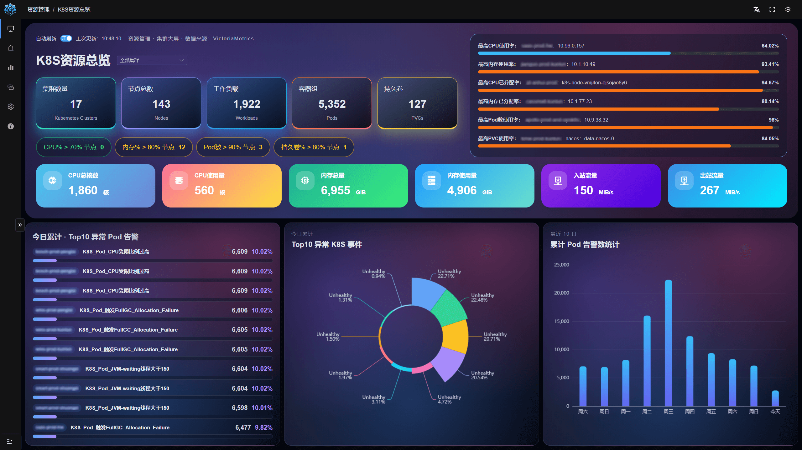
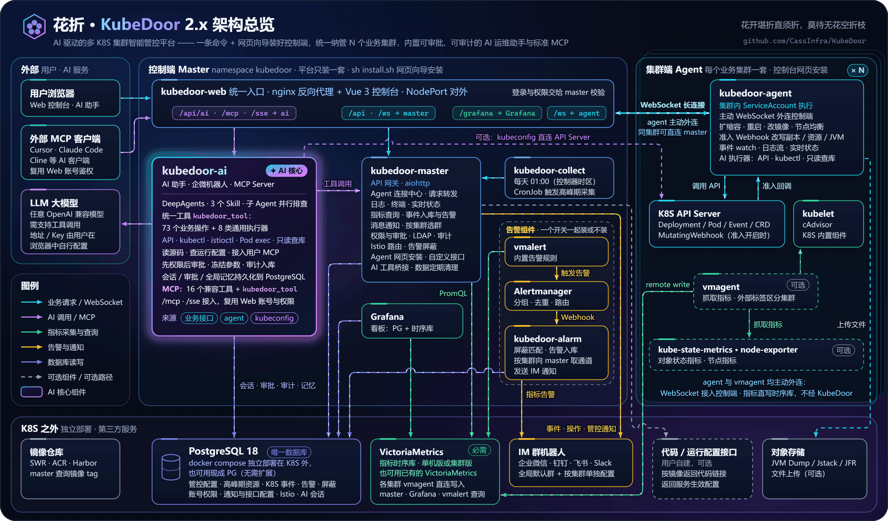
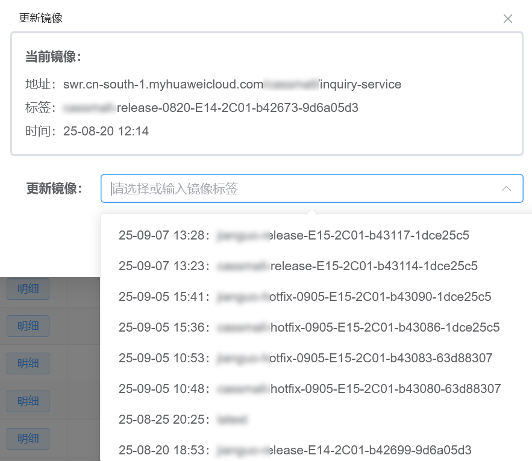

<div align="center">

简体中文 | [English](README.EN.md)

[](https://starsl.cn)
[](https://cassinfra.github.io/KubeDoor/)
[](https://github.com/CassInfra/KubeDoor/commits/main)
[](https://github.com/CassInfra/KubeDoor/issues)
[](https://www.python.org)
[](https://vuejs.org)
[](https://www.postgresql.org)
[](https://kubernetes.io)
[](LICENSE.txt)


# 花折 - KubeDoor

花开堪折直须折🌻莫待无花空折枝

**AI 驱动的多 K8S 集群智能管控平台**

[官网](https://cassinfra.github.io/KubeDoor/) · [快速部署](#快速部署) · [文档](#文档) · [交流群](#kubedoor交流群与赞赏)

</div>

---
**国内用户如果访问图片异常，可以访问Gitee同步站：<a target="_blank" href="https://gitee.com/starsl/KubeDoor">https://gitee.com/starsl/KubeDoor</a>**

## 🏷目录
* [🌈概述](#概述)
* [🎉2.x新特性](#2x新特性)
* [💠架构](#架构)
* [💎功能](#功能)
  * [🤖AI助手、企微机器人与MCP](#1-ai助手企微机器人与mcp)
  * [🧩获取代码与运行配置](#2-获取代码与运行配置)
  * [🌐Istio VirtualService管理](#3-istio-virtualservice管理)
  * [🧭CoreDNS管理](#4-coredns管理)
  * [🎛K8S资源管理](#5-k8s资源管理)
  * [📡多集群监控](#6-多集群监控)
  * [🧬告警、事件与通知](#7-告警事件与通知)
  * [🚧高峰期资源与准入管控](#8-高峰期资源与准入管控)
  * [☕JVM管控与诊断](#9-jvm管控与诊断)
  * [⚖节点均衡与弹性调度](#10-节点均衡与弹性调度)
  * [🔐平台、权限与界面配置](#11-平台权限与界面配置)
* [🚀快速部署](#快速部署)
* [♻升级说明](#升级说明)
* [📚文档](#文档)
* [🔔交流群与赞赏](#kubedoor交流群与赞赏)
* [🙇贡献者](#贡献者)
* [🥰鸣谢](#鸣谢)

---

## 🌈概述

🌼**花折 - KubeDoor** 是一个使用Python + Vue开发的**AI驱动的多K8S集群智能管控平台**：**一条命令启动网页向导**就能装好控制端，每个业务集群在网页上传kubeconfig即可接入；在一个Web里完成多集群的监控、资源管理、告警与事件、Istio路由、CoreDNS解析、高峰期资源治理和JVM管控；内置**可审批、可审计的AI运维助手**，网页和**企业微信**里都能直接对话，能读服务源码、查运行配置，并以**标准MCP**对外开放。

KubeDoor专注微服务每日高峰时段的资源视角：采集各微服务高峰期的真实资源用量，基于K8S准入控制让资源需求值与真实用量保持一致。2.x在此基础上把AI助手作为核心能力，把数据库统一为PostgreSQL，并把部署简化为一条命令加网页向导。

- 🚀**一条命令，网页装好**：执行`sh install.sh`启动网页向导，填好数据库、时序库和管理员密码，控制端各服务一起自动部署、逐项检查就绪，还能顺手在本集群装好Agent；其他集群在网页上传kubeconfig安装。执行机器只需`sh`和`kubectl`，不用Helm，也不用改配置文件。
- 🤖**AI运维助手**：用自然语言排障、查询和变更，自动调用73个KubeDoor业务操作与K8S API、kubectl、istioctl等工具；能下载服务源码定位问题，获取运行配置并只读查询MySQL、Redis、Elasticsearch，还能接入你自己的MCP服务；查询自动执行，变更先展示参数与差异，按配置人工批准后才执行。
- 🧩**获取代码与运行配置**：对接自己的接口，在Deployment、Pod菜单里一键打开当前镜像对应的代码页面、源码下载和最近Commit，或查看服务实际运行的配置（配置中心、环境变量、配置文件合并后的生效值）；AI助手也用它们读代码、查配置。
- 💬**企微智能机器人**：在企业微信里单聊机器人就能让AI助手排障和运维，变更点审批卡片或直接回复「批准」；成员绑定花折账号（未绑定的成员可统一设置默认权限），按账号权限实时校验。
- 🌐**Istio VirtualService管理**：把一个项目在多个集群里的VirtualService收拢成一份组标准，hosts和域名按集群维护；对比各集群差异、一键纳管，预览差异后再下发；改集群前自动备份、可一键回退，同集群的域名冲突自动检查。
- 🧭**CoreDNS管理**：像改表格一样维护集群的自定义解析，只重写改动的行；保存前看差异，保存后从集群内确认解析已生效。
- 🎯**高峰期资源治理**：按业务高峰时段采集资源数据，通过准入控制统一管控副本数、需求值、限制值和JVM启动参数。
- 🛰**多集群统一纳管**：agent主动外连控制端，业务集群无需开放入站端口；所有集群的资源、指标、事件和告警集中在一个平台。
- 🔔**告警与通知**：指标告警、K8S事件告警与告警屏蔽，通知推送到企业微信、钉钉、飞书、Slack；在「消息通知」页面配置，可按集群发到不同的群。
- 🔐**账号、权限与审批**：本地账号 + LDAP登录，按K8S集群授权「管理员 / 读写 / 只读 / 无」；「权限与审批」按27类操作配置每级权限能做什么、AI做哪些操作要人工批准；登录、变更与越权操作全部留痕审计。
- 🖥**界面配置**：通用配置（时序库、访问地址、对象存储、数据保留、登录安全等）、事件告警规则、通知、权限与审批、LDAP、企微机器人、镜像仓库、代码与运行配置接口都在「系统管理」里配置，保存即生效，敏感值加密保存，不用改配置文件或重启服务。

<div align="center">



K8S资源总览：多集群资源、风险节点、今日异常告警与事件，一屏尽览

</div>

---

## 🎉2.x新特性

**相对1.7，2.x是一次架构级升级：AI助手成为核心能力，PostgreSQL成为唯一数据库，部署改为一条命令加网页向导。** 下面按版本倒序列出主要变化，详细说明见[功能](#功能)。

**🚀2.6：一键安装与网页向导、获取代码与运行配置、AI读代码查配置、权限与审批**
- 🚀**一条命令 + 网页安装向导**：单独下载`deploy/install.sh`，在能用`kubectl`的机器上执行`sh install.sh`，打开打印的地址进入六步向导（环境检查 → PostgreSQL → 时序库 → 基础设置 → 自动安装 → 本集群Agent）。数据库不存在时自动创建，时序库读写地址自动生成，访问地址自动获取；控制端各服务一起部署，每个服务单独显示状态、耗时和失败原因，全部检查通过才报成功，完成后自动停用安装服务、撤销临时权限。不再需要Helm、Python或编辑`kubedoor.conf`。
- 🛰**网页安装Agent**：在「Agent管理」上传kubeconfig、确认集群标识，即可安装Agent和指标采集组件，逐步显示进度并验证上线和指标；每个集群使用独立的Agent账号，vmagent直连时序库；Agent上线后自动配置该集群的「AI Kubeconfig」。
- 🧩**获取代码与运行配置**：系统管理员在「获取代码接口」「获取运行配置接口」页面填写自己的接口地址和请求头；Deployment、Pod菜单里一键打开当前镜像的代码页面、源码下载和最近Commit，或查看服务实际运行的配置。
- 🤖**AI助手增强**：下载当前版本的源码，用ripgrep搜索、ctags找定义，从报错堆栈定位到代码行；获取运行配置（密码换成占位符，模型看不到明文）并只读查询MySQL、Redis、Elasticsearch；「MCP 管理」接入自己的MCP服务；通用操作改为Agent优先执行；企微里直接回复「批准」「拒绝」也能审批。
- 🔐**权限与审批**：系统管理员按27类操作勾选只读 / 读写 / 管理员能不能做、AI做之前要不要人工批准；AI在Pod内执行的命令按查看 / 其他 / 高危分类，rm、kill等高危命令固定审批；网页、AI助手、企微机器人和外部MCP共用一张表。
- 🔔**消息通知页面**：通知不再写在环境变量里，在「系统管理 → 消息通知」配置全局默认群，也可按集群发到不同的群，可发测试消息；运维操作通知改由master统一发送，agent断线时暂存、重连后补发。
- 🌐**Istio VirtualService**：改集群前自动备份，可一键回退；检查同一集群里的域名冲突，下发预览拦下这次新带来的冲突；对比时左右逐行对照，可把集群现状的规则同步到组标准；矩阵可按规则内容全文搜索。
- 另有：兼容CA证书缺少密钥标识的老集群（如较早创建的华为云CCE，新版Python默认会拒绝连接）。

**✨2.3：AI助手增强、企微机器人、Istio VirtualService管理、CoreDNS管理**
- 🤖**AI助手增强**：长对话持续命中模型的前缀缓存，上下文按模型窗口自动压缩、对话框显示占用比例，新增「AI 用量看板📊」统计用量、缓存命中率和估算费用，DeepSeek思考强度可调；认得花折资源管控，受管控的服务扩缩容、调整资源和JVM走管控表，执行后回读核验；会话可搜索，最后一轮可重新生成或编辑后重发，告警、事件、Deployment和Pod菜单里一键「问AI」。
- 💬**企微智能机器人**：企业微信API模式机器人经长连接接入AI助手，无需公网回调地址；单聊流式回复，变更通过「批准 / 拒绝」卡片审批，成员绑定花折账号（未绑定的成员可统一设置默认权限），按账号实时校验集群权限。
- 🌐**Istio VirtualService管理（重构）**：按「Istio组」管理一个项目的VirtualService，组标准全组共用，hosts和规则里的域名条件按集群维护；刷新现状、对比、一键纳管，预览差异后下发，跨组冲突检测，未建模字段原样保留。
- 🧭**CoreDNS管理**：表格化维护hosts自定义解析，只重写改动的行；保存前展示差异、并发修改自动检测冲突，从集群内检查解析是否生效，另有解析测试、端口测试和Monaco「高级编辑」。
- 另有：准入控制对用kubectl等直接改副本数的修改也改回管控值（以前会放行到下次发布或重启）；Pod实时日志与agent连接更稳定（日志流独立连接池并限量，大集群列表不再卡住agent）；控制台「关于」页改为内嵌官网。

**🔐2.2：账号与权限**
- **LDAP登录 + K8S集群级权限**：全局权限「管理员 / 读写 / 只读 / 无」+ 按用户×集群单独授权，「无」权限的集群在所有页面、告警和AI助手中都不可见；登录与会话改由master统一管理，agent和Grafana也统一接入KubeDoor认证。
- **操作审计**：登录、账号与权限变更、所有写操作（含越权被拒）都可查询，默认保留180天。
- **Pod终端与节点终端**：网页终端进容器，或经临时特权Pod进宿主机。
- 另有：Agent批量更新与重启、滚动更新参数（maxSurge / maxUnavailable）管控、管控配置跨环境同步、水墨月洞门登录页。

**🤖2.1：AI助手**
- **内置AI助手**（kubedoor-ai，随控制端必装）：使用自己的模型，选定集群后用自然语言排障和运维；变更经审批后执行，支持全局记忆与kubeconfig直连。
- **新版MCP**：并入kubedoor-ai，经Web入口提供`/mcp`（Streamable HTTP）与`/sse`，复用Web账号与权限，写操作需在Web中批准；兼容1.x的16个工具名。
- 另有：Deployment实时状态、JVM启动参数管控与高峰期P95堆内存。

**🧱2.0：架构与部署**
- **PostgreSQL唯一数据库**：移除ClickHouse与MySQL，启动时自动建表、无需扩展，过期数据自动清理。
- **网页向导部署**：单独下载 `deploy/install.sh`，用 `sh` 或 `bash` 启动 Web 和安装服务；在网页填写数据库信息、自动安装并逐项检查服务状态，支持内网镜像仓库。
- 另有：告警屏蔽、节点均衡、华为云CCI弹性扩容、Deployment级聚合日志。

---

## 💠架构

**控制端用网页向导一次装好，每个业务集群装一个agent；agent主动外连，数据统一存进PostgreSQL（指标在时序库）。**

<div align="center">

</div>

- **控制端**（网页向导自动部署）：kubedoor-web（nginx统一入口 + Vue 3控制台）、kubedoor-master（API网关、agent连接中心、消息通知）、kubedoor-ai（AI助手、企微机器人与MCP Server）、kubedoor-collect（每日高峰期采集CronJob）和Grafana看板，以及一个开关一起装或不装的告警组件（vmalert、Alertmanager、kubedoor-alarm）。安装用的kubedoor-setup是临时服务，装完自动停用。
- **集群端**（「Agent管理」网页安装，控制端所在集群也可在安装向导最后一步一起装）：kubedoor-agent，以及可选的vmagent、kube-state-metrics、node-exporter。agent**主动**通过WebSocket连接控制端，业务集群无需开放入站端口；同集群直连master的Service，跨集群经Web入口，网页安装为每个集群生成独立的Agent账号；vmagent直接远程写入时序库。
- **PostgreSQL 18是唯一数据库**：用docker compose独立部署在K8S外，也可用现成的PG（无需扩展和超级用户，库不存在时安装向导自动创建）。
- **时序库独立部署**：VictoriaMetrics单机版（`deploy/victoria-metrics/`的Docker Compose）或集群版，也可接入已有的；各集群指标用标签`<PROM_K8S_TAG_KEY>=<集群名>`区分。
- **统一入口**：Web、Grafana、AI助手和MCP共用kubedoor-web的一个NodePort，登录与权限由master统一管理。

---

## 💎功能

**覆盖K8S日常运维的完整链路；其中的查询与运维操作，大多也可以直接交给AI助手完成。** 下文【2.x】表示首次提供该能力的版本。

### 1. 🤖AI助手、企微机器人与MCP

**点击顶栏正中的「AI 助手」，选定集群后用一句话描述问题：查询自动执行，变更默认先审批再执行，全程可追溯。** 同一套工具、权限与审批也开放给企业微信机器人，以及Cursor、Claude Code等外部MCP客户端。

- 🧠**自带模型**：在「模型设置」填写Base URL、API Key和模型名，「测试连接」实测工具调用能力；支持任意OpenAI兼容的Chat Completions接口（含无需鉴权的自建模型），并专门适配DeepSeek思考模式（可调思考强度）；上下文窗口和压缩阈值按模型名自动预填，可按需修改；模型配置只保存在本人浏览器。
- 🎯**资源上下文**：先选「K8S 集群」（每轮只操作选中的集群），可再细化到命名空间、Deployment、Pod。
- 🧰**统一受控工具**：所有集群操作都经同一个工具`kubedoor_tool`，覆盖**73个KubeDoor业务操作**（44个只读、29个写入）和**8类通用执行器**（K8S API/CRD、kubectl、istioctl、诊断命令、Pod exec，以及只读查询MySQL、Redis、Elasticsearch），已有接口优先。
- 🛰**Agent优先，也可直连**：通用操作优先经在线Agent在业务集群里执行（master复核、Agent二次校验，免kubeconfig）；Agent离线或版本旧时改用该集群的kubeconfig直连——网页安装Agent时用Agent服务账号自动配置，也可由系统管理员在「Agent管理」上传（加密存储）；agent离线时仍可查询历史与监控数据。
- 🔍**读源码定位问题【2.6】**：按Deployment或Pod查当前镜像的代码页面、源码下载和最近Commit；管理员允许后，AI下载当前版本的源码，按日志里的异常用ripgrep搜索、ctags找定义、逐行阅读，指出出错的代码并给出修复建议。源码只在kubedoor-ai里解压缓存，模型拿不到也传不进下载地址。
- 🗄**运行配置与只读查库【2.6】**：管理员允许后，AI获取服务实际运行的配置，其中的密码、密钥换成占位符，模型看不到明文；排障时用配置里的连接信息只读查询MySQL、Redis、Elasticsearch，执行时由服务端填入真实密码、只连配置里写的地址，默认每次要提问人批准。
- 🔌**接入自己的MCP【2.6】**：对话框「MCP 管理」接入自己的SSE / Streamable HTTP MCP服务（地图、工单、知识库等），按账号隔离、加密保存；AI按需调用，只读工具自动执行，其余按设置审批。
- ⏰**立即/定时/周期运维**：Deployment重启与扩缩容支持立即、定时、按Cron周期执行；时序库为VictoriaMetrics时，AI还能直接写MetricsQL查询指标（限定在当前集群）。
- 📝**全局记忆**：会话可「总结为记忆」，保存为全局记忆后，所有登录用户提问时都能按需引入。
- 🛡**认得花折资源管控**：扩缩容、调整requests/limits和JVM参数前先识别该Deployment是否受准入控制管控：受管控走管控表（永久扩缩容写入管控副本数，也可临时扩缩），不受管控直接修改Deployment；审批卡片写明当前→目标和副作用，执行后回读核验；受管控时用kubectl等直接修改会被拦下，不再出现「返回成功、实际被改回」。
- 💬**对话体验**：会话按标题和内容搜索；最后一轮可「重新生成」或「编辑」后重发；告警、K8S事件、Deployment和Pod的操作菜单里一键「问AI」，自动带上集群、资源和告警原文。
- 🧩**DeepAgents驱动**：内置K8S运维、服务源码分析、运行配置与数据查询三个Skill，子Agent并行排查、上下文自动压缩（对话框头部显示上下文占用）；系统提示和历史保持稳定，长对话也能持续命中模型的前缀缓存；会话保存在服务端（仅本人可见），流式回复、断线续传，关闭对话框后任务继续执行。

#### 💬企业微信智能机器人

**【2.3】系统管理员在「系统管理 → 企微 AI 机器人」接入企业微信智能机器人后，成员在企业微信里单聊机器人，就能像在网页里一样查询、排障和发起变更。**

- 🔗**长连接接入**：填写企业微信API模式机器人的Bot ID和Secret，kubedoor-ai主动建立长连接，不需要公网回调地址，只要能出站访问企业微信；页面实时显示连接状态，断线自动重连。
- 🧠**专用模型**：机器人单独配置模型（Base URL、API Key、模型名），「测试模型」检查工具调用能力，不影响网页AI的模型配置；凭证加密存储（AES-256-GCM），不会回显。
- 👥**成员绑定与默认权限**：把企业微信UserID绑定到花折账号并指定默认集群，没绑定的成员发过一次消息就会出现在「待绑定」列表；也可以设置「未绑定成员默认权限」，让未绑定的成员统一按一个花折账号的权限使用（建议专门建一个，如只读账号；不能选系统管理员或集群管理员），并指定他们的默认集群，不设置则必须先绑定。绑定本身不授予任何权限，每条消息都按花折账号实时校验，账号停用或失去集群权限立即生效。
- 🎯**集群切换**：每轮只操作一个集群，回答末尾会注明；没切换过集群时用默认集群，默认集群为「无」时要先选集群才能提问。发送「集群」查看带序号的可访问集群，「切换集群 2」或「切换集群 名称」切换，提问里写出集群全名也会自动切过去。
- 🧹**对话边界**：企微只有一个聊天窗口，距上次对话超过2小时（可在配置页调整，0为关闭）的新消息自动进入新对话并提示；发送「新对话」重新开始（停止未完成的任务），发送「继续上次」回到上一个对话。每天首次进入单聊会收到欢迎卡片，可一键开始新对话或继续上次对话；上下文较大时回答末尾提示占用比例；审批过期的任务会自动停止，不再卡住后续提问。
- ✅**审批卡片**：回复流式输出；权限和审批规则与网页完全一样，需要审批的变更先冻结参数，再推送「批准 / 拒绝」卡片（卡片上方醒目标出集群），只有发起的成员本人能批准，也可以直接回复「批准」「拒绝」；过期即失效，批准后继续执行并回传结果。
- 🗂企微会话单独保存，不出现在网页AI的会话列表；首版只支持单聊文本消息。

📖详见：[企业微信智能机器人](src/kubedoor-ai/README.md#企业微信智能机器人)

#### 🛡安全护栏

| 护栏 | 说明 |
| --- | --- |
| 审批 | 先权限后审批：没有权限的操作直接拒绝，不进审批；有权限时按「系统管理 → 权限与审批」的审批列决定是否要人工批准（默认业务变更和kubectl / K8S API修改要批准，AI在Pod内执行的查看命令、其他命令和诊断工具不审批，高危命令如rm、kill固定审批）。需要批准的先展示准确参数、执行命令、变更预览或配置差异，30分钟内有效；勾选「自动批准执行」后需要审批的操作（含高危命令）自动批准（只对当前页面生效） |
| 参数冻结 | 准备阶段把完整参数写入数据库，批准后按原样执行，模型无法替换；kubeconfig被替换后原批准失效 |
| Dry-run | 通用K8S API写操作先以`dryRun=All`生成配置差异，并带resourceVersion/UID前置条件；`kubectl apply`先执行`--dry-run=server` |
| 不盲目重放 | 超时或断线的写操作标记为「执行结果不确定」，本轮不再继续写入；服务重启不会重发已派发的操作 |
| 脱敏 | 网页AI的API Key只在单次运行的内存中使用，不写库、不写日志（企微机器人的模型密钥加密存储）；流式输出、checkpoint、日志与记忆统一脱敏，Secret内容自动隐藏；运行配置里的密码、密钥换成占位符再交给模型，查库时由服务端换回原文，结果里出现的密码打码 |
| 只读查库 | MySQL只允许一条查询语句并在只读事务里执行，Redis按只读命令白名单，Elasticsearch按查询接口白名单，不合格的请求直接拒绝、不进审批；连接地址必须是该服务运行配置里写的地址，防止密码被发到别的主机 |
| 按集群和操作授权 | 每项操作按账号在所选集群的权限查「权限与审批」的操作权限表，网页AI、企微机器人和外部MCP规则完全一样（默认只读账号只能对话和查询）；「无」权限的集群在AI助手、企微机器人和MCP中都不可见；上传kubeconfig仅限系统管理员 |
| 审计 | 会话、运行、每次工具调用（含完整参数、预览与结果）写入PostgreSQL；外部MCP调用同样生成会话，可在Web中回看 |

> 提示：对集群只读的账号通过AI可执行的只读查询（如K8S API GET、查看日志与ConfigMap）比经典页面更宽，Secret脱敏为尽力而为，请按需分配账号；生产环境请在Web前加HTTPS。

#### 🔗接入外部MCP客户端

- **地址**：`http(s)://<KubeDoor 地址>/mcp`（Streamable HTTP，推荐），只支持SSE的客户端用`/sse`；`<KubeDoor 地址>`就是Web入口，如`<节点IP>:<Web NodePort>`。
- **鉴权**：复用Web账号（本地或LDAP），请求头`Authorization: Basic <base64(用户名:密码)>`，按该账号的集群权限和「权限与审批」执行，规则与网页AI一样。
- **工具**：保留1.x的16个工具名（如`get_k8s_list`、`get_pods_logs`、`scale_deployment`、`get_pod_jvm_dump`）+ 统一工具`kubedoor_tool` + Skill资源`skills://kubedoor-k8s`。
- **需要审批的操作不会直接执行**：按「权限与审批」需要批准的操作（默认包括写操作和需进入Pod执行的JVM诊断）会返回`pending`和`browserlink`（相对路径），用**同一账号**登录Web打开即可审批，批准后的执行结果不会回推给MCP客户端，请再次查询核验；不需要批准的操作直接执行并返回结果。
- **关闭外部入口**：旧配置式部署可在`kubedoor.conf`中设置`ENABLE_MCP="false"`，网页里的AI助手不受影响。

示例（Cursor的`mcp.json`写法，按接口推导；其它客户端的字段名以其文档为准）：

```json
{
  "mcpServers": {
    "kubedoor": {
      "url": "http://<KubeDoor 地址>/mcp",
      "headers": {
        "Authorization": "Basic <base64(用户名:密码)>"
      }
    }
  }
}
```

`<base64(用户名:密码)>`可用`printf '%s' '用户名:密码' | base64`生成，建议为MCP单独建一个账号。

<details close>
<summary>💬点击展开示例对话（示意：集群、服务名与数据均为虚构）</summary>

```text
上下文：K8S 集群 prod-a · 命名空间 demo · Deployment deploy-demo-order

你：这个服务最近频繁重启，结合日志、事件和监控帮我找原因。

AI 助手：
  工具调用 5（只读查询，自动执行）
    ✓ pods                 Pod 列表与重启次数
    ✓ previous_logs        上次退出的容器日志
    ✓ events               相关 K8S 事件
    ✓ resource_inventory   管控表中的限制值与 JVM 参数
    ✓ metrics              近 6 小时内存曲线
  结论：容器内存持续贴近限制值，上次退出原因为 OOMKilled。
  建议：把内存限制调到 1024MB，并在低峰期滚动重启。需要我提交调整吗？

你：可以，内存限制调到 1024MB，今晚 23:30 重启一次。

AI 助手：
  1 项待批准  resource_config_update
    准确参数：limit_mem_mb=1024（其余字段保持当前值）   [拒绝] [批准这次操作]
  …… 批准后 ……
  1 项待批准  schedule_deployment_restart
    准确参数：run_at=<今天>T23:30                      [拒绝] [批准这次操作]
  …… 批准后 ……
  管控配置已保存（下次发布或重启时生效）；单次重启任务已注册，到点执行。
```

其中`metrics`自由查询需要时序库为VictoriaMetrics。

</details>

📖详见：[AI助手使用说明](docs/ai-assistant.md)

---

### 2. 🧩获取代码与运行配置

**【2.6】对接你自己的接口，在Deployment、Pod的操作菜单里一键查看当前镜像对应的代码，或获取服务实际运行的配置；AI助手也用它们读代码、查配置排障。** KubeDoor只约定请求和返回的格式，代码托管在哪、配置从哪里取由你的接口决定（例如按镜像tag找到对应的Git提交，从配置中心、环境变量和配置文件合并出生效配置）。

- 🔗**获取代码**：系统管理员在「系统管理 → 获取代码接口」填写接口地址和请求头（如鉴权token，加密保存、只回显名称），测试通过后保存。在Deployment页的操作菜单点「获取代码」，KubeDoor把`{k8s, namespace, deployment, image}`POST给接口，接口返回代码页面、源码下载、最近Commit三个链接，在弹窗里点开即可；集群只读及以上的账号可用。
- ⚙**获取运行配置**：在「系统管理 → 获取运行配置接口」同样配置。Deployment页、Deployment明细里的Pod和Pod页的「获取运行配置」把`{k8s, namespace, deployment|pod}`发给接口，返回的JSON在只读编辑器里按层级折叠展示，可一键复制；接口准备得慢时可以先返回202，KubeDoor按`Retry-After`自动重试，直到配置的超时。需要「查看运行配置」权限（默认读写及以上）。
- 🤖**交给AI**：在同一页面打开「允许 AI 下载并分析源码」「允许 AI 获取运行配置」（默认都关闭）后，AI助手能下载当前版本的源码，按日志里的异常搜索、阅读代码定位问题；也能获取运行配置（密码换成占位符），再只读查询其中的MySQL、Redis、Elasticsearch。
- 🛡**安全**：链接只接受http(s)地址；调用带超时、不跟随重定向、限制响应大小；每次获取都记入操作审计（运行配置只记谁在什么时候取了哪个服务，不记配置内容）。完整的接口约定写在两个配置页上。

📖详见：[服务源码查询与分析](docs/ai-assistant.md#服务源码查询与分析) · [运行配置与数据查询](docs/ai-assistant.md#运行配置与数据查询)

---

### 3. 🌐Istio VirtualService管理

**【2.3】按「Istio组」统一维护一个项目在多个集群里的VirtualService：花折保存一份组标准（规则、默认路由、gateways全组共用），hosts和规则里的域名条件按集群各自维护，对比、纳管、预览后下发。**

适合同一套服务部署在测试集群和多个生产集群（多机房）的场景：各集群的VirtualService规则基本相同、只有域名不同，过去逐个集群`kubectl apply`，时间一长就对不上；现在改一处、按集群下发，哪个集群漂移了一眼可见。

- 🗺**组与矩阵**：一个组 = 共用的测试集群 + 本项目的生产集群，一个集群可以加入多个组；矩阵视图一屏看到每个VirtualService在各集群的hosts和状态（一致 / 待下发 / 不一致 / 集群中没有 / 缺少域名），每个VirtualService自己选择部署到哪些集群；搜索框可按名称、hosts和规则内容全文搜索。
- 📥**刷新现状与纳管**：并行采集各集群的VirtualService（只读快照）；规则按匹配条件对齐、YAML逐行对比各集群差异，一致的一键纳管（只差hosts和域名的也算一致），不一致的选基准集群纳管后再下发拉齐。
- ✏**可视化编辑**：新建VirtualService，新增/编辑HTTP规则（匹配条件、URI重写、转发目标与权重或下级VirtualService、超时、优先级），一键「整理优先级」；按域名区分的条件（authority、headers.host）按集群各存一份，可按关键字一次在各集群里选域名，或从其它集群复制并替换机房标识（如penglai→kunlun）。
- 🚀**预览后下发**：下发前从集群取最新现状，逐项展示「集群现状 → 将要下发」的差异，勾选了生产集群会额外提醒；矩阵格子上能看到最近一次的下发人和时间。
- 🧯**备份与回退【2.6】**：改集群里的VirtualService之前（下发、回退、删除）都先从集群取最新内容备份，每个保留最近5份；详情页每个集群可「回退」到其中一份（回退前也会备份，能撤销），只改集群、不改组标准，记入审计。
- 🚦**域名冲突检查【2.6】**：同一集群里绑定同一个gateway的VirtualService的hosts不能重复；同一个VirtualService里被前面规则挡住、永远不会生效的规则也会标出。矩阵和详情页实时显示，下发预览拦下这次新带来的冲突，原来就有的只提示。
- 🔁**同步到组标准【2.6】**：对比时左右逐行对照（不同的行标红、行内差异加深），可以把集群现状里的规则挑着加入、替换、删除或调整顺序后保存到组标准；保存时核对两边版本，防止覆盖别人刚做的修改。
- 🧩**范围与冲突**：同一个VirtualService只能属于一个组，组用包含 / 忽略规则（通配符或正则）划定范围，单个VirtualService也可以手动忽略或单独纳入；和共用集群的其他组冲突的整行标红，不能纳管和下发。
- 🔎**查看与删除**：实时查看集群里VirtualService的完整对象（同`kubectl get -o yaml`），或直接从集群删除（二次确认，删除前自动备份并记入审计）。
- 🛡**无损与权限**：未建模的字段（retries、corsPolicy、redirect、fault等）原样保留，下发不丢配置；查看按集群读权限过滤，修改要该集群的「Istio 修改」权限（默认只有管理员），组级修改（组、组标准、规则、hosts）要求组内每个集群都有。
- 🚸委托（delegate）VirtualService的管理页面仍在开发中。

📖详见：[Istio VirtualService管理说明](src/kubedoor-master/istio_route/README.md)（模型、状态判断与典型流程）

---

### 4. 🧭CoreDNS管理

**【2.3】在「资源管理 → CoreDNS管理」维护集群CoreDNS的自定义解析（`kube-system/coredns`里hosts插件的记录）：像改表格一样增删改，保存前看差异，保存后从集群内确认解析已生效，不用再`kubectl edit`手改Corefile。**

- 📋**表格化编辑**：hosts记录拆成「IP / 域名 / 备注」表格，可搜索，可按启用 / 停用 / 注释 / 未保存筛选；「启用」开关等于在行首加`#`注释掉（不删除，随时可再启用），整行注释可以当分组标题；任意位置插入、复制、删除，改过的行标黄、新增的标绿。
- 🧷**只改该改的行**：只重写改动的行并按已有列对齐，其余内容（注释、空行、其他插件）原样保留；实时校验IP、域名格式和记录位置（必须在fallthrough之前），有多个server块时可切换。
- 🔍**保存前确认，不覆盖别人的修改**：逐行「保存」或「全部保存」，保存和删除前都先展示改动；保存带resourceVersion乐观锁，打开后被别人（kubectl或其他页面）改过会提示冲突，「加载最新」后尽量保留未保存的修改。
- ✅**生效检查**：每条记录可「检查」，从kubedoor-agent所在Pod每秒解析一次，直到解析到期望的IP（停用的记录则是不再解析到），并显示等了多久；Corefile没开reload插件时提醒需要重启CoreDNS。
- 🛠**网络测试**：「解析测试」走agent所在Pod的`/etc/resolv.conf`（和进业务Pod执行ping一样，会补search域）；「端口测试」相当于在集群内执行`nc -zv`，需要「端口测试」权限（默认读写及以上）。
- 📝**高级编辑**：Monaco编辑器直接编辑ConfigMap里的全部文件（Corefile、`*.server`、hosts等按类型语法高亮），Ctrl+S保存、Ctrl+/切换注释；保存前校验Corefile并展示差异。
- 🔐只读账号可以查看、检查和解析测试，修改需要该集群的「CoreDNS 修改」权限（默认只有管理员；在ConfigMap页面编辑YAML或让AI修改`kube-system/coredns`同样要），每次保存都记入操作审计；需要新版agent（旧版会提示先升级）。

---

### 5. 🎛K8S资源管理

**在一个控制台里管理所有集群的Deployment、Pod、Service、Ingress、ConfigMap、StatefulSet、DaemonSet和节点，常用运维动作一键完成。**

- 🗂**统一资源页**：查看、用Monaco编辑YAML（Create / Apply / Replace）与删除；Deployment的就绪副本、滚动更新状态和Pod明细由WebSocket实时刷新【2.1】；Deployment、Pod的操作菜单里还有「获取代码」「获取运行配置」【2.6】和「问AI」。
- 💻**Pod终端与节点终端【2.2】**：在新标签页打开网页终端；Pod终端自动选择bash / ash / sh，节点终端由agent起临时特权Pod，`nsenter`进宿主机，退出后自动清理；需要「网页 Pod 终端」/「网页节点终端」权限（默认读写及以上），会话记入审计。
- 📜**日志查看器**：实时跟随、关键字搜索与定位、日志级别着色、「重启前日志」；Deployment可聚合查看全部Pod的日志，完整日志可gzip下载。
- 🔁**扩缩容与重启**：立即、定时、按周期执行，可选「临时扩容」「调度到指定节点」。
- 🏷**镜像更新**：自动列出镜像仓库最近20个标签（阿里云ACR、华为云SWR、Harbor），只读账号可按集群、时间段、账号白名单授权，进度推送IM。规则和仓库凭据在「系统管理 → 镜像管理」维护，保存到数据库后立即生效。
- 🧪**Pod隔离**：把Pod的`app`标签改为`<原值>-ALERT`，脱离Service流量、保留现场排查，可同时临时扩容1个Pod。

<details close>
<summary>🔍点击展开截图 ...</summary>

||
|-|

</details>

📖详见：[K8S微服务镜像更新配置说明](help/K8S微服务镜像更新配置说明.md)

---

### 6. 📡多集群监控

**各集群的vmagent把指标远程写入同一个时序库，靠一个标签区分集群——在一个Web里看全部集群。**

- 🖥**K8S资源总览**：在全部集群与单集群之间切换，展示资源数量、风险节点、最高使用率/分配率，以及今日Top10异常Pod告警、Top10异常K8S事件和近10日告警趋势。
- 🌊**统一时序库**：VictoriaMetrics单机版或集群版，可用`deploy/victoria-metrics`的Docker Compose单独部署，也可接入已有的（旧配置式部署还支持Prometheus）；各集群的vmagent直接远程写入，集群里已有的kube-state-metrics、node-exporter可以直接复用。
- 📊**Grafana看板**：「K8S监控看板📊」「节点监控看板📊」「高峰资源看板📊」内嵌在Web中，随安装自动导入；系统管理员另有「系统管理 → AI 用量看板📊」，统计AI助手的用量、缓存命中率、上下文占用和估算费用。

<details close>
<summary>🔍点击展开截图 ...</summary>

||
|-|

</details>

---

### 7. 🧬告警、事件与通知

**指标告警、K8S事件告警和运维操作通知统一推送到企业微信、钉钉、飞书、Slack，在「消息通知」页面配置、可按集群发到不同的群；告警屏蔽只拦通知、不丢数据。**

- 🚨**指标告警**：内置44条vmalert告警规则（Pod、Deployment、节点、JVM等），经Alertmanager由kubedoor-alarm推送IM，Pod类告警同时入库，故障/恢复通知标注持续时长；告警组件（vmalert、Alertmanager、kubedoor-alarm）在安装时一个开关一起装或不装。
- 📋**告警分析**：「告警面板」按告警名按日聚合；「K8S告警详情」支持多条件筛选，可直接对Pod执行隔离、删除、Dump、Jstack、JFR，或一键「屏蔽」。
- 🔕**告警屏蔽【2.0】**：Alertmanager风格条件（`=`、`!=`、`=~`、`!~`），命中预览、到期自动失效；IM通知里的【屏蔽】链接直达屏蔽页并预填条件。被屏蔽的告警照常入库，只拦截通知。
- 📺**K8S事件中心**：各集群的全部K8S事件写入PostgreSQL，可按集群、命名空间、Kind、原因、消息等检索；在「系统管理 → 事件告警规则」配置事件告警（界面 / JSON 两种模式，可用最近的真实事件试运行，保存即生效；内置重启、健康检查失败、调度失败、资源压力等规则），去重窗口内同一事件不重复通知。
- 🔔**消息通知【2.6】**：在「系统管理 → 消息通知」配置IM类型、机器人地址和默认@人（token加密保存，页面只显示最后4位），保存后立即生效，可发送测试消息；可为单个集群单独配置群，没单独配置的集群用全局配置；页面上的说明表写清四类通知（K8S事件告警、管控表通知、运维操作通知、指标告警）分别由谁发、什么时候发。安装向导第4步也可以先填好。
- 📮**运维通知**：隔离、扩缩容、重启、改镜像、准入结果等由agent产生，交给master按集群选群发送，业务集群不再保存机器人token；agent与master断线时暂存，重连后补发并标注延迟。外部系统可通过`POST /api/custom_alert`写入告警（需安装告警组件）。

<details close>
<summary>🔍点击展开截图 ...</summary>

|||
| ------------------------------------| ----------------------------------- |

</details>

📖详见：[告警屏蔽](docs/alert-silence.md) · [K8S事件告警规则配置说明](help/K8S事件告警规则配置说明.md)

---

### 8. 🚧高峰期资源与准入管控

**采集每个微服务每日业务高峰时段的真实资源用量，再通过K8S准入控制让需求值与高峰期真实用量保持一致——调度更准确，资源碎片更少。**

- 📊**高峰期采集**：在「Agent管理」开启「自动采集」并设置「高峰时段」，每天北京时间01:00采集前一天的高峰数据，也可补采1~90天；CPU、内存取高峰时段P80，堆内存与G1 Eden使用率取P95，管控表采用最近10天里集群CPU总消耗最大那一天的数据。
- 🗂**高峰资源管控**：集中查看和配置副本数、需求值、限制值、JVM参数与滚动更新参数（maxSurge / maxUnavailable）【2.2】，支持批量扩缩容、批量重启，配置可「同步到」其他K8S环境【2.2】；「高峰资源看板📊」看长期趋势与TOP10。
- 🚧**准入控制**：开启后agent自动创建MutatingWebhook，Deployment创建、发布和扩缩容时按管控值改写副本数、第一个容器的requests/limits与JVM参数；管控表里没有的新服务可选择拒绝并通知或直接放行；用kubectl等直接改副本数同样改回管控值，只有「临时扩容」放行。

> ⚠️ 准入控制默认关闭，开启后为**fail-closed**：agent或master不可用时，所有未打`kubedoor-ignore`标签的命名空间里的Deployment创建、发布和扩缩容都会被拒绝，应急可执行`kubectl delete mutatingwebhookconfiguration kubedoor-admis-configuration`。

<details close>
<summary>🔍点击展开截图 ...</summary>

高峰资源看板（Grafana）：高峰时段全局资源统计与各资源TOP10、命名空间/微服务/Pod级高峰资源分析与资源曲线。

|||
|-|-|
|||

</details>

📖详见：[K8S资源管控功能说明](help/K8S资源管控功能说明.md)

---

### 9. ☕JVM管控与诊断

**Java微服务的启动参数、高峰期堆内存使用率和一键诊断，都在KubeDoor里完成。**

- 🩺**一键诊断**：在Deployment、Pod、K8S告警详情页对Pod执行「Dump」「Jstack」「JFR」「JVM」，结果弹窗展示并推送IM，文件上传到对象存储（上传地址在「系统管理 → 通用配置」配置）。
- 🧩**启动参数管控【2.1】**：采集并管控`-Xms`、`-Xmx`、`-Xss`、`-XX:MaxMetaspaceSize`，发布或重启时由准入控制替换为管控值；每日高峰P95堆内存与G1 Eden使用率辅助调参。
- 🚨**JVM告警**：内置14条JVM告警规则，vmagent自动抓取带`prometheus.io/jvm: "true"`注解的Pod。

<details close>
<summary>🔍点击展开截图 ...</summary>

||
|-|

</details>

📖详见：[JVM参数管控](docs/jvm-resource-control.md)

---

### 10. ⚖节点均衡与弹性调度

**按节点实时CPU负载生成迁移计划，人工确认后分批迁移；扩容时还能把Pod调度到指定节点或华为云CCI。**

- ⚖**节点均衡【2.0】**：「分析负载」按节点CPU使用率生成「迁移计划」，确认后分批隔离式迁移（新Pod就绪后才进行下一批，旧Pod确认无误再清理），阈值、黑名单、排除命名空间/节点等可配置。仅支持手动执行，执行期间会临时禁止调度（cordon）其它节点，依赖metrics-server，建议在低峰期操作。
- 🎯**指定节点与CCI**：扩缩容、重启、隔离时按CPU、内存、Pod数排行挑选目标节点；华为云CCE集群「临时扩容」时可把超出部分弹到CCI【2.0】。
- 💻**节点管理**：查看节点用量与可分配量，批量禁止/允许调度，打开节点终端。

📖详见：[节点均衡算法与参数](src/kubedoor-agent/load_balance/README.md)（开发者文档；其中的定时检测、自动执行等配置项目前未实现，只能手动执行）

---

### 11. 🔐平台、权限与界面配置

**一个入口、按集群和操作授权、配置都在界面里：Web、Grafana、AI助手和MCP共用一个NodePort，登录、权限和各项设置由KubeDoor自己管理。**

- 🚪**统一入口**：kubedoor-web的nginx只做反向代理，登录、会话和权限校验都在master；AI助手、MCP、Grafana（`/grafana/`）通过nginx `auth_request`交给master判定。
- 👥**账号与权限【2.2】**：本地账号 + LDAP（Web上配置并可一键测试，首次登录自动开通）；全局角色「系统管理员 / 集群管理员 / 读写 / 只读（默认） / 无」，再按用户×K8S集群单独授权「管理员 / 读写 / 只读 / 无」，单独授权优先；「无」权限的集群在所有页面、告警和AI中都不可见。系统管理员另外能管理用户、LDAP、企微机器人、Agent、权限与审批和各项系统配置，集群管理员只管集群。内置超级管理员`kubedoor`不能被删除或改权限。
- 🧩**权限与审批【2.6】**：在「系统管理 → 权限与审批」按27类操作（重启、扩缩容、删除Pod、编辑YAML、查看Secret、查看运行配置、CoreDNS修改、Istio修改、网页终端、AI在Pod内执行命令、AI查询数据库等）勾选只读 / 读写 / 管理员能不能做，以及AI做这类操作前要不要人工批准；另可维护AI在Pod内执行时用的查看命令、高危命令清单（高危命令固定审批）。网页、AI助手、企微机器人和外部MCP共用这一张表；默认与以往一致，只有CoreDNS、Istio的修改改为只有管理员。
- 🖥**界面配置【2.6】**：「系统管理」集中了通用配置、用户与权限、权限与审批、LDAP设置、镜像管理、企微AI机器人、获取代码接口、获取运行配置接口、消息通知、事件告警规则、AI用量看板和操作审计；这些配置存进数据库，保存即生效、不用重启，token、请求头等敏感值加密保存，只显示是否已配置。
- 🧾**操作审计【2.2】**：登录、账号与权限变更、所有写操作（含越权被拒）都可在「系统管理 → 操作审计」查询。
- 🛰**Agent管理**：「安装 Agent」上传kubeconfig即可在网页安装【2.6】（时序库写入地址、对象存储用通用配置，可顺带填这个集群的通知群）；agent首次连接自动登记，查看在线状态、心跳和版本；单个或勾选批量更新镜像、重启【2.2】，集中配置采集、准入控制与「AI Kubeconfig」（网页安装时自动配置）。
- 🧹**数据自动清理**：K8S事件保留90天，告警记录与高峰快照保留365天，可在`kubedoor-config`中调整（`0`表示不清理）。
- 🌗**界面**：水墨月洞门登录页【2.2】，简体中文/English（部分页面翻译）、浅色/深色/自动主题，适配移动端。

📖详见：[部署指南](deploy/README.md)、[账号与权限](tools/legacy-install/README.md#账号与权限)

<details close>
<summary>🔍点击展开截图 ...</summary>

||
|-|

</details>

---

## 🚀快速部署

**一条命令启动网页向导，在浏览器里点完六步就装好控制端；各集群的Agent也在网页上传kubeconfig安装。** 不用Helm，不用编辑配置文件，执行机器只需要`sh`和`kubectl`；没有kubectl也能用脚本生成YAML部署。完整说明见[部署指南](deploy/README.md)。

#### 前置条件

| 项目 | 要求 |
| --- | --- |
| 执行机器 | 只需`sh`（或`bash`）和能连上目标集群的`kubectl`，不需要Python、jq或完整源码；没有kubectl时用脚本生成YAML再部署（见第②步） |
| Kubernetes | ≥ 1.21；每日采集与定时/周期任务按北京时间执行（`timeZone: Asia/Shanghai`），需要≥ 1.25，更老的集群按kube-controller-manager的时区执行 |
| metrics-server | 需要：Pod/节点的CPU与内存用量、节点均衡都依赖它 |
| PostgreSQL | 现成的PostgreSQL（建议14+，无需扩展和超级用户；库不存在时向导用该账号自动创建），或用`deploy/postgres`的Docker Compose单独起一个PostgreSQL 18 |
| 时序库 | VictoriaMetrics单机版或集群版：可用`deploy/victoria-metrics`的Docker Compose单独部署，也可用已有的。Deployment列表、K8S资源总览和高峰期采集都依赖时序库，没有监控数据时页面为空、也采集不到数据 |
| CPU架构 | 官方镜像仅提供amd64 |
| 网络 | 数据库和时序库要能从K8S Pod访问；各业务集群的vmagent直连时序库写入，跨集群的Agent经KubeDoor的Web入口连接控制端；网页安装其他集群的Agent时，控制端要能访问目标集群的API Server |

#### 安装步骤

**① 准备数据库和时序库**（已有可跳过）

已有PostgreSQL和VictoriaMetrics时直接用。没有时，在K8S节点能访问到的机器上用Docker Compose各起一个：

```bash
git clone https://github.com/CassInfra/KubeDoor.git
cd KubeDoor/deploy/postgres
cp .env.example .env && vi .env      # 至少改掉 PG_PASSWORD
docker compose up -d

cd ../victoria-metrics
cp .env.example .env && vi .env      # 至少改掉 VM_PASSWORD
docker compose up -d
```

不用手动建表，master与kubedoor-ai启动时会自动建好。默认镜像只有amd64，海外或ARM机器可在`.env`里改用官方镜像（如`PG_IMAGE=postgres:18-alpine`），详见[VictoriaMetrics部署说明](deploy/victoria-metrics/README.md)。

**② 一条命令启动安装向导**

把[install.sh](deploy/install.sh)单独复制到能用`kubectl`连上集群的机器执行：

```sh
sh install.sh        # 也支持 bash install.sh
```

脚本在`kubedoor`命名空间启动Web和临时安装服务，最后打印「Web 入口」地址和一次性安装密钥。镜像仓库和版本写在脚本顶部，内网环境可用`--image-repo`、`--tag`、`--image-pull-secret`覆盖，详见[网页安装说明](deploy/README.md#网页向导安装推荐)。

**没有kubectl？用脚本生成YAML部署。** 导出不连接集群，任何有`sh`的机器都能执行（上面的镜像参数同样适用）：

```sh
sh install.sh --export kubedoor-install.yaml --nodeport 30080    # 固定Web端口，端口可换
```

把生成的`kubedoor-install.yaml`导入目标集群：K8S管理平台或云厂商控制台的「YAML创建」，或在其他能执行kubectl的机器上`kubectl apply -f`。等`kubedoor-setup`、`kubedoor-web`就绪后打开`http://<K8S节点IP>:30080`，安装密钥在Secret `kubedoor-setup-auth`的`SETUP_KEY`里，在管理平台查看即可。导出的文件只用于全新安装，详见[导出YAML后安装](deploy/README.md#导出-yaml-后安装)。

**③ 在网页里点完六步**

| 步骤 | 你要做的 | 向导自动完成的 |
| --- | --- | --- |
| 1. 环境检查 | 用安装密钥进入，核对安装位置 | 检测集群访问、部署权限、节点架构和已有安装 |
| 2. PostgreSQL | 填地址、库名和账号密码，「测试连接」后「继续」 | 真实检查连接、认证和建表权限；库不存在时自动创建 |
| 3. 时序数据库 | 选VictoriaMetrics单机版或集群版，地址只填主机名或IP | 生成远程读 / 写地址，查找带集群标签的数据 |
| 4. 基础设置 | 设置管理员`kubedoor`的密码；选择是否装告警组件；可选填写告警通知 | 自动获取访问地址，生成内部密钥和服务凭据 |
| 5. 自动安装 | 核对摘要，点「开始安装」 | 各服务一起部署，逐个显示状态、耗时和失败原因；验证入口、登录和指标写入 |
| 6. 安装 Agent（可选） | 勾选并填写集群名称 | 在控制端所在集群装好Agent和采集组件并验证上线；收尾停用安装服务、撤销临时权限 |

全部服务和检查通过后才提示成功，完成页显示访问地址、管理员账号和密码。刷新或关闭网页不会中断安装；失败时页面给出原因，修好后点重试即可，不会重新初始化数据库。

- PostgreSQL和时序库的地址要能从K8S Pod访问，向导从集群内做真实检查。
- 集群指标标签名默认`origin_prometheus`；接入已有监控时要填实际的标签名（例如指标带`cluster="prod-k8s"`就填`cluster`）。

**④ 接入其他集群**

管理员登录后打开「Agent管理」→「安装 Agent」，上传目标集群的kubeconfig，选择context、确认集群标识，检测通过后安装；进度逐步显示，Agent上线和指标写入都会验证，并自动配置该集群的「AI Kubeconfig」。控制端无法访问目标K8S API时，可在目标网络内使用[旧脚本安装入口](tools/legacy-install/README.md)。

#### 访问Web

- 浏览器打开安装时打印的地址（也显示在安装完成页），以`kubedoor`和向导中设置的密码登录。
- 在「系统管理 → 用户与权限」添加账号、按集群授权，在「LDAP 设置」接入LDAP；需要时在「权限与审批」调整各级权限能做的操作和AI审批。
- 网页安装的Agent各用独立凭据。旧脚本部署若仍使用内置Agent出厂口令，应在「用户与权限」重置，并同步更新所有使用该账号的Agent。

#### 首次使用

1. 打开「Agent管理」，确认集群状态为「在线」（安装向导第6步装过本集群的已经在线，其他集群用「安装 Agent」接入）。
2. 打开「自动采集」，在弹窗中设置「高峰时段」（默认`10:00:00-11:30:00`）。
3. 点「采集历史数据」列的「采集」，选择「采集天数」（默认10天，可选1~90），把历史高峰数据写入管控表；之后每天北京时间01:00自动采集。新装的监控要经历一个完整的高峰时段后才有数据可采，之后也可执行`kubectl -n kubedoor create job --from=cronjob/kubedoor-collect collect-now`立即采集一次。
4. 在「高峰资源管控」确认数据无误后，再按需开启「准入控制」（默认关闭）。
5. 点顶栏「AI 助手」→「模型设置」，填写Base URL、API Key、模型名并「测试连接」，即可开始对话。
6. （可选）在「系统管理 → 消息通知」配置或调整告警通知（向导第4步填过的已经写入），在「获取代码接口」「获取运行配置接口」对接自己的接口。
7. （可选）在「系统管理 → 企微 AI 机器人」接入企业微信机器人，绑定成员或设置未绑定成员的默认权限，见[企业微信智能机器人](#企业微信智能机器人)。

#### 生产环境提示

- 🔒Web与MCP默认是HTTP，生产环境建议在Web前加HTTPS（Ingress/LB需支持WebSocket），有域名时在向导第4步修改访问地址；TLS在nginx前面终结时把`kubedoor-config`的`AUTH_COOKIE_SECURE`设为`"true"`。
- 🚧准入控制为fail-closed，agent或master不可用时Deployment变更会被拒绝；应急执行`kubectl delete mutatingwebhookconfiguration kubedoor-admis-configuration`。卸载或重装agent前，先在「Agent管理」关闭「准入控制」。
- 💾请备份PostgreSQL数据及集群内的连接、认证和`kubedoor-ai-security`等Secret；旧脚本部署还需备份原配置与`.ai-secrets`。更换AI加密密钥会使已保存的kubeconfig、企微机器人凭证、消息通知token和接口请求头无法解密。
- 📌命名空间请保持默认的`kubedoor`，准入控制、定时任务等功能依赖这个命名空间。

---

## ♻升级说明

首次安装使用网页向导。网页向导只做全新安装（数据库里已有KubeDoor数据时不会初始化），安装完成后修改脚本里的镜像版本也不会更新已运行的服务，目前还没有网页升级入口。以下升级说明适用于旧的配置式部署，命令均在`tools/legacy-install`目录执行，并用`-c`指定原配置。

发行镜像版本位于`deploy/install.sh`顶部的镜像配置区；旧脚本仍允许原配置中的`TAG_*`覆盖默认值，详见[旧部署维护说明](tools/legacy-install/README.md)。

VictoriaMetrics现已独立部署。旧版K8S实例与PVC不会随master更新自动迁移或删除；先备份并迁移数据，更新查询和写入地址，确认正常后再手动清理旧资源，详见[迁移说明](deploy/victoria-metrics/README.md#数据与维护)。

#### 从1.x（Helm）升级

- 1.x的ClickHouse/MySQL数据不会迁移，2.x按全新安装设计；旧Helm chart注入的是`CK_*`变量，不要与新清单混用。
- 建议顺序：
  1. 如果开启过准入控制，先在旧版Web的「Agent管理」里关闭「准入控制」；
  2. 用`helm uninstall`卸载旧的控制端与agent（如`helm uninstall kubedoor -n kubedoor`、`helm uninstall kubedoor-agent -n kubedoor`，release名以实际安装为准）；
  3. 按[快速部署](#快速部署)全新安装；已有的Prometheus/VictoriaMetrics可继续使用，填写`PROM_URL`、`PROM_TYPE`与`METRICS_WRITE_URL`。
- 1.x的MCP地址（独立`kubedoor-mcp`的NodePort `/sse`）已废弃，改用Web入口的`/mcp`。

#### 从2.0.x升级到2.1

1. 更新到最新仓库代码；在`kubedoor.conf`中追加或更新`TAG_MASTER`、`TAG_AGENT`、`TAG_WEB`为`2.1.0`，并设置`TAG_AI="2.1.0"`；旧的`TAG_MCP`不再使用，可以删除。
2. `ENABLE_MCP`的含义变了：现在只控制Web是否开放kubedoor-ai的`/mcp`、`/sse`、`/messages`，默认`true`。
3. 执行`./install.sh master`，再到各集群执行`./install.sh agent`（新版agent才支持AI的通用工具）。
4. 安装脚本只做`apply`，不会删除2.0.x遗留的独立MCP服务，请手动删除：
   ```bash
   kubectl -n kubedoor delete deploy/kubedoor-mcp svc/kubedoor-mcp
   ```
5. 外部MCP客户端改用`/mcp`（`/sse`仍然兼容）；2.1起外部MCP的写操作需在Web中批准后才执行。
6. 首次安装2.1时脚本会生成`kubedoor.conf.ai-secrets`，请与PostgreSQL数据一起备份。

#### 从2.1.x升级到2.2

2.2把登录与权限从nginx basic auth改为由master统一管理（本地账号 + LDAP，按K8S集群授权）。

1. 更新到最新仓库代码，在`kubedoor.conf`中追加或更新`TAG_MASTER`、`TAG_AGENT`、`TAG_WEB`、`TAG_AI`为`2.2.0`（告警服务本版没有变化，`TAG_ALARM`保持`2.1.0`）。
2. 原`WEB_AUTH_USERS`/`WEB_RW_USERS`不再生效（安装时会提示）。执行`./install.sh master`后用内置管理员`kubedoor`登录，在「系统管理 → 用户与权限」重新建账号，或在「LDAP 设置」接入LDAP后按集群授权。
3. agent一律要带内置Agent账号`Up4biLko1dNh`：同集群agent的`MASTER_WS`改成`ws://Up4biLko1dNh:<口令>@kubedoor-master.kubedoor`，再到各集群执行`./install.sh agent`。跨集群agent如果沿用出厂口令，`MASTER_WS`不用改；以前改过这个账号口令的，升级前在`kubedoor.conf`里把`KUBEDOOR_INIT_AGENT_PASSWORD`设为原口令（只在首次创建账号时生效）。来不及一起改时，可先设`AGENT_AUTH_REQUIRED="false"`过渡，改完再改回`true`并重跑`./install.sh master`。
4. Grafana改为auth proxy接入：KubeDoor系统管理员是Admin、其他人是Viewer，并且只对能看到全部集群的账号开放。

详见[部署说明 · 账号与权限](tools/legacy-install/README.md#账号与权限)。

#### 从2.2.x升级到2.3

2.3新增CoreDNS管理和企微智能机器人，重构了Istio VirtualService管理，并增强了AI助手；`kubedoor.conf`不需要新增配置。

1. 更新到最新仓库代码，在`kubedoor.conf`中追加或更新`TAG_MASTER`、`TAG_AGENT`、`TAG_WEB`、`TAG_AI`为`2.3.0`（告警服务没有变化，`TAG_ALARM`保持`2.1.0`），执行`./install.sh master`。master、web和AI这一版要一起升级（新的AI依赖master的新接口），这一步会一起完成；同时会在`kubedoor-config`里加上`RETENTION_AI_CHECKPOINT_DAYS`（企微旧对话的检查点保留天数，默认7），并给Grafana导入「KubeDoor-AI」用量看板。
2. agent只需更换镜像：在「Agent管理」勾选集群「批量更新」到`2.3.0`，或到各集群重跑`./install.sh agent`。CoreDNS管理与网络测试、Istio的从集群删除VirtualService和查看完整现状都需要新版agent（旧版会提示先升级）；定时/周期执行的「临时扩容」、准入控制对直接改副本数的改写也需要新版agent（旧版不会提示：定时任务到点按普通扩缩容处理，直接改副本数仍会放行）。
3. Istio VirtualService管理改为按「Istio组」管理：master启动时会删除2.2试用版的旧表（`vs_global`、`vs_http_routes`、`k8s_cluster`），集群里的VirtualService不受影响；升级后在「ISTIO管理」菜单的全局VirtualService管理页建组，「刷新现状」后重新纳管即可。
4. 企微智能机器人由kubedoor-ai主动连接企业微信，需要能出站访问企业微信；不配置不影响其他功能。
5. **准入控制的行为变化**：管控命名空间里用`kubectl edit/patch/apply`直接改受管控服务的`spec.replicas`，以前按请求的值放行、到下次发布或重启才恢复，升级agent后会立即改回管控值（和`kubectl scale`一样）。要长期改副本数请修改「指定Pod」，短时扩容用「临时扩容」。
6. AI助手的系统提示和工具有变化，升级后每个已有会话的下一次请求不会命中模型的前缀缓存（只发生一次）。

#### 从2.3.x升级到2.6

2.6把首次安装改为网页向导，通知改为在控制台配置；旧部署用旧脚本升级，`kubedoor.conf`不需要新增配置。

1. 更新到最新仓库代码；原配置里有`TAG_*`的改为`2.6.0`（或删掉这些覆盖项，跟随`deploy/install.sh`顶部的默认版本），执行`./install.sh master -c <原配置>`。master、web、AI和alarm这一版要一起升级。
2. **通知改在控制台配置**：`MSG_TYPE`、`MSG_TOKEN`、`DEFAULT_AT`不再生效（脚本发现`MSG_TOKEN`有值时会提示）。升级后以系统管理员登录，在「系统管理 → 消息通知」重新填写机器人地址，可按集群单独配置，保存即生效。指标告警仍由kubedoor-alarm发送，它按告警所属的集群向master取通道。
3. agent只需更换镜像：在「Agent管理」勾选集群「批量更新」到`2.6.0`。新版agent的运维操作通知交给master按集群发送；AI从业务集群里只读查询MySQL / Redis / ES也需要新版agent（旧版时改从kubedoor-ai发起，业务库可能连不上）。
4. 要在网页安装Agent并采集指标时，在`kubedoor.conf`里补上各业务集群都能访问的时序库完整写入地址`METRICS_WRITE_URL`，再执行一次第1步的命令。
5. 「权限与审批」新增「查看运行配置」「AI 查询数据库 / Redis / ES」两类操作，默认读写及以上能做，后者默认要审批；「获取代码接口」「获取运行配置接口」默认未配置，需要时由系统管理员在「系统管理」里配置，允许AI使用源码和运行配置要在同一页面另外打开。

> 2.x内部升级：master与kubedoor-ai采用Recreate策略，升级期间AI/MCP短暂不可用，开启了准入控制的集群在master重启期间Deployment变更会被拒绝，建议低峰期操作。nginx配置以subPath挂载，若Web镜像标签未变，需执行`kubectl -n kubedoor rollout restart deploy/kubedoor-web`让新配置生效。

---

## 📚文档

**先看部署指南，再按需查阅各功能说明。**

| 文档 | 内容 |
| --- | --- |
| [部署指南](deploy/README.md) | 一条命令启动网页向导安装控制端，导出YAML、内网镜像与失败恢复，PostgreSQL和VictoriaMetrics独立部署 |
| [账号与权限](tools/legacy-install/README.md#账号与权限) | 本地账号与LDAP、全局角色与集群授权、权限与审批、内置账号、操作审计与忘记口令 |
| [AI助手](docs/ai-assistant.md) | 模型配置、资源范围、多轮对话、权限与审批、全局记忆、kubeconfig直连、接入自己的MCP与外部MCP |
| [服务源码与运行配置](docs/ai-assistant.md#服务源码查询与分析) | AI读源码定位问题、获取运行配置（密码占位符）与只读查询MySQL / Redis / ES |
| [企业微信智能机器人](src/kubedoor-ai/README.md#企业微信智能机器人) | 机器人与专用模型配置、成员绑定与默认权限、集群切换与审批卡片 |
| [Istio VirtualService管理](src/kubedoor-master/istio_route/README.md) | Istio组与组标准、按集群的hosts与域名条件、状态判断、典型流程与接口 |
| [告警屏蔽](docs/alert-silence.md) | 屏蔽规则语法、状态、命中预览与IM【屏蔽】链接 |
| [JVM参数管控](docs/jvm-resource-control.md) | Xms/Xmx/Xss/MaxMetaspaceSize的采集与管控，高峰期堆内存与G1 Eden使用率 |
| [K8S资源管控功能说明](help/K8S资源管控功能说明.md) | 基于准入控制管控副本数、需求值与限制值 |
| [K8S事件告警规则配置说明](help/K8S事件告警规则配置说明.md) | 事件告警规则的语法、默认规则与页面配置方式 |
| [K8S微服务镜像更新配置说明](help/K8S微服务镜像更新配置说明.md) | 按集群、时间段、账号授权镜像更新，以及镜像仓库凭据配置 |
| [常见问题](help/FAQ.md) | 常见问题与排查 |

**开发者参考**
- [src/kubedoor-master/auth/README.md](src/kubedoor-master/auth/README.md)：认证、授权与审计的实现（权限模型、权限与审批、接口权限登记表、nginx `auth_request`）
- [src/kubedoor-ai/README.md](src/kubedoor-ai/README.md)：AI服务的接口、环境变量、构建与测试
- [src/kubedoor-tools/README.md](src/kubedoor-tools/README.md)：AI与agent共用的K8S执行库及安全边界
- [src/kubedoor-web/README.md](src/kubedoor-web/README.md)：前端开发与构建、登录页与系统管理页面
- [src/kubedoor-agent/load_balance/README.md](src/kubedoor-agent/load_balance/README.md)：节点均衡算法与参数

---

## 🔔KubeDoor交流群与🧧赞赏

<div align="center">

#### 如果觉得项目不错，麻烦动动小手点个⭐️Star⭐️ 如果你还有其他想法或者需求，欢迎在 issue 中交流


**加作者微信或关注公众号加入交流群**

</div>

## 🙇贡献者
<div align="center">
<table>
<tr>
    <td align="center">
        <a href="https://github.com/starsliao">
            
            <br />
            <sub><b>StarsL.cn</b></sub>
        </a>
    </td>
    <td align="center">
        <a href="https://github.com/xiaofennie">
            
            <br />
            <sub><b>xiaofennie</b></sub>
        </a>
    </td>
    <td align="center">
        <a href="https://github.com/shidousanxia">
            
            <br />
            <sub><b>shidousanxia</b></sub>
        </a>
    </td>
    <td align="center">
        <a href="https://github.com/comqx">
            
            <br />
            <sub><b>comqx</b></sub>
        </a>
    </td>
    <td align="center">
        <a href="https://github.com/seaworld008">
            
            <br />
            <sub><b>seaworld008</b></sub>
        </a>
    </td>
  </tr>
</table>
</div>

## 🥰鸣谢

感谢如下优秀的项目，没有这些项目，不可能会有**KubeDoor**：
- [Python](https://www.python.org/) [AIOHTTP](https://github.com/aio-libs/aiohttp) [FastAPI](https://fastapi.tiangolo.com/) [Flask](https://flask.palletsprojects.com/) [VUE](https://cn.vuejs.org/) [Pure Admin](https://pure-admin.cn/) [Element Plus](https://element-plus.org) [ECharts](https://echarts.apache.org/) [Monaco Editor](https://microsoft.github.io/monaco-editor/) [Kubernetes](https://kubernetes.io/) [VictoriaMetrics](https://victoriametrics.com/) [Prometheus](https://prometheus.io/) [PostgreSQL](https://www.postgresql.org/) [Grafana](https://grafana.com/) [Nginx](https://nginx.org/) [LangChain](https://github.com/langchain-ai/langchain) [LangGraph](https://github.com/langchain-ai/langgraph) [DeepAgents](https://github.com/langchain-ai/deepagents) [FastMCP](https://gofastmcp.com/) ...

**特别鸣谢**
- [**CassTime**](https://www.casstime.com)：**KubeDoor**的诞生离不开🦄**开思**的支持。
