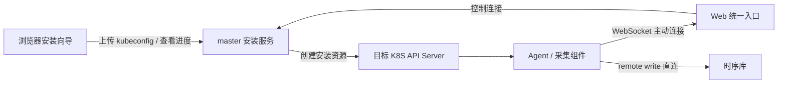

# Agent 网页安装方案与实现

在 `/#/workbench/index` 的 Agent 管理页完成目标 K8S 的接入。常规操作为：**上传 kubeconfig → 确认集群信息 → 安装并等待上线**。安装接口、后台任务、独立 Agent 凭据、共享模板及 vmagent 直连时序库均已实现；使用方式见 [安装说明](../../deploy/README.md)。

实现入口：master 的 `agent_install/`、Web 的 `views/workbench/AgentInstallDialog.vue`。上线需重新构建 master/Web 镜像并应用新版 master 清单；不要求预先安装 Agent 或启用 AI 功能。浏览器操作使用模拟接口验证，尚未对真实目标 K8S 执行安装。

## 1. 页面怎么简化

Agent 管理页增加管理员可见的「安装 Agent」按钮，打开三步向导。

### 第一步：连接目标集群

- 上传 YAML / JSON kubeconfig。
- 只有一个 context 时自动选中；多个时默认选中 current-context，显示 context 与 API Server，允许切换。
- 点击「检测连接」，显示 Kubernetes 版本、集群身份、所需安装权限及已有安装情况。
- 文件只用于当前安装任务；不要求先有在线 Agent，也不要求开启 AI。

### 第二步：确认安装信息

| 字段 | 默认行为 |
| --- | --- |
| 集群标识 | 根据 context 提供符合规则的建议值，允许修改，检查唯一性。对应现有 `K8S_NAME`，与指标标签值保持一致 |
| 集群别名 | 可选；复用现有 aliases，不再引入另一套集群名称 |
| 安装方式 | 默认「完整接入」，也可选择「仅安装 Agent，已有监控采集」 |
| KubeDoor 连接地址 | 从全局配置自动带出，正常情况下不必输入；高级设置允许为特殊网络覆盖 |

「完整接入」安装 Agent、vmagent，并根据检测结果安装或复用 kube-state-metrics、node-exporter。已有采集组件必须确认抓取配置兼容，检测不明确时显示原因，不能仅凭同名 Deployment 就认定可复用。

「仅安装 Agent」适用于已有采集链路的集群：不安装 vmagent/exporter，不等待本次指标写入。页面注明现有指标仍需具有匹配的集群标签。

高级设置默认折叠，包含命名空间（默认 `kubedoor`）、镜像仓库/已有镜像拉取 Secret、发布包推荐的 Agent 版本、对象存储地址、采集组件明细，以及确有需要时的指标写入地址覆盖。版本使用发布包的明确推荐值，不假设 Agent 与 master 的镜像标签总是相同。工作负载资源配额使用发布模板的默认值。

提交前显示一份简短安装摘要：目标 API Server、集群标识、命名空间、连接地址、将安装/复用的组件、将授予的权限。当前 Agent 模板授予集群管理员级权限；当前 node-exporter 模板需要主机网络、主机进程空间和特权容器，这些应纳入权限与准入预检。

### 第三步：安装与结果

以可恢复的步骤列表显示进度：

1. 验证配置与权限。
2. 创建命名空间和访问凭据。
3. 应用 Agent 与选中的采集组件。
4. 等待工作负载就绪。
5. 等待 Agent 连接 master。
6. 验证新采集指标（仅完整接入）。

成功后显示「Agent 已上线」并刷新当前管理列表。Agent 上线但采集失败时显示「Agent 已连接，指标采集异常」，保留可用的管理能力和具体失败原因。不能把 `kubectl apply` 成功或 Pod Ready 等同于完成接入。

指标验证：Agent 上线后，master 每 3 秒查询一次时序库，要求 vmagent、kube-state-metrics、k8s-node-exporter、k8s-cadvisor 四个抓取任务在开始验证之后都有成功样本（`up == 1`，按集群标签和本次安装标识 `kubedoor_installation` 过滤），2 分钟内没齐就判定为部分成功（`partial`）。查询写成 `max by (job) (timestamp(up{…}) and (up{…} == 1))` 并带 `nocache=1`：

- VictoriaMetrics 对比较运算的结果取 `timestamp()`，得到的是按 5 分钟对齐的计算时刻，不是样本时间，写成 `timestamp(up{…} == 1)` 会让刚上线的集群在下一个 5 分钟整点之前一直验证不过；
- VictoriaMetrics 默认不返回最近 30 秒内写入的数据（`-search.latencyOffset`），`nocache=1` 让刚写入的样本马上可见。Prometheus 会忽略这个参数。

部分成功时，失败原因列出没采到新指标的抓取任务及已正常的任务；还能连接目标集群时，经 API Server 读取 vmagent 的 `/api/v1/targets`，带上每个抓取任务的目标数和最近一次抓取报错。

关闭弹窗或刷新网页不取消安装。再次打开时恢复任务进度；失败可查看错误步骤并重试，临时凭据过期后重新上传 kubeconfig。

- 部分成功的重试按钮是「重新验证指标采集」：Agent 已经上线，前几步不再执行，只重新查询时序库，不连接目标集群，也不需要安装凭据。
- 其他失败的重试按钮是「核对状态并重试」：用还没过期的临时凭据重新连接集群，复用同一个 Agent 账号。目标集群返回 401 时说明凭据已失效，提示重新上传 kubeconfig。
- 安装向导第 6 步在本集群安装的记录（kubeconfig 的 context 为 `in-cluster`）用的是安装向导签发的临时令牌，安装收尾时安装账号 `kubedoor-agent-installer` 连同令牌一起撤销，不能再用这条记录连接集群（已安装的 Agent 不受影响）。要重装或调整本集群的 Agent，点「安装新集群」上传 kubeconfig。

## 2. 只填一个 master 地址

**用户只配置一个 KubeDoor 连接地址，系统即可生成控制连接；vmagent 直连控制端配置的时序库。** VictoriaMetrics 在 `deploy/victoria-metrics/` 独立部署，或使用已有时序库。

地址和凭据的分工：

- `PROM_URL` 为控制端查询时序库的地址。
- `METRICS_WRITE_URL` 为控制端配置的时序库完整写入地址（网页安装第 3 步的远程写地址，带账号口令），网页安装 Agent 时各集群的 vmagent 默认直连它，所以它必须能从各业务集群访问。网页安装把它放在 Secret `kubedoor-connection`，旧配置式部署放在 `kubedoor-config`；master 从环境变量读取，不返回给浏览器。
- 安装时把写入地址里的账号口令拆出来，放进目标集群的 Secret `kubedoor-metrics-credentials`，vmagent 用 `-remoteWrite.basicAuth.username` 和 `passwordFile` 认证，口令不出现在启动参数里。
- 高级设置的「指标写入地址覆盖」优先：网络特殊、需要单独写入账号的集群可以填自己的地址。脚本安装启用 vmagent 时需要显式填写可达的 `REMOTE_WRITE_URL`。

全局安装设置维护「Agent 可访问的 KubeDoor 地址」，优先复用已填写的 `KUBEDOOR_EXTURL` 作为默认值。未配置时可用浏览器当前地址提供建议，但不能认定该地址在目标集群中可达，例如浏览器可能使用本机 port-forward。

假设填写 `https://kubedoor.example.com`、控制端的写入地址为 `http://monit:<口令>@192.0.2.11:8428/api/v1/write`：

| 用途 | 自动生成的地址 |
| --- | --- |
| Agent 控制连接 | `wss://kubedoor.example.com/ws` |
| vmagent 指标写入 | `http://192.0.2.11:8428/api/v1/write`（账号 `monit`，口令在 Secret 里） |

当前 Agent 会自行在 `KUBEDOOR_MASTER` 后追加 `/ws`，所以写入其环境变量的应是 WebSocket 基础地址，避免重复 `/ws`。使用 URL 解析器转换 `http → ws`、`https → wss`，保留显式端口，去掉浏览器 hash、查询参数和登录路径。当前入口按域名根路径部署；若后续支持子路径部署，需要同时配置代理与路径前缀，不能仅在表单里拼接。

指标不经过 KubeDoor：vmagent 直接远程写时序库，不给 Web 入口和 master 增加指标流量和鉴权请求，Web 或 master 重启也不影响指标写入。早期测试版本曾有一个经 Web 入口转发的 `/agent/metrics/write` 指标网关，已删除；用它装过的 Agent 需要重新安装，或手工把 vmagent 的 `-remoteWrite.url` 改成时序库地址。

管理员在首次安装向导中配置时序库及认证；旧配置式部署在 `kubedoor.conf` 中配置 `METRICS_WRITE_URL`，例如独立单机 VM 使用 `http://monit:<URL编码口令>@<VM宿主机IP>:8428/api/v1/write`。读地址 `PROM_URL` 与写地址可能不同，不能互相替代。VM 的镜像、存储、端口和账号由其独立目录的 `.env` 管理。控制端没有配置写入地址时，「完整接入」需要在高级设置里填写写入地址，否则只能选「仅安装 Agent」；完全不安装 vmagent 时不要求写入地址。

## 3. 安装由谁执行

安装期间要求 **master 能访问目标集群 API Server**，且 kubeconfig 中的地址和认证能在 master 环境使用；浏览器电脑能够 kubectl 并不代表 master 能访问。运行期间仍然由 Agent 主动访问 KubeDoor，vmagent 直接访问时序库。目标集群到 master、到时序库的连通性必须从目标环境验证，不能由 master 对自身地址的检测代替。

对于 API Server 不向 master 开放的集群，保留 `tools/legacy-install/` 中的脚本安装，后续可以增加「下载安装 YAML」作为同一份安装计划的出口。网页直接安装不会自动穿透目标集群网络。

安装服务放在 master，使用 `/api/admin/agent-installations`，按现有规则限制系统管理员。现有 AI kubeconfig 界面可以复用上传、context 选择与错误提示组件，底层可复用 `kubedoor_tools.config.parse_kubeconfig`；但 AI 连接接口要求集群已登记，不能作为首次安装 API。

master 当前未安装 Kubernetes SDK / kubedoor-tools，落地时需要补齐依赖。使用独立配置的 Kubernetes API 客户端，不改变进程全局 Kubernetes 配置；不将 kubeconfig 内容拼进 shell 命令，也不让安装流程执行上传文件里的 `exec` 认证插件。

## 4. 后端最小接口

| 接口 | 作用 |
| --- | --- |
| `POST /api/admin/agent-installations/inspect` | 上传 kubeconfig，创建有时效的草稿，返回 context 与非敏感摘要 |
| `POST /api/admin/agent-installations/{id}/preflight` | 确认 context/参数，检测权限、冲突，生成安装计划 |
| `POST /api/admin/agent-installations/{id}/start` | 按已确认的计划启动安装；使用幂等键 |
| `GET /api/admin/agent-installations/{id}` | 获取状态、逐步进度和脱敏错误 |
| `POST /api/admin/agent-installations/{id}/retry` | 重新核对当前状态后重试，不能盲目重复执行 |

修改参数或切换 context 后必须重新预检。启动时绑定确认过的配置版本与目标集群身份，防止预检后实际装到另一个目标。

任务及每步结果存 PostgreSQL。至少记录操作者、集群标识、目标集群身份、安装参数摘要、模板版本、资源清单、状态、时间和脱敏错误；临时 kubeconfig 单独加密保存。用目标集群身份和集群标识加锁，避免两个页面并发安装。

master 重启后，未结束任务标记为待核对；重连目标集群检查已存在资源与上线状态，再恢复或报告中断，不自动删除资源、不直接宣布失败后重新创建一套。

## 5. 模板、权限与凭据

### 共用一份安装定义

沿用 `src/kubedoor-master/agent_install/manifests/` 的五份资源定义，不另造一套前端 YAML，也不为网页安装引入 Helm。

将 Agent 参数默认值、校验和渲染抽成可由 master 与脚本共同使用的模块；随 master 镜像打包模板及发布清单。脚本成为同一渲染器的命令行入口，安装目标和安装结果应一致。master 不能假设运行容器里能读到部署机器上的 `deploy/kubedoor.conf`。

发布清单提供推荐 Agent/采集组件镜像；全局运行配置提供指标标签键、通知配置、对象存储默认值、入口地址和时序库写入地址。正常安装不让用户逐项抄写这些值。

使用 Kubernetes API 按 Namespace → RBAC/Secret/ConfigMap → Service/工作负载顺序应用。采用 Server-Side Apply，固定 field manager；对外部管理字段发生冲突时明确报告，不默认强制接管。给配置增加摘要 annotation，使配置/Secret 变更能触发所需的滚动更新。

### 预检与重复安装

- 检测 API 连通性、实际所需资源权限、ClusterRole/Binding 的授权约束、Pod 安全准入、同名资源和已有采集组件。
- 用 namespace UID 等目标集群身份辅助识别，不只比较 context 名或 API Server URL。
- 既检查 master 侧 `K8S_NAME` 唯一性，也检查目标集群现有 Agent 指向哪个 master、使用哪个标识。
- 网页安装的同一 Agent 支持重试和更新：当前控制端以前给同一个集群（同一集群标识、同一个 kube-system UID）装的资源直接更新。目标命名空间里已有、但不属于这次安装的 Agent 资源（另一项安装留下的，例如重装控制端前装的、安装记录已不在当前控制端；脚本安装的；集群名称不同的），预检一次列出全部资源和原因（`payload.takeover`），检查行带 `forceable: true`，报“目标集群已有 Agent 资源，不会直接覆盖”。管理员在确认框里看过清单后选择“强制覆盖安装”（预检请求带 `force: true`）才接管：安装时服务端应用加 `force=true`、接管其他字段管理器的字段，归属标签改成这次安装；开始安装前会再核对一次，预检之后才出现的资源仍需重新确认。控制端自己记录里的冲突不能强制覆盖：同名集群已在线、同一集群已用别的名称接入、已有安装任务在执行。Agent 清单里的集群级资源都带 `kubedoor-` 前缀，不会覆盖别的监控栈的同名 ClusterRole。
- 权限查询与 server-side dry-run 组合使用。新 Namespace 的 dry-run 不会真正创建它，后续命名空间资源的 dry-run 可能返回 404；应区分这一情况，并在开始安装、创建 Namespace 后完成剩余验证。
- 复用 KSM 时核对 Service 标签及抓取配置；复用 node-exporter 时核对实际抓取地址与可达性。不能只检测「有这个组件」。

### 凭据生命周期

- kubeconfig 仅接受可在服务端独立使用的内嵌凭据。沿用现有解析器对 `exec`、auth-provider、外部证书文件、tokenFile 的限制，返回可操作的中文提示。
- 临时 kubeconfig 加密保存并设置有效期；成功后删除，失败时短时保留以便重试。上传的 kubeconfig 本身不会保存为 AI 的长期连接配置。
- AI Kubeconfig 自动配置：Agent 上线后，master 读取目标集群 Secret `kubedoor-agent`（Agent 清单里 Agent 服务账号的长期令牌，权限与 Agent 相同），集群地址、CA 沿用这次安装的 kubeconfig，凭据换成这个令牌，交给 kubedoor-ai 测试连通后保存为该集群的「AI Kubeconfig」（context 名 `kubedoor-agent`，列里显示「自动配置」）。安装向导第 6 步在本集群安装时同样配置，临时安装令牌收尾时撤销不影响它。已有管理员手动上传的保留不变；重装时更新自动配置的那份。没配上（例如 kubedoor-ai 连不上该集群的 API Server）不影响安装，结果和原因显示在安装记录的「AI Kubeconfig」一行。AI 优先经在线 Agent 执行，Agent 离线或版本不支持时才用它直连。
- Agent 继续使用目标集群的 ServiceAccount，不把上传的管理员 kubeconfig 挂载进 Agent。
- 由安装服务为每个安装生成独立的 Agent 账号和随机口令，沿用现有 Agent 账号鉴权。当前代码允许多个 Agent 账号，但尚无账号与集群绑定；新增绑定记录并在 WebSocket 握手时校验，不能直接复用面向人类账号的集群权限。不得从密码哈希反取口令，也不得通过重置共用内置 Agent 账号影响已有集群。
- 敏感运行值写目标 Secret，保留 Agent 既有环境变量名称，无需增加一批新的 Agent 配置项。Agent 连接地址中的凭据正确 URL 编码；vmagent 认证使用独立的认证参数和 Secret 文件。
- 上传接口、预检接口、安装任务日志和审计不得记录 kubeconfig/口令原文。特别处理 nginx 日志：当前普通 `/api` 日志包含请求体，新增安装接口必须使用脱敏日志规则。

### 失败处理

记录本次创建/更新的具体资源和归属标记。默认保留已安装部分并给出诊断与重试入口；需要清理时只处理确认属于当前任务的资源，不删除已有共享资源和命名空间。不能直接调用现有脚本卸载作为回滚，因为其资源集合含 Namespace。

更新凭据采用先创建并验证新凭据、确认 Agent 已使用后再撤销旧凭据的顺序。更新失败不得导致已运行 Agent 的凭据先失效。

## 6. 建议首版范围与验收

首版交付完整的管理员网页安装：独立安装 API、临时 kubeconfig、权限和冲突预检、模板共用、后台任务、状态恢复、vmagent 直连时序库、自动地址与凭据，以及完整接入/仅 Agent 两种模式。跨网络集群继续支持脚本；批量安装、云厂商动态登录插件和任意 Helm 管理可后续扩展。

验收重点：

1. 一个全新集群，只上传 kubeconfig 并确认集群标识，即可安装上线；关闭 AI 功能仍可执行。
2. HTTP NodePort / HTTPS 域名均可从同一入口派生正确的控制连接地址；vmagent 默认使用控制端配置的时序库写入地址，不要求手填 VM 端口和密码。
3. API 不可达、权限不足、准入拒绝、镜像拉取失败、Agent 认证失败、指标写入失败分别显示准确步骤和原因。
4. 多 context 不会装错目标；标识重名、目标已有安装和重复点击不会产生第二套冲突资源。
5. 刷新网页或 master 重启后可继续查看并核对任务；失败重试不删除已有 namespace/业务资源。
6. 完整接入分别验证工作负载 Ready、专用 Agent 账号的新连接与真实心跳，以及带本次安装标签的新采集指标；仅 Agent 模式不等待新指标。
7. kubeconfig/认证信息不进入响应、普通日志或审计明文；安装结束清理临时凭据。
8. 脚本与网页渲染结果一致；原有脚本安装的 Agent 仍正常连接，现有管理与镜像升级能力不受影响。

参考：

- [Kubernetes API 更新与 Server-Side Apply](https://kubernetes.io/docs/reference/using-api/api-concepts/)
- [vmagent 的 remote-write 认证参数](https://docs.victoriametrics.com/victoriametrics/vmagent/)
